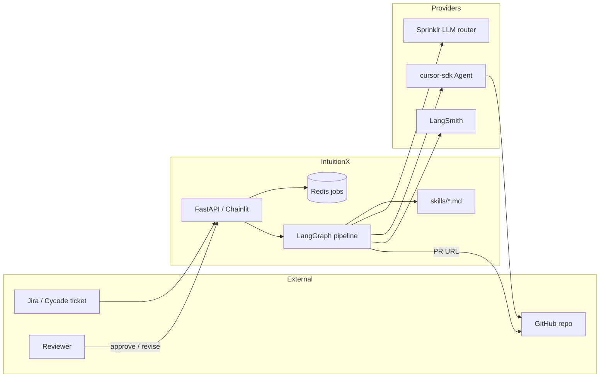
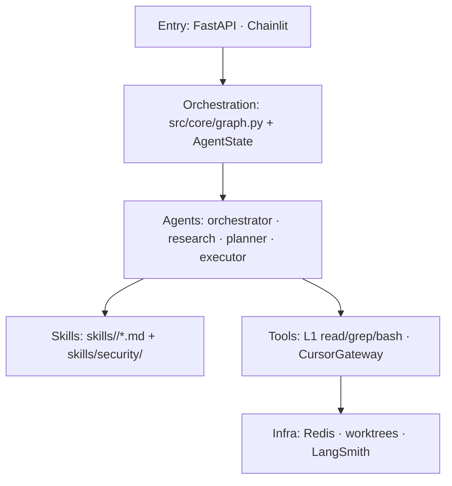
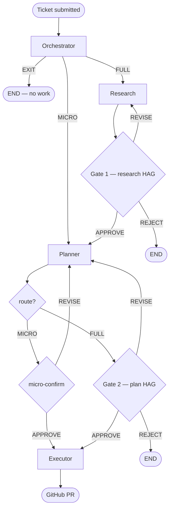
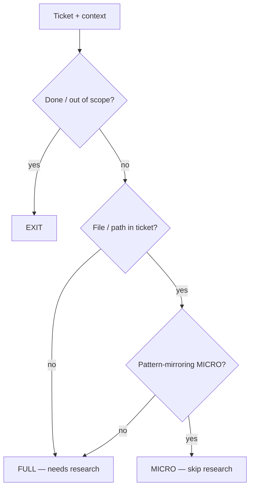
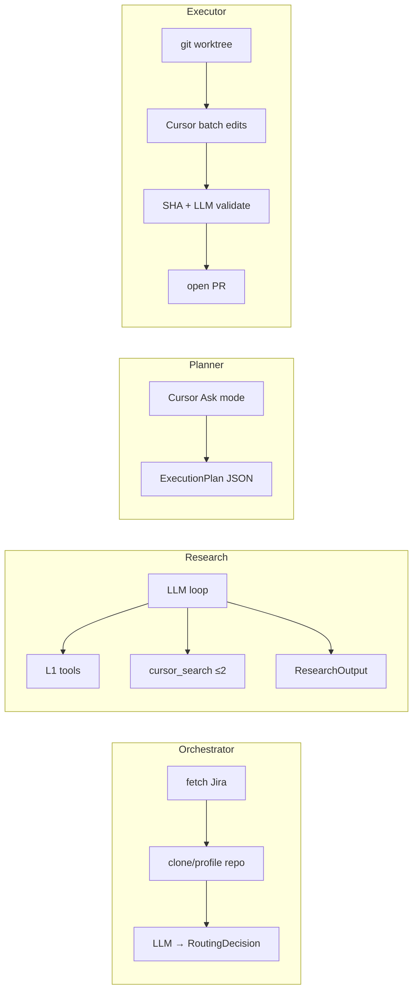
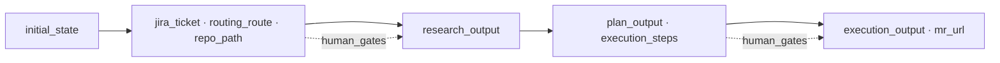
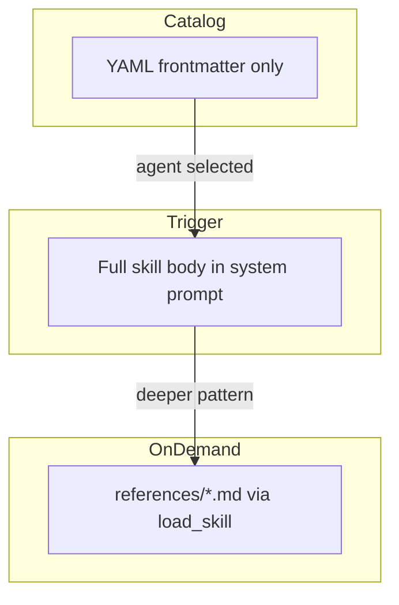
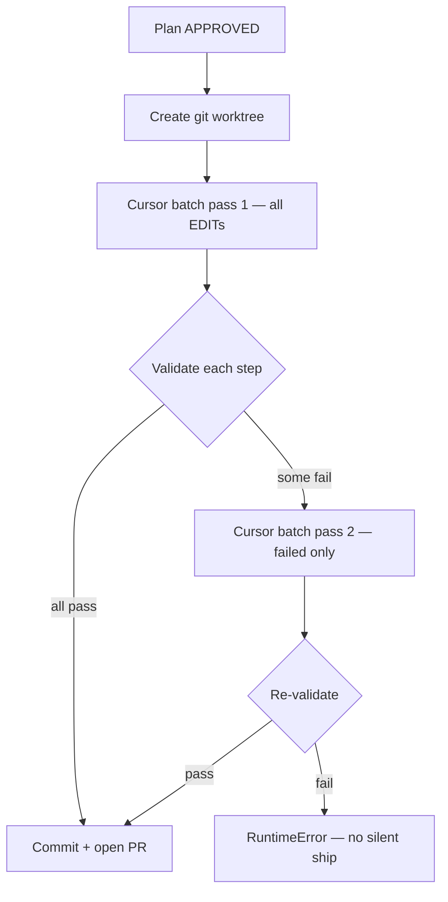
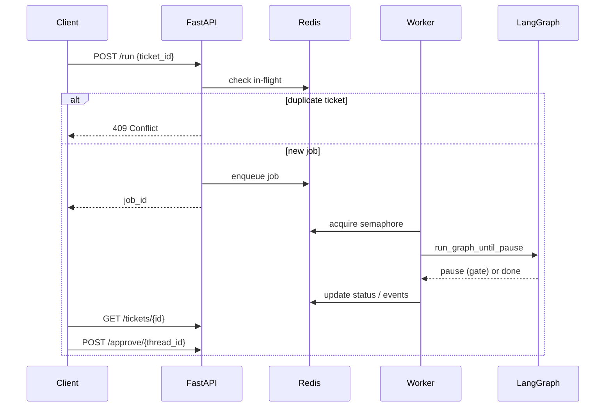
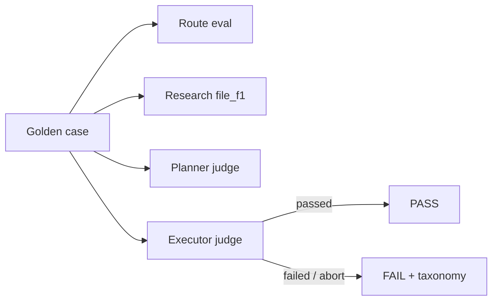

# IntuitionX — Architecture Presentation Pack

Copy Mermaid blocks into [mermaid.live](https://mermaid.live) → Export SVG/PNG for slides.  
Bullet lines are ≤8 words for deck text; speaker notes are for you.

---

## Slide A1 — One-liner Architecture

**Says:**
- Ticket in → reviewed PR out
- LangGraph owns phase topology
- Four agents; skills own intelligence
- Cursor edits; LLM routes & validates
- Human gates pause before write/PR

**Speaker:** IntuitionX is a multi-agent LangGraph pipeline. Python wires phases; markdown skills decide routing and fix patterns; Cursor applies code changes in an isolated worktree.

---

## Slide A2 — System Context (C4 Level 1)

**Says:**
- Inputs: Jira ticket + optional repo path
- Entrypoints: FastAPI `/run` or Chainlit
- Brain: Sprinklr IntuitionX LLM router
- Hands: Cursor headless local agent
- Outputs: GitHub PR + LangSmith traces



---

## Slide A3 — Layered Stack

**Says:**
- UI/API — admit tickets, HITL
- LangGraph — state machine + gates
- Agents — thin Python runners
- Skills — markdown decision logic
- Integrations — Jira, Cursor, Redis



| Layer | Owns | Does not own |
|-------|------|--------------|
| Python runners | Call LLM/Cursor, validate JSON, mutate state | Routing rules, fix recipes |
| Skills markdown | When to FULL/MICRO/EXIT, how to fix CVE class | Graph edges, concurrency |
| Cursor | Search + semantic edits in repo | Routing, HITL, PR policy |
| LangGraph | Phase order, interrupts, resume | Prompt wording |

---

## Slide A4 — End-to-End Pipeline (main diagram)

**Says:**
- Orchestrator routes only — no code
- FULL → research → Gate 1 → planner
- MICRO → planner (skip research)
- Gate 2 / micro-confirm → executor
- Executor worktree → edit → PR



**Talk track:** Point left-to-right. “Triage nurse” = orchestrator. Research only when file location is unclear. Humans see research and/or plan before any PR.

---

## Slide A5 — Routing Decision Tree (Gate 0–3)

**Says:**
- Gate 0 — EXIT if Done / out of scope
- Locatability — file named in ticket?
- Pattern-mirroring — MICRO vs FULL
- Mandatory `reasoning` cites evidence
- Route is auditable, not vibes



| Route | Research? | Typical ticket |
|-------|-----------|----------------|
| **FULL** | Yes | JWT across files; path not obvious |
| **MICRO** | No | Ticket names `api_views/users.py` |
| **EXIT** | No | Already Done / not actionable |

---

## Slide A6 — Agent Roles + Who Calls What

**Says:**
- Orchestrator — one LLM routing turn
- Research — LLM ReAct + Cursor search
- Planner — Cursor Ask → ExecutionPlan
- Executor — Cursor edit + LLM validate
- Cost rule — cheap tools first



| Agent | Primary brain | Max Cursor use |
|-------|---------------|----------------|
| Orchestrator | Sprinklr LLM | none |
| Research | LLM + Cursor search | 2 searches (budget) |
| Planner | Cursor Ask | 1 plan call |
| Executor | Cursor edit + LLM judge | ≤2 batch passes |

---

## Slide A7 — Data Flow Through AgentState

**Says:**
- One shared AgentState backpack
- Orchestrator fills ticket + route
- Research fills ResearchOutput
- Planner fills PlanOutput / steps
- Executor fills ExecutionOutput + PR



**Key typed payloads:**
- `RoutingDecision` → `FULL` | `MICRO` | `EXIT`
- `ResearchOutput` → hypotheses + affected_files
- `ExecutionPlan` → READ / EDIT / VERIFY steps (semantic instructions)
- `ExecutionOutput` → mr_url, changed_files, worktree

---

## Slide A8 — Skills Progressive Disclosure

**Says:**
- L1 — YAML frontmatter catalog (cheap)
- L2 — skill body when agent needs it
- L3 — references via `load_skill`
- Teams add `skills/security/*.md`
- Python stays thin — skills plug in



**Directory map for slides:**
```
skills/
  orchestrator/orchestrator.md      ← Gate 0–3 tree
  research/research.md              ← search budget
  planner/planner.md + references/  ← plan schema
  executor/executor.md              ← batch + validate
  security/*.md                     ← OWASP fix patterns
```

---

## Slide A9 — Executor Self-Healing Loop

**Says:**
- Pass 1 — batch all EDIT steps
- Validate — SHA + structural + LLM
- Pass 2 — repair failed steps only
- Still failing → hard exit (no PR)
- Default: `CURSOR_MAX_EDIT_ATTEMPTS=2`



**Demo callout:** Golden case G-06 needed `retry_count: 1` (pass-2 repair).

---

## Slide A10 — Concurrency & Isolation

**Says:**
- Redis job store + status events
- `Semaphore(2)` caps parallel runs
- Same ticket in-flight → HTTP 409
- One worktree directory per ticket
- Bounds Cursor + LLM spend



---

## Slide A11 — Evaluation Architecture (optional)

**Says:**
- Golden cases G-01–G-18 = contract
- Route + file F1 + LLM judges
- Pass = executor judge true
- Pass 3 baseline: 18/18 (100%)
- Proves architecture choices hold



| Metric | What it proves about architecture |
|--------|-----------------------------------|
| Route correctness | Gate 0–3 tree is teachable |
| file_f1 | Research + Cursor search find vulns |
| Planner/Executor judge | Semantic plans + validation work |
| Pass rate 16.7% → 100% | Symbol-resolver → skills + SHA repair |

---

## Slide A12 — Why This Design (speak to)

1. **Skills-as-config** — change routing/fix text without redeploying agent Python.
2. **Multi-agent, not monolith** — separate LangSmith audits; fail one phase cleanly.
3. **HITL gates** — humans approve research/plan before Cursor writes a PR.
4. **Worktree isolation** — ticket blast radius = one directory / branch.
5. **Budgeted Cursor** — expensive searches/edits capped; L1 tools do cheap read/grep.

---

## Paste-ready bar chart data (token / quality)

Use in Excel or slide chart:

| Series | Value |
|--------|------:|
| Research call-1 tokens (before progressive tools) | 7587 |
| Research call-1 tokens (after) | 2500 |
| Tool-schema tokens (before) | 4814 |
| Tool-schema tokens (after) | ~450–900 |
| Benchmark Pass 1 | 16.7% |
| Benchmark Pass 2 | 72.2% |
| Benchmark Pass 3 | 100% |
| Planner judge mean (Pass 3) | 94.9 |
| Executor judge mean (Pass 3) | 96.8 |

---

## 60-second architecture script

> “A Jira security ticket hits FastAPI or Chainlit. LangGraph starts with the orchestrator—one LLM call that only chooses FULL, MICRO, or EXIT. FULL tickets go through research with cheap in-process tools and at most two Cursor searches, then a human Gate 1. MICRO skips research because the ticket already names the file. The planner asks Cursor for a semantic ExecutionPlan; Gate 2 or micro-confirm pauses for approval. The executor clones into a ticket worktree, applies edits in up to two Cursor batches, validates with SHA plus an LLM security check, and opens a GitHub PR. Routing intelligence and fix recipes live in markdown skills—so teams extend the system without rewriting the pipeline.”
