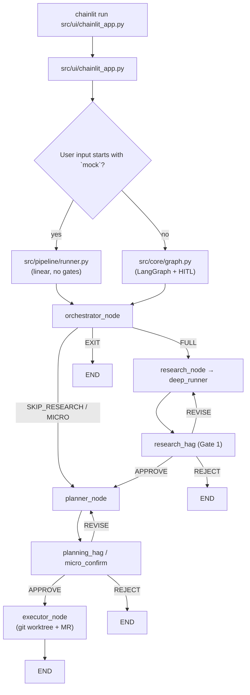

# Codebase Map — Sprinklr Jira Solver

> Generated for: `chainlit run src/ui/chainlit_app.py --port 8080`  
> This document classifies every tracked file so you can study the codebase efficiently.

---

## How the app runs



**Two user-facing paths:**

| Path | Trigger | Engine | Gates |
|------|---------|--------|-------|
| **Mock demo** | `mock SEC-4421` | `run_pipeline()` | None |
| **Production** | `PLAT-1234` | `build_graph().astream()` | Gate 1 (research), Gate 2 (plan), or micro-confirm |

On startup, Chainlit loads `chainlit_app.py`, which imports `build_graph()` — so **all four agent modules are imported immediately**, even before the user sends a message.

---

## 1. Read these first (in order)

These files define *what the application does*. Read them top-to-bottom before diving into helpers.

| # | File | Why |
|---|------|-----|
| 1 | [`src/ui/chainlit_app.py`](src/ui/chainlit_app.py) | UI entry: parses input, routes mock vs HITL, streams progress |
| 2 | [`src/core/graph.py`](src/core/graph.py) | LangGraph wiring: nodes, gates, routing edges |
| 3 | [`src/core/state.py`](src/core/state.py) | `AgentState` schema passed between all nodes |
| 4 | [`src/agents/orchestrator/agent.py`](src/agents/orchestrator/agent.py) | Jira load, repo resolution, LLM routing |
| 5 | [`src/agents/research/agent.py`](src/agents/research/agent.py) | Research LangGraph node (thin wrapper) |
| 6 | [`src/agents/research/deep_runner.py`](src/agents/research/deep_runner.py) | Actual research loop (deepagents / ReAct) |
| 7 | [`src/agents/planner/agent.py`](src/agents/planner/agent.py) | Plan generation + verification |
| 8 | [`src/agents/executor/agent.py`](src/agents/executor/agent.py) | Step execution, worktree, PR creation |
| 9 | [`src/pipeline/runner.py`](src/pipeline/runner.py) | Linear mock path (bypasses LangGraph gates) |
| 10 | [`src/core/schemas.py`](src/core/schemas.py) | Pydantic models: `ResearchReport`, `ExecutionPlan`, `RoutingDecision`, tool I/O |
| 11 | [`src/core/config.py`](src/core/config.py) | Environment variables and `settings` singleton |
| 12 | [`src/integrations/jira/client.py`](src/integrations/jira/client.py) | Jira fetch for UI preview (production path) |

**Prompt / routing intelligence** (read after the spine):

| File | Role |
|------|------|
| [`src/agents/orchestrator/skills/scripts.md`](src/agents/orchestrator/skills/scripts.md) | Orchestrator routing prompt |
| [`src/agents/research/skills/scripts.md`](src/agents/research/skills/scripts.md) | Research agent system prompt |
| [`src/agents/planner/skills/scripts.md`](src/agents/planner/skills/scripts.md) | Planner system prompt |
| [`src/agents/executor/skills/scripts.md`](src/agents/executor/skills/scripts.md) | Executor system prompt |

---

## 2. Safe to ignore for now

You do not need these to understand a normal `chainlit run` session.

### Tests
All files under [`tests/`](tests/) — unit/integration tests only.

### CLI entry points (not used by Chainlit)
| File | Purpose |
|------|---------|
| [`src/__main__.py`](src/__main__.py) | `python -m src` — tool registry smoke test |
| [`src/pipeline/__main__.py`](src/pipeline/__main__.py) | `python -m src.pipeline` — CLI pipeline runner |
| [`src/agents/research/__main__.py`](src/agents/research/__main__.py) | Standalone research runner |
| [`src/agents/planner/__main__.py`](src/agents/planner/__main__.py) | Standalone planner runner |
| [`src/agents/executor/__main__.py`](src/agents/executor/__main__.py) | Standalone executor runner |
| [`src/tools/cli.py`](src/tools/cli.py) | Tool demo CLI |

### Alternate server (FastAPI, not Chainlit)
| File | Purpose |
|------|---------|
| [`src/api/main.py`](src/api/main.py) | `uvicorn src.api.main:app` — REST API for CI/CD + approval resume |
| [`src/api/__init__.py`](src/api/__init__.py) | Package marker |

### Deployment / infra
| File | Purpose |
|------|---------|
| [`docker/Dockerfile`](docker/Dockerfile) | Container image (runs FastAPI by default) |
| [`docker/docker-compose.yml`](docker/docker-compose.yml) | Local stack (Mongo, Chainlit, API) |
| [`k8s/deployment.yaml`](k8s/deployment.yaml) | Kubernetes deployment |
| [`k8s/service.yaml`](k8s/service.yaml) | Kubernetes service |
| [`k8s/configmap.yaml`](k8s/configmap.yaml) | Kubernetes config |
| [`k8s/secrets.yaml`](k8s/secrets.yaml) | Kubernetes secrets template |

### Planning / docs / notes
| File | Purpose |
|------|---------|
| [`plan.md`](plan.md) | Internal implementation plan (1341 lines) |
| [`Implementation_plan.md`](Implementation_plan.md) | Earlier plan doc |
| [`Implementation_plan/plan_v2.md`](Implementation_plan/plan_v2.md) | Plan v2 |
| [`Project_state.md`](Project_state.md) | Project status notes |
| [`docs/PRD_ADDENDUM_PHASE1.md`](docs/PRD_ADDENDUM_PHASE1.md) | Product requirements addendum |
| [`AGENTS.md`](AGENTS.md) | Agent coding standards for AI assistants |
| [`chainlit.md`](chainlit.md) | Chainlit default welcome screen (unused — app sets its own welcome message) |

### Test fixtures (JSON)
| File | Purpose |
|------|---------|
| [`src/agents/planner/fixtures/mock_research_report.json`](src/agents/planner/fixtures/mock_research_report.json) | Used by `tests/test_planner.py` only |
| [`src/agents/executor/fixtures/mock_plan.json`](src/agents/executor/fixtures/mock_plan.json) | Used by `tests/test_executor.py` only |

### Reference / sample code (never imported)
| Path | Purpose |
|------|---------|
| [`pi sample tools/`](pi%20sample%20tools/) | TypeScript reference implementations of L1 tools |
| [`jira sample/`](jira%20sample/) | Early Jira client prototypes |

### Local / env / debug
| File | Purpose |
|------|---------|
| [`.env.local`](.env.local) | Local secrets (loaded by `config.py`) |
| [`.env.production`](.env.production) | Production env template |
| [`.cursor/debug-*.log`](.cursor/) | Cursor debug session logs |
| [`.gitignore`](.gitignore) | Git ignore rules |

### Root shim (not your entry point)
| File | Purpose |
|------|---------|
| [`chainlit_app.py`](chainlit_app.py) | `from src.ui.chainlit_app import *` — backward-compat re-export; docker-compose still mounts this |

---

## 3. Obsolete or deletable candidates

| File / path | Evidence | Recommendation |
|-------------|----------|----------------|
| [`src/core/debug_log.py`](src/core/debug_log.py) | `agent_debug()` is **never imported** anywhere in the repo (grep finds only its own definition) | Safe to delete or wire up if you want diagnostics |
| [`jira sample/jira_client.py`](jira%20sample/jira_client.py) | Superseded by [`src/agents/orchestrator/tools/jira_client.py`](src/agents/orchestrator/tools/jira_client.py); zero imports | Delete folder after confirming no external refs |
| [`jira sample/jira_schema.py`](jira%20sample/jira_schema.py) | Superseded by [`src/agents/orchestrator/tools/jira_schema.py`](src/agents/orchestrator/tools/jira_schema.py); zero imports | Delete with `jira sample/` |
| [`pi sample tools/*`](pi%20sample%20tools/) | TypeScript prototypes; Python tools live in `src/tools/`; zero imports | Archive or delete — useful only as design reference |
| [`chainlit_app.py`](chainlit_app.py) (root) | Duplicate entry; real app is `src/ui/chainlit_app.py`; only used by docker-compose command | Update docker-compose to use `src/ui/chainlit_app.py`, then delete shim |
| [`chainlit.md`](chainlit.md) | Default Chainlit boilerplate; app overrides welcome in `on_chat_start` | Delete or replace with project-specific content |
| [`.cursor/debug-*.log`](.cursor/) | Untracked debug artifacts | Add to `.gitignore`, delete locally |

**Not obsolete (common false positives):**

- [`src/api/main.py`](src/api/main.py) — separate deployment target (`uvicorn`), referenced in README and Dockerfile
- [`src/integrations/jira/client.py`](src/integrations/jira/client.py) — used by Chainlit for Jira preview; wraps orchestrator Jira helpers
- [`src/agents/orchestrator/tools/jira_client.py`](src/agents/orchestrator/tools/jira_client.py) — low-level Jira SDK client; used by `jira.py` and integrations client

---

## 4. Full file classification

Legend: **CR** = Core Runtime · **RS** = Runtime Support · **CO** = Conditional Runtime · **DT** = Development / Testing · **UL** = Unused / Legacy

### `src/ui/` — Chainlit UI

| File | Cat | Description |
|------|-----|-------------|
| `src/ui/chainlit_app.py` | **CR** | Main UI: chat handlers, mock vs graph routing, HITL resume via `Command`, Jira preview |
| `src/ui/__init__.py` | **RS** | Package marker |

### `src/core/` — Shared kernel

| File | Cat | Description |
|------|-----|-------------|
| `src/core/graph.py` | **CR** | LangGraph `StateGraph`: orchestrator → research → gates → planner → executor |
| `src/core/state.py` | **CR** | `AgentState`, `initial_state()`, typed dicts for all pipeline artifacts |
| `src/core/schemas.py` | **CR** | Pydantic models: plans, reports, routing, tool inputs/outputs |
| `src/core/config.py` | **RS** | Loads `.env.local`; exposes `settings` (LLM keys, Jira, GitHub, paths) |
| `src/core/llm.py` | **RS** | `get_llm()` — model selection by task complexity |
| `src/core/logging.py` | **RS** | structlog setup (`configure_logging`, `get_logger`) |
| `src/core/runner_utils.py` | **RS** | `llm_content()`, `parse_llm_json()` — LLM response helpers |
| `src/core/formatters.py` | **RS** | Formats HITL gate messages (Gate 1, Gate 2, micro-confirm) |
| `src/core/checkpointing.py` | **RS** | Async SQLite / in-memory checkpointer for graph persistence |
| `src/core/skills_loader.py` | **RS** | Loads `security.md` etc.; `select_research_skill()` by ticket labels |
| `src/core/transform_context.py` | **RS** | Builds phase-specific prompts from `AgentState` |
| `src/core/tracing.py` | **RS** | LangSmith metadata: `PROMPT_VERSIONS`, trace sync |
| `src/core/ticket_repo.py` | **RS** | Clones GitHub repo from Jira links when no local path given |
| `src/core/github_links.py` | **RS** | Parses GitHub URLs / slugs / target branches from ticket text |
| `src/core/tool_permissions.py` | **RS** | Reads `tool_permissions.yaml`; `get_allowed_tools(agent)` |
| `src/core/tool_permissions.yaml` | **RS** | Per-agent tool allowlists (loaded at runtime) |
| `src/core/debug_log.py` | **UL** | No-op `agent_debug()` stub — never imported |
| `src/core/__init__.py` | **RS** | Package marker |

### `src/agents/orchestrator/`

| File | Cat | Description |
|------|-----|-------------|
| `src/agents/orchestrator/agent.py` | **CR** | `orchestrator_node`: fetch ticket, resolve repo, LLM routing |
| `src/agents/orchestrator/skills/scripts.md` | **RS** | Routing prompt template (read at runtime) |
| `src/agents/orchestrator/tools/jira.py` | **RS** | High-level Jira: `fetch_jira_ticket`, mock ticket, field parsing |
| `src/agents/orchestrator/tools/jira_client.py` | **RS** | Jira SDK wrapper, credentials check |
| `src/agents/orchestrator/tools/jira_schema.py` | **RS** | `JiraTicketRaw` model, security enrichment |
| `src/agents/orchestrator/tools/__init__.py` | **RS** | Package marker |

### `src/agents/research/`

| File | Cat | Description |
|------|-----|-------------|
| `src/agents/research/agent.py` | **CR** | `research_node`: wraps `run_research`, handles gate REVISE feedback |
| `src/agents/research/deep_runner.py` | **CR** | Deep agent loop: tool registry, skill selection, JSON report output |
| `src/agents/research/memory.py` | **RS** | `InMemoryResearchMemory` — per-run research notes |
| `src/agents/research/skills/scripts.md` | **RS** | Research system prompt |
| `src/agents/research/skills/security.md` | **CO** | Security-specific skill — loaded when ticket has security labels/CVE |
| `src/agents/research/tools/builder.py` | **RS** | Builds LangChain tool list for research |
| `src/agents/research/tools/file_discovery.py` | **RS** | `extract_anchors()` — file hints from ticket text |
| `src/agents/research/tools/repo_profile.py` | **RS** | `profile_repository()` — language/framework detection |
| `src/agents/research/tools/langchain_tools.py` | **RS** | `make_repo_profile_tool()` LangChain wrapper |
| `src/agents/research/tools/web_search.py` | **RS** | Optional web search LangChain tool |
| `src/agents/research/tools/__init__.py` | **RS** | Package marker |
| `src/agents/research/__main__.py` | **DT** | CLI: run research standalone |

### `src/agents/planner/`

| File | Cat | Description |
|------|-----|-------------|
| `src/agents/planner/agent.py` | **CR** | `planner_node` / `run_planner`: LLM plan + tool verification |
| `src/agents/planner/skills/scripts.md` | **RS** | Planner system prompt |
| `src/agents/planner/tools/builder.py` | **RS** | read/grep/find registry for planner |
| `src/agents/planner/fixtures/demo/UserSearchController.py` | **CO** | Mock-security demo target file (reset by mock pipeline) |
| `src/agents/planner/fixtures/mock_research_report.json` | **DT** | Test fixture for planner unit tests |
| `src/agents/planner/__main__.py` | **DT** | CLI: run planner standalone |

### `src/agents/executor/`

| File | Cat | Description |
|------|-----|-------------|
| `src/agents/executor/agent.py` | **CR** | `run_executor` + `executor_node`: steps, worktree, PR |
| `src/agents/executor/skills/scripts.md` | **RS** | Executor system prompt |
| `src/agents/executor/tools/builder.py` | **RS** | write/edit/bash tool registry |
| `src/agents/executor/tools/git_worktree.py` | **CO** | Git worktree create/commit/push — runs in `executor_node` only |
| `src/agents/executor/tools/mr_create.py` | **CO** | GitHub PR creation — runs after successful execution |
| `src/agents/executor/tools/__init__.py` | **RS** | Package marker |
| `src/agents/executor/fixtures/mock_plan.json` | **DT** | Test fixture for executor unit tests |
| `src/agents/executor/__main__.py` | **DT** | CLI: run executor standalone |

### `src/agents/`

| File | Cat | Description |
|------|-----|-------------|
| `src/agents/__init__.py` | **RS** | Package marker |

### `src/pipeline/`

| File | Cat | Description |
|------|-----|-------------|
| `src/pipeline/runner.py` | **CR** | `run_pipeline()` — mock/linear path; also imported by orchestrator for fixture reset |
| `src/pipeline/fixtures/user_search_controller_vulnerable.py` | **CO** | Source SQLi fixture copied into repo during `mock` runs |
| `src/pipeline/__init__.py` | **RS** | Package marker |
| `src/pipeline/__main__.py` | **DT** | CLI: `python -m src.pipeline TICKET /repo` |

### `src/tools/` — L1 primitives

| File | Cat | Description |
|------|-----|-------------|
| `src/tools/registry.py` | **RS** | `ToolRegistry` — registers all L1 tools for an agent |
| `src/tools/base.py` | **RS** | `ToolDefinition`, audit wrapper, event emitter (Chainlit hooks here) |
| `src/tools/read_tool.py` | **RS** | Read file with truncation |
| `src/tools/write_tool.py` | **RS** | Write file (executor) |
| `src/tools/edit_tool.py` | **RS** | Search-and-replace edit (executor) |
| `src/tools/edit_args.py` | **RS** | Normalizes edit tool arguments |
| `src/tools/edit_diff.py` | **RS** | Core diff/replace logic for edits |
| `src/tools/bash_tool.py` | **RS** | Sandboxed shell execution |
| `src/tools/grep_tool.py` | **RS** | Ripgrep-style search |
| `src/tools/find_tool.py` | **RS** | File discovery |
| `src/tools/ls_tool.py` | **RS** | Directory listing |
| `src/tools/path_utils.py` | **RS** | Path sandboxing / resolution |
| `src/tools/truncate.py` | **RS** | Output truncation for read/grep |
| `src/tools/cli.py` | **DT** | Interactive tool demo |
| `src/tools/__init__.py` | **RS** | Package marker |

### `src/integrations/`

| File | Cat | Description |
|------|-----|-------------|
| `src/integrations/jira/client.py` | **CR** | `fetch_ticket_by_id()` — UI Jira preview + typed parse |
| `src/integrations/jira/__init__.py` | **RS** | Package marker |
| `src/integrations/__init__.py` | **RS** | Package marker |

### `src/memory/`

| File | Cat | Description |
|------|-----|-------------|
| `src/memory/cache.py` | **CO** | Failed-attempt persistence — read by orchestrator on retry; written on executor failure |
| `src/memory/__init__.py` | **RS** | Re-exports cache helpers |

### `src/api/` — FastAPI (separate entry)

| File | Cat | Description |
|------|-----|-------------|
| `src/api/main.py` | **DT** | REST API: `/health`, `/approve/{thread_id}`, CI/CD error ingestion |
| `src/api/__init__.py` | **DT** | Package marker |

### `src/` package root

| File | Cat | Description |
|------|-----|-------------|
| `src/__init__.py` | **RS** | Package marker |
| `src/__main__.py` | **DT** | Tool registry smoke test |

### `tests/`

| File | Cat | Description |
|------|-----|-------------|
| `tests/__init__.py` | **DT** | Package marker |
| `tests/test_core.py` | **DT** | Core module tests |
| `tests/test_pipeline.py` | **DT** | Pipeline integration tests |
| `tests/test_executor.py` | **DT** | Executor tests |
| `tests/test_planner.py` | **DT** | Planner tests |
| `tests/test_research.py` | **DT** | Research tests |
| `tests/test_tools.py` | **DT** | L1 tool tests |
| `tests/test_skills_loader.py` | **DT** | Skills loader tests |
| `tests/test_jira.py` | **DT** | Jira parsing tests |
| `tests/test_jira_client_parsed.py` | **DT** | Integrations Jira client tests |
| `tests/test_jira_issue_fields.py` | **DT** | Jira field extraction tests |
| `tests/test_jira_repo_links.py` | **DT** | GitHub link parsing tests |
| `tests/test_ticket_repo.py` | **DT** | Repo clone resolution tests |
| `tests/test_git_worktree.py` | **DT** | Git worktree tests |
| `tests/test_mr_create.py` | **DT** | MR creation tests |
| `tests/test_runner_utils.py` | **DT** | LLM helper tests |
| `tests/tools/test_edit_diff.py` | **DT** | Edit diff unit tests |

### Repository root & misc

| File | Cat | Description |
|------|-----|-------------|
| `chainlit_app.py` | **UL** | Backward-compat shim → `src/ui/chainlit_app.py` |
| `chainlit.md` | **UL** | Unused Chainlit welcome boilerplate |
| `requirements.txt` | **RS** | Python dependencies (loaded by pip, not Python import) |
| `README.md` | **DT** | Project documentation |
| `AGENTS.md` | **DT** | AI agent coding standards |
| `plan.md` | **DT** | Internal implementation plan |
| `Implementation_plan.md` | **DT** | Planning doc |
| `Implementation_plan/plan_v2.md` | **DT** | Planning doc v2 |
| `Project_state.md` | **DT** | Status notes |
| `docs/PRD_ADDENDUM_PHASE1.md` | **DT** | PRD addendum |
| `.env.local` | **RS** | Local config (read by `config.py` at import) |
| `.env.production` | **DT** | Production env template |
| `.gitignore` | **DT** | Git ignore rules |

### `docker/` & `k8s/`

| File | Cat | Description |
|------|-----|-------------|
| `docker/Dockerfile` | **DT** | Container build (FastAPI CMD) |
| `docker/docker-compose.yml` | **DT** | Local multi-service stack |
| `k8s/deployment.yaml` | **DT** | K8s deployment manifest |
| `k8s/service.yaml` | **DT** | K8s service manifest |
| `k8s/configmap.yaml` | **DT** | K8s config |
| `k8s/secrets.yaml` | **DT** | K8s secrets template |

### Legacy samples

| File | Cat | Description |
|------|-----|-------------|
| `jira sample/jira_client.py` | **UL** | Early Jira prototype — superseded |
| `jira sample/jira_schema.py` | **UL** | Early schema prototype — superseded |
| `pi sample tools/*.ts` (15 files) | **UL** | TypeScript tool reference implementations |

---

## 5. Conditional runtime — when each file executes

| File | Condition |
|------|-----------|
| `src/pipeline/runner.py` (`run_pipeline`) | User message starts with `mock` |
| `src/core/graph.py` gate nodes | Production path — pauses at Gate 1, Gate 2, or micro-confirm |
| `src/pipeline/fixtures/user_search_controller_vulnerable.py` | Mock path resets demo SQLi file into target repo |
| `src/agents/planner/fixtures/demo/UserSearchController.py` | Target file for mock security demo |
| `src/agents/research/skills/security.md` | Ticket has security label, security issue type, or CVE IDs |
| `src/agents/research/tools/web_search.py` | Research agent invokes web_search (allowed in permissions) |
| `src/agents/executor/tools/git_worktree.py` | `executor_node` runs (after plan approval) |
| `src/agents/executor/tools/mr_create.py` | Executor completes steps and creates GitHub PR |
| `src/memory/cache.py` (`get_failed_attempts`) | Orchestrator loads prior failures for same ticket |
| `src/memory/cache.py` (`save_failed_attempt`) | Executor step failure in graph path |
| `src/core/ticket_repo.py` | No explicit repo path — clones from Jira GitHub link |
| `src/core/checkpointing.py` (MongoDB) | `MONGO_URL` reachable (sync path only; Chainlit uses async SQLite/memory) |
| `src/agents/research/deep_runner.py` (deepagents) | `deepagents` package installed; else ReAct fallback |

---

## 6. Quick stats

| Category | Count (approx.) |
|----------|-----------------|
| Core Runtime | 12 Python files + 4 skills `.md` |
| Runtime Support | ~45 Python files + YAML + env |
| Conditional Runtime | ~10 files |
| Development / Testing | ~35 files (tests + CLI + docs + k8s/docker) |
| Unused / Legacy | ~20 files (samples, shim, debug_log) |

**Python files that matter for Chainlit:** ~57 under `src/` (excluding `api/`, `__main__.py` files, and test-only fixtures).

---

## 7. Suggested study path

```
Day 1 — Spine
  chainlit_app.py → graph.py → state.py → schemas.py → config.py

Day 2 — Agents (in pipeline order)
  orchestrator/agent.py + skills/scripts.md
  research/agent.py → deep_runner.py + skills/
  planner/agent.py + skills/scripts.md
  executor/agent.py + skills/scripts.md

Day 3 — Integrations & tools
  integrations/jira/client.py → orchestrator/tools/jira*.py
  tools/registry.py + read/grep/find (research/planner)
  tools/write/edit/bash (executor)
  executor/tools/git_worktree.py + mr_create.py

Day 4 — Optional depth
  ticket_repo.py, transform_context.py, checkpointing.py
  pipeline/runner.py (mock path)
  tests/test_pipeline.py (executable spec)
```
