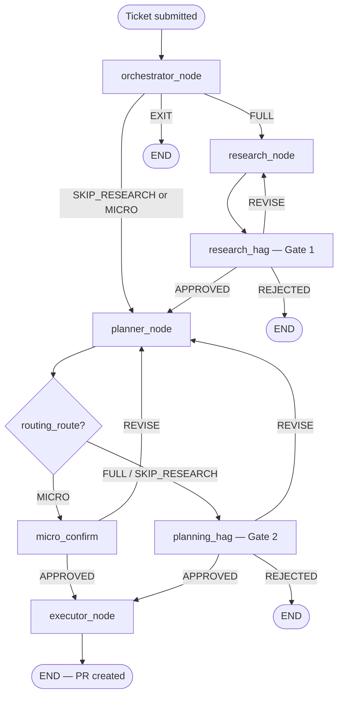

# Agent Pipeline Guide — Research, Planner & Executor

> **Purpose:** A plain-language, step-by-step explanation of how the Jira Solver pipeline works today — what runs when, which LLM or Cursor model is called, what data flows between agents, which skill files are used, and where validation happens.
>
> **Audience:** Anyone new to the codebase who wants to understand the full flow without reading every Python file.
>
> **Last updated:** 2026-07-06

---

## Table of contents

1. [The big picture](#1-the-big-picture)
2. [How a run starts](#2-how-a-run-starts)
3. [Shared concepts](#3-shared-concepts)
4. [Orchestrator (entry routing)](#4-orchestrator-entry-routing)
5. [Research agent](#5-research-agent)
6. [Gate 1 — human review of research](#6-gate-1--human-review-of-research)
7. [Planner agent](#7-planner-agent)
8. [Gate 2 / micro-confirm](#8-gate-2--micro-confirm)
9. [Executor agent](#9-executor-agent)
10. [LLM vs Cursor — who calls what](#10-llm-vs-cursor--who-calls-what)
11. [Skills & prompts reference](#11-skills--prompts-reference)
12. [Validation layers](#12-validation-layers)
13. [Environment variables](#13-environment-variables)
14. [Key source files](#14-key-source-files)

---

## 1. The big picture

When you submit a Jira ticket (for example `SEC-4421`), the system runs a **LangGraph workflow** defined in `src/core/graph.py`. The graph is a chain of **nodes** (Python functions). Each node reads and updates a shared dictionary called **`AgentState`**.



**Three agents do the real work:**

| Agent | Main job | Primary “brain” |
|-------|----------|-------------------|
| **Research** | Find vulnerable files, form hypotheses | **LLM** (ReAct / deepagents loop) + **Cursor** for repo search |
| **Planner** | Turn research into an ordered step list | **Cursor** (Ask mode, one call) |
| **Executor** | Apply edits, verify, open PR | **Cursor** for edits + **LLM** for post-edit validation |

The **Orchestrator** runs first and only decides the route (`FULL`, `SKIP_RESEARCH`, `MICRO`, or `EXIT`). It does not read code.

---

## 2. How a run starts

### Production path (API / jobs)

1. Client calls `POST /run` with `{ "ticket_id": "SEC-4421", "user_prompt": "...", "repo_path": "..." }`.
2. `src/api/ticket_jobs.py` enqueues a job and eventually calls `run_graph_until_pause()` in `src/pipeline/graph_runner.py`.
3. `graph_runner` builds the graph, creates fresh `AgentState` via `initial_state()`, and streams until:
   - the run **completes** (executor done),
   - it **fails** (`current_error_log` set), or
   - it **pauses** at a human gate (`interrupt()` in Gate 1 / Gate 2 / micro-confirm).
4. To continue after a pause, client calls `POST /approve/{thread_id}` with `{ "status": "APPROVE" | "REVISE" | "REJECT", "feedback": "..." }`, which calls `resume_graph_until_pause()`.

### Chainlit UI path

Same graph (`build_graph()`), but the UI in `src/ui/chainlit_app.py` drives streaming and gate prompts interactively.

### Mock / linear path (no gates)

If input starts with `mock`, `src/pipeline/runner.py` runs a simpler linear pipeline without LangGraph gates. This doc focuses on the **production graph path**.

---

## 3. Shared concepts

### AgentState — the shared backpack

Defined in `src/core/state.py`. Every node receives the full state and returns updates. Important fields:

| Field | Set by | Consumed by |
|-------|--------|-------------|
| `jira_ticket_id` | `initial_state()` | All agents |
| `jira_ticket` | Orchestrator (`fetch_jira_ticket`) | Research, Planner, Executor |
| `user_prompt` | API / UI | Orchestrator, Research |
| `repo_path` | Orchestrator (clone or override) | Research, Planner, Executor |
| `repo_profile` | Orchestrator (`profile_repository`) | Research, Planner |
| `git_target_branch` | Orchestrator | Executor (worktree base branch) |
| `routing_route` | Orchestrator | Graph routing, Planner context |
| `research_output` | Research | Planner, Gate 1 |
| `plan_output` | Planner | Executor, Gate 2 |
| `execution_output` | Executor | UI / API (MR URL, diff) |
| `human_gates` | Gate nodes | Re-run logic (REVISE feedback) |
| `previous_attempts` | Memory cache | Orchestrator, Planner |

### Two kinds of “AI”

| System | Config | Used for |
|--------|--------|----------|
| **Project LLM** | `LLM_PROVIDER` + provider-specific keys/models (`src/core/llm.py`) | Orchestrator routing, Research agent loop, Executor edit validation |
| **Cursor Agent** | `CURSOR_API_KEY` + `CURSOR_MODEL` (`src/integrations/cursor/client.py`) | Research `cursor_search`, Planner plan generation, Executor file edits |

These are **independent**. Research can use Sprinklr GPT for reasoning while Cursor uses `composer-2.5` for repo operations.

### Skills — where prompts live

Markdown files under `skills/` are the **routing and behavior instructions**. Python does not hard-code agent logic; it:

1. Loads the skill body from `skills/<module>/<module>.md` (or `SKILL.md`).
2. Injects runtime **CONTEXT** JSON (ticket, repo, research handoff, etc.).
3. Sends the combined text to an LLM or Cursor.

Loader: `src/core/skill_manager.py` (`PromptBuilder`, `SkillRegistry`).

### ToolRegistry vs LangChain tools

- **Research** uses LangChain `StructuredTool` wrappers (read, ls, bash, cursor_search, load_skill).
- **Executor** uses `ToolRegistry` primitives for READ / VERIFY / RUN_TESTS (local file ops, no LLM).

---

## 4. Orchestrator (entry routing)

> Included because every ticket passes through here before Research or Planner.

### When it runs

`orchestrator_node` in `src/agents/orchestrator/agent.py` — first node after `initial_state()`.

### Step-by-step

| Step | Function | What happens |
|------|----------|--------------|
| 1 | `fetch_jira_ticket(ticket_id)` | Pulls Jira issue into `JiraTicket` shape |
| 2 | `is_ticket_done(ticket)` | If Done/Resolved → `routing_route=EXIT`, stop |
| 3 | `_resolve_repo_path()` | Clone or resolve local checkout via `resolve_ticket_repo_path` |
| 4 | `profile_repository(repo_path)` | Detects repo type (Java/Python), modules → `repo_profile` |
| 5 | `get_failed_attempts(ticket_id)` | Loads prior failures from Redis/Mongo cache |
| 6 | `run_orchestrator_routing()` | **LLM call** for routing decision |
| 7 | `apply_orchestrator_ticket_analysis()` | Writes `vulnerability_category` + recommended security skill onto ticket |

### LLM call

```python
llm = get_llm(TaskComplexity.MEDIUM)   # e.g. Sprinklr gpt-5.2, Claude Sonnet, etc.
invoke_tracked(llm, routing_prompt, agent="orchestrator")
```

Model picked by `LLM_PROVIDER` env var and complexity tier in `src/core/llm.py`.

### Prompt assembly

| Piece | Source |
|-------|--------|
| Skill body | `skills/orchestrator/orchestrator.md` |
| Context JSON | `build_orchestrator_routing_context()` — compact ticket, repo, retry summary, security skill list |
| Extra instruction | `"Return ONLY the RoutingDecision JSON."` |

Built by `PromptBuilder.build("orchestrator", SKILLS_DIR, routing_context, ticket=ticket)`.

### Output

Parsed into `RoutingDecision` (`src/core/schemas.py`):

- `routing_route`: `FULL` | `SKIP_RESEARCH` | `MICRO` | `EXIT`
- `risk_level`: `LOW` | `MEDIUM` | `HIGH`
- `vulnerability_category`, `recommended_security_skill`, `reasoning`

Sanitized by `sanitize_routing_decision()` so only real security skill names pass through.

### Graph routing (`route_after_orchestrator`)

| `routing_route` | Next node |
|-----------------|-----------|
| `FULL` | `research` |
| `SKIP_RESEARCH` or `MICRO` | `planner` (skips research) |
| `EXIT` | END |

---

## 5. Research agent

### When it runs

`research_node` in `src/agents/research/agent.py` — after Orchestrator when route is `FULL`, or again on Gate 1 `REVISE`.

### High-level flow

```
research_node
  → ResearchAgent(repo_path).run(ticket, ...)
    → build tools (cursor_search, read, ls, bash, load_skill, …)
    → build user message (ticket + repo context)
    → build_research_agent(llm, tools)  # deepagents or ReAct fallback
    → agent.invoke({ messages: [user_message] })
    → parse ResearchReport JSON
    → sanitize paths, backfill affected_files
  → store as state.research_output
```

### Input data

| Data | From | Used for |
|------|------|----------|
| `jira_ticket` | Orchestrator | Title, problem, labels, vulnerability_category |
| `repo_path` | Orchestrator | All repo tools |
| `repo_profile` | Orchestrator | Repo type, modules in context |
| `user_prompt` | API/UI | Extra instructions |
| Gate feedback | `human_gates` (if REVISE) | Appended to user_prompt |
| `anchors` | `extract_anchors(ticket, user_prompt)` | File/symbol hints from ticket text |

### LLM call — the research loop

```python
llm = get_llm(TaskComplexity.HIGH)   # strongest tier for investigation
agent, harness = build_research_agent(llm, tools, tool_budget)
result = agent.invoke(
    {"messages": [{"role": "user", "content": user_message}]},
    config={"recursion_limit": recursion_limit},
)
```

**Harness options** (`src/agents/research/deep_runner.py`):

1. **Preferred:** `deepagents.create_deep_agent` with `response_format=ResearchReport`
2. **Fallback:** LangGraph `create_react_agent` if deepagents not installed

### System prompt (research)

Short hard-coded suffix in `_research_system_prompt()` plus middleware-injected skill bodies after `load_skill` calls. ReAct fallback uses full `skills/research/research.md` body via `PromptBuilder.build_system_only()`.

Key rules encoded in prompt + skill:

- Call `load_skill` once for `research` + one security skill
- Max **2** `cursor_search` calls
- Max **8** read/ls/bash calls
- Emit `ResearchReport` JSON when done

### User message (research)

Built by `build_research_user_message()` — **not** the full skill file. Contains:

```json
{
  "ticket_id", "title", "module", "problem_statement", "labels",
  "vulnerability_category", "repo_path", "repo_bootstrap", "repo_profile",
  "anchors", "user_prompt", "security_enrichment"
}
```

Plus a **Skills System** section listing available security skills (names only — bodies loaded via `load_skill` tool).

### Tools available to research LLM

| Tool | What it does | Calls Cursor? |
|------|--------------|---------------|
| `load_skill` | Loads `research.md` or `skills/security/*.md` into system context | No |
| `cursor_search` | Natural-language repo search | **Yes** → `gateway.search()` |
| `read` | Read file lines | No (local ToolRegistry) |
| `ls` | List directory | No |
| `bash` | Shell in repo | No |
| `grep`, `find` | If allowed in permissions | No |
| `web_search` | External search (optional) | No |
| `repo_profile` | Re-profile repo | No |

Tool list built in `src/agents/research/tools/builder.py`.

### When Cursor is called (research)

**Only via `cursor_search` tool** → `CursorGateway.search()` → `run_local_agent()` with:

- Prefix: security-audit search instructions + JSON schema for hits
- Model: **`CURSOR_MODEL`** (default `composer-2.5`)
- Mode: read-only search (no file edits)

Budget: hard cap of **2** searches per run (`_CURSOR_SEARCH_BUDGET = 2` in `research_agent.py`), enforced in `make_cursor_search_tool()`.

### Middleware (`src/agents/research/middleware.py`)

- **ProgressiveSkillMiddleware:** After `load_skill`, appends skill body to system message; hides `load_skill` from further calls.
- **ResearchToolFilterMiddleware:** Hides deepagents built-ins; unlocks `web_search` / `repo_profile` only after first `cursor_search` completes.

### Output — ResearchReport → research_output

Parsed to `ResearchReport` Pydantic model, then converted to `ResearchOutput` dict:

| Field | Meaning |
|-------|---------|
| `research_summary` | Narrative of findings |
| `hypotheses[]` | Ranked theories with evidence |
| `affected_files[]` | Paths + reasons + evidence strength |
| `affected_modules`, `module_blast_radius` | Scope |
| `architectural_risk` | low / medium / high |
| `flags` | Warnings (budget abort, path remap, etc.) |

Post-processing in `ResearchAgent.run()`:

- `_sanitize_research_report` — remove false “repo not found” flags
- `_normalize_research_paths` — fix Cursor temp-clone paths
- `_backfill_affected_files_from_hypotheses` — ensure cited files appear in `affected_files`

### On failure

`research_node` catches exceptions and still returns a valid `research_output` with weak hypothesis and error flag (pipeline continues to Gate 1).

---

## 6. Gate 1 — human review of research

**Node:** `research_hag_node` in `src/core/graph.py`

1. Formats a review message via `format_gate1_request(state)`.
2. Calls LangGraph `interrupt()` — graph **pauses**.
3. Human approves / revises / rejects via API.
4. Decision stored in `human_gates[]`.
5. Routing:
   - `APPROVED` → `planner`
   - `REVISE` → `research` (feedback injected into next research run)
   - `REJECTED` → END

---

## 7. Planner agent

### When it runs

`planner_node` in `src/agents/planner/agent.py` — after Gate 1 approval, or directly after Orchestrator for `SKIP_RESEARCH` / `MICRO` routes.

### Important design choice

**The Planner does NOT use the project LLM for planning.** Planning is a **single Cursor Ask call** that explores the repo and returns JSON. Python only validates and normalizes the result.

### Step-by-step

| Step | Function | What happens |
|------|----------|--------------|
| 1 | `ResearchReport.model_validate(research_raw)` | Parse research from state |
| 2 | `_latest_gate_feedback(state, "PLANNING")` | Gate 2 revise notes if re-planning |
| 3 | `run_planner(report, repo_path, …)` | Main planner logic |
| 4 | `run_semantic_plan()` or `mock_semantic_plan()` | **Cursor ask** or dry-run mock |
| 5 | `_normalize_plan_paths()` | Fix `.`, empty paths, Cursor temp paths |
| 6 | `_validate_plan_executable()` | Paths exist, steps non-empty |
| 7 | `validate_instruction_edits()` | Hard checks on EDIT steps |
| 8 | `validate_execution_plan()` | READ→EDIT→VERIFY triad, path vs research |
| 9 | `_plan_to_output()` | Store as `plan_output` on state |

### Input data

| Data | Source | In prompt? |
|------|--------|------------|
| Research handoff | `research_handoff_for_planner(report)` | Yes — summary, hypotheses, affected files |
| Compact ticket | `compact_ticket_for_planner(jira_ticket)` | Yes — id, title, problem, acceptance criteria |
| Repository | `repo_path`, `git_target_branch`, `repo_type` | Yes |
| `routing_route` | Orchestrator | Yes |
| `retry_summary` | `previous_attempts` | Yes — last failure only |
| `gate_feedback` | Gate 2 REVISE | Yes |
| Domain skills | `format_domain_skills_for_prompt("planner", ticket)` | Appended to prompt |

Full Jira comments, attachments, and old execution plans are **not** sent to Cursor.

### Cursor call — plan generation

```python
# Only if CURSOR_API_KEY is set and not dry_run
gw = get_cursor_gateway(repo_path)
run = gw.ask(prompt)   # Ask mode — read-only exploration
plan = parse_llm_json(run.text, ExecutionPlan)
```

`gw.ask()` prepends:

```
You are in Ask mode. Explore and answer only — do NOT modify any files.
```

Then the full planner prompt. Cursor model: **`CURSOR_MODEL`**.

If no API key: `mock_semantic_plan()` builds a minimal deterministic plan for tests.

### Prompt assembly

| Piece | Source |
|-------|--------|
| Skill body | `skills/planner/planner.md` |
| Context JSON | research handoff + repository + ticket + retry + gate feedback |
| Extra instructions | Schema for `ExecutionPlan`, instruction-based EDIT rules, READ→EDIT→VERIFY requirement |
| Domain skills | Matched security skills from `skills/security/*.md` (summaries) |

Built by `build_semantic_plan_prompt()` in `src/integrations/cursor/semantic_plan_runner.py`.

### Output — ExecutionPlan → plan_output

Each plan contains:

| Field | Purpose |
|-------|---------|
| `root_hypothesis` | Main theory being fixed |
| `files_to_change[]` | Allow-list for edits |
| `execution_steps[]` | Ordered READ / EDIT / VERIFY / RUN_TESTS steps |
| `implementation_constraints` | Guardrails for executor |
| `write_tests`, `create_files`, `risk_level` | Flags |
| `planner_snapshot_head` | Git HEAD at plan time (executor checks match) |

**EDIT steps use instruction-based edits** (not `old_string`/`new_string` patches):

- `instruction` — self-contained change description + acceptance checklist
- `intent_marker` — string that must appear after fix
- `approximate_line` — optional hint
- `target`, `reason`, `validate`

### Planner validation (Python, no LLM)

All in `run_planner()` after Cursor returns:

| Validator | File | Checks |
|-----------|------|--------|
| `_validate_plan_executable` | `planner/agent.py` | Non-empty steps, valid file paths |
| `validate_instruction_edits` | `plan_validation.py` | instruction + intent_marker present; no legacy patch fields |
| `validate_execution_plan` | `plan_validation.py` | Every EDIT has READ before + VERIFY after; paths exist |
| `_validate_plan_files` | `planner/agent.py` | Files on disk |
| `sync_files_to_change_from_edit_steps` | `plan_validation.py` | Union EDIT files into `files_to_change` |

Failures raise `ValueError` → `planner_node` sets `exit_message` and stops.

### Graph routing after planner

| `routing_route` | Next |
|-----------------|------|
| `MICRO` | `micro_confirm` (lighter human check) |
| `FULL` or `SKIP_RESEARCH` | `planning_hag` (Gate 2) |

---

## 8. Gate 2 / micro-confirm

Same pattern as Gate 1:

- **Gate 2** (`planning_hag_node`): Full plan review → approve → executor, revise → planner, reject → END.
- **Micro confirm** (`micro_confirm_node`): Shorter confirm for `MICRO` route tickets.

Feedback on `REVISE` is passed to `run_planner(..., gate_feedback=...)`.

---

## 9. Executor agent

### When it runs

`executor_node` in `src/agents/executor/agent.py` — after plan approval (Gate 2 or micro-confirm).

### Two phases: worktree setup + step execution

```
executor_node
  → ExecutionPlan.model_validate(plan_output)
  → create_worktree(repo_path, ticket_id)     # isolated git branch
  → run_executor(plan, worktree_path)
  → show_diff → stage_commit_push → create_github_pr
  → state.execution_output = { mr_url, changed_files, … }
```

### Input data

| Data | From |
|------|------|
| `plan_output` | Planner (approved) |
| `jira_ticket` | Orchestrator (for PR body, validation policy skill matching) |
| `git_target_branch` | Orchestrator (worktree base) |

### run_executor — step loop

Entry: `run_executor()` in `src/agents/executor/agent.py`.

| Step | What happens |
|------|--------------|
| 1 | `_normalize_executor_plan()` — remap paths, sync files_to_change |
| 2 | `_assert_snapshot_consistency()` — executor HEAD must match `planner_snapshot_head` |
| 3 | `build_executor_tools(repo_path)` — ToolRegistry for read/bash |
| 4 | `_run_edit_batch_phase()` — batch pass #1 applies ALL EDITs in one Cursor call; validate; optional pass #2 for failures |
| 5 | For each `execution_step` in order: `_execute_step()` (EDIT steps use pre-computed outcomes) |
| 6 | On failure: raise → `save_failed_attempt()` |

### Step actions

| Action | How executed | LLM? | Cursor? |
|--------|--------------|------|---------|
| **READ** | `registry.execute("read", …)` | No | No |
| **EDIT** | `gateway.edit(instruction, files=[path])` then validation | **Yes** (validation) | **Yes** (edit) |
| **VERIFY** | `verify_intent_marker` + grep pattern checks on file content | No | No |
| **RUN_TESTS** | `run_tests_for_file()` | No | No |

### When Cursor is called (executor)

1. **Batch pass #1:** `_apply_batched_edits()` with **all** EDIT steps — single `gateway.edit()`.
2. **Batch pass #2 (repair):** if any step fails validation after pass #1, one more `gateway.edit()` with **only failed steps** and retry notes.

`gateway.edit()` prepends edit instructions and calls `run_local_agent()` with **`CURSOR_MODEL`**.

Max batch passes for the whole plan: `CURSOR_MAX_EDIT_ATTEMPTS` (default **2**).

Edit instruction built by `_build_batched_instruction()` / `_build_edit_instruction()` from planner step fields + optional retry note from failed validation.

### When LLM is called (executor)

**Only for post-edit semantic validation**, not for applying edits.

```python
llm = get_llm(TaskComplexity.LOW)   # cheaper/faster model tier
validate_edit(llm, plan, step, original_snippet, modified_snippet, validation_policy)
```

Flow in `_validate_all_edits()` after each batch pass:

1. `capture_pre_edit()` — snapshot file region before edit
2. Call Cursor to edit
3. `_evaluate_post_edit()`:
   - If file unchanged after Cursor → noop check via LLM
   - `check_file_structure()` — brace balance / `ast.parse` (deterministic)
   - `validate_edit()` — **LLM** compares original vs modified snippet against planner instruction

On validation failure with attempts remaining: `build_retry_note()` → second Cursor call with missing requirements.

### Validation policy prompt

Loaded from `skills/executor/executor.md` via `load_validation_policy()` plus matched domain security skills. This text is the **first section** of the validation prompt; then edit verifier instructions and code snippets.

### VERIFY step logic (no LLM)

`_execute_verify()`:

1. If `intent_marker` set → `verify_intent_marker()` script
2. Else parse `validate` field for grep patterns
3. Check required substrings present / forbidden substrings absent in file

### Output

`ExecutionResult` internally; exposed on state as `execution_output`:

- `mr_url` — GitHub PR link
- `changed_files`
- `git_diff_summary`
- `worktree_path`, `branch_name`

---

## 10. LLM vs Cursor — who calls what

| Phase | Component | Provider | Complexity / Model |
|-------|-----------|----------|-------------------|
| Orchestrator routing | `run_orchestrator_routing` | Project LLM | `MEDIUM` tier |
| Research agent loop | `ResearchAgent.run` → `agent.invoke` | Project LLM | `HIGH` tier |
| Research `cursor_search` | `CursorGateway.search` | Cursor SDK | `CURSOR_MODEL` |
| Planner plan generation | `run_semantic_plan` → `gw.ask` | Cursor SDK | `CURSOR_MODEL` |
| Executor file edits | `gateway.edit` | Cursor SDK | `CURSOR_MODEL` |
| Executor edit validation | `validate_edit` | Project LLM | `LOW` tier |

### Project LLM provider selection

`LLM_PROVIDER` env var → `src/core/llm.py`:

| Provider | Default model (MEDIUM/HIGH) |
|----------|---------------------------|
| `sprinklr` | `SPRINKLR_LLM_MODEL` (default `gpt-5.2-2025-12-11`) |
| `anthropic` | Claude Sonnet / Opus by tier |
| `openai` | gpt-4o |
| `google` | `GOOGLE_MODEL` (gemini-2.5-flash) |
| `openrouter` | `OPENROUTER_MODEL` |
| `local` | Ollama codellama |

### Cursor

- API key: `CURSOR_API_KEY`
- Model: `CURSOR_MODEL` (default `composer-2.5`)
- Entry point: `run_local_agent()` in `src/integrations/cursor/client.py`
- Gateway abstraction: `src/integrations/cursor/gateway.py` (`CliCursorGateway`, `DryRunCursorGateway`, `LocalPatchCursorGateway` for tests)

---

## 11. Skills & prompts reference

### Per-agent skill files

| Agent | Primary skill | Tool budget (skill frontmatter) | Prompt delivery |
|-------|---------------|--------------------------------|-----------------|
| Orchestrator | `skills/orchestrator/orchestrator.md` | 5 | Full skill + CONTEXT → **LLM** |
| Research | `skills/research/research.md` | 12 | Loaded via `load_skill` tool + system suffix → **LLM**; user message is CONTEXT only |
| Planner | `skills/planner/planner.md` | 8 | Full skill + CONTEXT + schema → **Cursor ask** |
| Executor | `skills/executor/executor.md` | 15 | Body used as validation policy → **LLM** (validation only); edit behavior is Python-driven |

### Security domain skills (`skills/security/`)

Loaded on demand for research (`load_skill`) or appended as summaries for planner/executor:

- `injection.md`, `broken-access-control.md`, `cryptographic-failures.md`, `authentication-failures.md`, etc.

Orchestrator may set `recommended_security_skill` on the ticket; research user message lists recommended skills.

### Research references (`skills/research/references/`)

- `general_patterns.md` — always for research
- `security_patterns.md` — when security labels/CVE present

### Planner references (`skills/planner/references/`)

- `plan_schema.md` — ExecutionPlan field documentation

### Executor references (`skills/executor/references/`)

- `edit_patterns.md` — edit conventions

---

## 12. Validation layers

Summary of every validation checkpoint:

| When | Where | Type | On failure |
|------|-------|------|------------|
| Orchestrator output | `sanitize_routing_decision` | Schema + skill name check | Bad skill stripped |
| Research output | Pydantic `ResearchReport` | Schema | Exception → negative finding report |
| Gate 1 | Human | Manual | REVISE / REJECT |
| Planner — Cursor JSON | `parse_llm_json(ExecutionPlan)` | Schema | Fallback mock plan or exit |
| Planner — paths | `_validate_plan_executable` | Deterministic | `ValueError` → exit |
| Planner — EDIT shape | `validate_instruction_edits` | Deterministic | `ValueError` → exit |
| Planner — triad | `validate_execution_plan` | READ→EDIT→VERIFY | Flags appended |
| Gate 2 | Human | Manual | REVISE / REJECT |
| Executor — input | `ExecutionPlan.model_validate` | Schema | exit_message |
| Executor — git HEAD | `_assert_snapshot_consistency` | Deterministic | RuntimeError |
| Executor — file allow-list | `_assert_file_allowed` | Deterministic | RuntimeError |
| Executor — post-edit | `check_file_structure` | AST/braces | Triggers retry |
| Executor — post-edit | `validate_edit` (LLM) | Semantic | Cursor retry (max 2) |
| Executor — VERIFY step | Pattern / intent_marker | Deterministic | Step fails |
| Executor — PR | `stage_commit_push` | Git | exit_message |

---

## 13. Environment variables

| Variable | Affects |
|----------|---------|
| `LLM_PROVIDER` | Orchestrator, Research loop, Executor validation |
| `SPRINKLR_LLM_MODEL` / `ANTHROPIC_API_KEY` / etc. | Project LLM model and auth |
| `CURSOR_API_KEY` | Whether real Cursor runs (planner, research search, executor edits) |
| `CURSOR_MODEL` | Cursor agent model (default `composer-2.5`) |
| `CURSOR_MAX_EDIT_ATTEMPTS` | Executor retries per EDIT (default `2`) |
| `REPO_PATH` / `GITHUB_TOKEN` | Default repo and clone |
| `WORKTREE_BASE` | Executor worktree location |
| `GIT_TARGET_BRANCH` | PR base branch |
| `TOKEN_BUDGET` | Orchestrator context |
| `SEMANTIC_SOFT_VALIDATION_ENABLED` | Eval/harness soft validation (not main graph) |

---

## 14. Key source files

| Topic | File |
|-------|------|
| Graph wiring | `src/core/graph.py` |
| Graph runner (API) | `src/pipeline/graph_runner.py` |
| Shared state | `src/core/state.py` |
| Schemas | `src/core/schemas.py` |
| LLM factory | `src/core/llm.py` |
| Skill loading | `src/core/skill_manager.py` |
| Orchestrator | `src/agents/orchestrator/agent.py` |
| Research node | `src/agents/research/agent.py` |
| Research agent class | `src/agents/research/research_agent.py` |
| Research deep runner | `src/agents/research/deep_runner.py` |
| Research tools | `src/agents/research/tools/builder.py` |
| cursor_search tool | `src/agents/research/tools/cursor_search.py` |
| Planner node | `src/agents/planner/agent.py` |
| Semantic plan (Cursor) | `src/integrations/cursor/semantic_plan_runner.py` |
| Plan validation | `src/core/plan_validation.py` |
| Executor node | `src/agents/executor/agent.py` |
| Executor validation | `src/agents/executor/validation.py` |
| Structural check | `src/agents/executor/structural_check.py` |
| Cursor gateway | `src/integrations/cursor/gateway.py` |
| Cursor SDK client | `src/integrations/cursor/client.py` |
| Planner context | `src/core/planner_context.py` |
| Orchestrator context | `src/core/orchestrator_context.py` |

---

## Quick reference — one ticket end-to-end

1. **API** receives ticket → `initial_state()` → **Orchestrator** fetches Jira, clones repo, **LLM** picks route.
2. If **FULL** → **Research**: **LLM** runs tool loop; **Cursor** searches repo (≤2×); output = hypotheses + files.
3. **Gate 1** pauses for human approval.
4. **Planner**: **Cursor** (Ask) reads repo + research handoff → `ExecutionPlan` JSON; **Python** validates triad + instructions.
5. **Gate 2** (or micro-confirm) pauses for human approval.
6. **Executor**: creates git worktree; **Cursor** applies edits (batched or per-step); **LLM** validates each edit; local VERIFY; commit + **GitHub PR**.

That is the complete path from Jira ticket to merge request in the current codebase.
