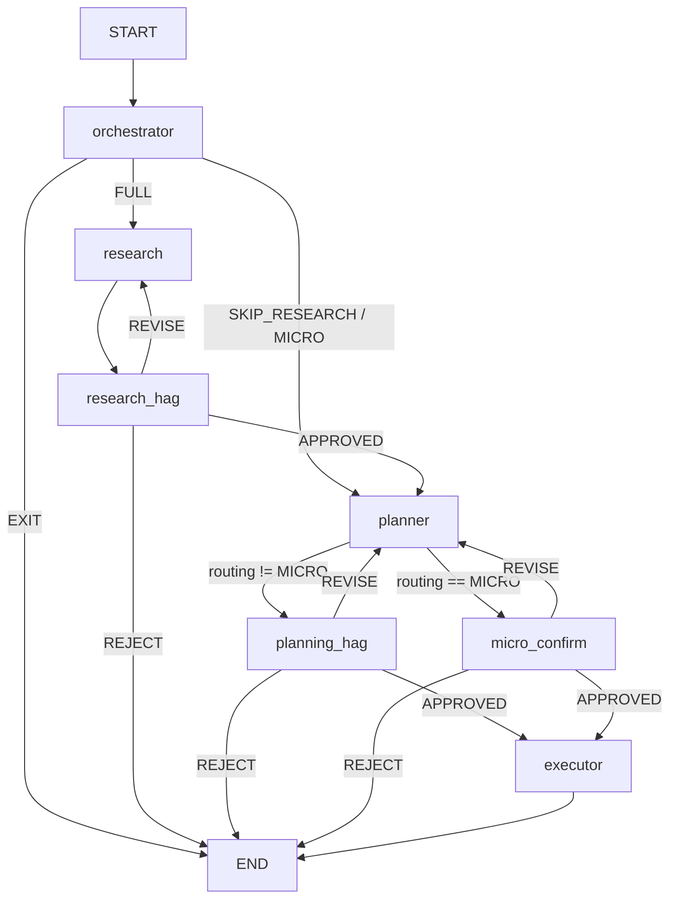

# IntuitionX Runtime Data Flow Audit

Exhaustive map of data flowing in and out of every agent and sub-agent at runtime.
Source of truth: `src/core/state.py` (`AgentState`), `src/core/schemas.py` (Pydantic boundaries), LangGraph wiring in `src/core/graph.py`.

---

## 0. Global State Schema

### 0.1 `AgentState` (LangGraph state)

| Field | Type | Set by | Read by |
|-------|------|--------|---------|
| `jira_ticket_id` | `str` | `initial_state()` / user | orchestrator, research, executor |
| `user_prompt` | `str` | user | orchestrator, research |
| `context_image` | `Optional[str]` | user (optional) | — |
| `repo_path` | `Optional[str]` | user override or orchestrator | research, planner, executor |
| `git_target_branch` | `Optional[str]` | orchestrator (`resolve_ticket_repo_path`) | planner, executor (worktree) |
| `jira_ticket` | `Optional[JiraTicket]` | orchestrator | research, planner, executor (PR) |
| `repo_profile` | `Optional[RepoProfile]` | orchestrator (`profile_repository`) | research, planner |
| `routing_route` | `Optional[Literal["FULL","SKIP_RESEARCH","MICRO","EXIT"]]` | orchestrator | graph routing, planner, gates |
| `current_phase` | phase literal | every node | metadata |
| `risk_level` | `Optional[Literal["LOW","MEDIUM","HIGH"]]` | orchestrator | metadata |
| `exit_message` | `Optional[str]` | orchestrator / failures | UI |
| `research_output` | `Optional[ResearchOutput]` | research | Gate 1, planner |
| `plan_output` | `Optional[PlanOutput]` | planner | Gate 2, micro_confirm, executor |
| `execution_output` | `Optional[ExecutionOutput]` | executor | UI / review |
| `human_gates` | `list[HumanApprovalGate]` | HITL nodes | research (REVISE), planner (REVISE) |
| `previous_attempts` | `list[FailedAttempt]` | Redis + orchestrator | orchestrator, planner |
| `current_error_log` | `Optional[str]` | executor failure | self-healing |
| `retry_count` | `int` | — | — |
| `max_retries` | `int` | `initial_state` (default 3) | orchestrator |
| `self_healing_cycle_index` | `int` | — | — |
| `total_tokens_used` | `int` | LLM tracking | budget |
| `token_budget` | `int` | orchestrator (`settings.token_budget`) | orchestrator prompt |
| `messages` | `Annotated[list, add_messages]` | LangGraph reducer | **unused by graph nodes today** |
| `session_id` | `str` | `initial_state` | gates, failure records |
| `created_at` / `updated_at` | ISO `str` | nodes | metadata |
| `prompt_version` | `str` | each agent node | metadata |
| `pending_diff` / `pending_worktree` / `pending_branch` | `Optional[str]` | — | reserved |

### 0.2 Nested TypedDicts

**`JiraTicket`** (`state.py:29–47`): `issue_id`, `title`, `issue_type`, `status`, `priority_raw`, `priority_normalized`, `module`, `problem_statement`, `acceptance_criteria`, `assignee`, `reporter`, `labels`, `repo_links`, `dependencies`, `attachments`, `comments`, `ticket_history_summary`, `flags`.

**`ResearchOutput`** (`state.py:63–72`): `ticket_id`, `research_summary`, `hypotheses[]`, `affected_files[]`, `affected_modules[]`, `module_blast_radius[]`, `architectural_risk`, `issue_type_assessment`, `flags[]`.

**`PlanOutput`** (`state.py:87–97`): `ticket_id`, `root_hypothesis`, `files_to_change[]`, `implementation_constraints[]`, `execution_steps[]`, `write_tests`, `create_files`, `risk_level`, `self_healing_notes[]`, `flags[]`. Planner may also attach `planner_repo_path`, `planner_snapshot_head` (extra keys on dict).

**`ExecutionOutput`** (`state.py:100–106`): `mr_url`, `changed_files[]`, `git_diff_summary`, `worktree_path`, `branch_name`, `compilation_status`.

**`HumanApprovalGate`** (`state.py:109–114`): `gate_id`, `gate_type` (`RESEARCH`|`PLANNING`|`MICRO_CONFIRM`), `status`, `feedback`, `timestamp`.

**`FailedAttempt`** (`state.py:117–125`): `attempt_id`, `ticket_id`, `phase_failed`, `error_type`, `error_summary`, `plan_hash`, `plan_used`, `timestamp`.

**`RepoProfile`** (`state.py:128–132`): `repo_type`, `root_path`, `modules[]`, `package_roots[]`.

### 0.3 Pydantic boundary models (`schemas.py`)

| Model | Used at boundary |
|-------|------------------|
| `RoutingDecision` | orchestrator LLM output |
| `ResearchReport` | research agent internal → `ResearchOutput` |
| `ExecutionPlan` / `ExecutionStep` | planner output → executor input |
| `FixPlan` / `FixTarget` | Cursor plan sub-agent (M1.3) |
| `PatchResult` | Cursor implement sub-agent (M1.4) |
| `ToolResult` | all L1 tool returns |
| `CursorSearchResponse` / `CursorEditResult` | CursorGateway |

---

## 1. LangGraph Topology



**Entry points:**
- Chainlit: `initial_state()` → `build_graph().stream/invoke`
- FastAPI: `initial_state` + `graph.invoke`
- CLI pipeline: `run_pipeline()` in `src/pipeline/runner.py` (no HITL gates)

---

## 2. Orchestrator Agent

**Files:** `src/agents/orchestrator/agent.py`, `src/core/orchestrator_context.py`

### 2.1 LangGraph node: `orchestrator_node`

#### Input (reads `AgentState`)

| Field | Type | Source |
|-------|------|--------|
| `jira_ticket_id` | `str` | `initial_state` / user |
| `user_prompt` | `str` | user |
| `repo_path` | `Optional[str]` | user override |
| `max_retries` | `int` | state |

**External (not in state):** `get_failed_attempts(ticket_id)` → `list[FailedAttempt]` from Redis.

#### Processing

1. Strip `[mock-security]` from prompt; fetch Jira or mock security ticket.
2. Early EXIT if `is_ticket_done(ticket)`.
3. `_resolve_repo_path(state)` → `(repo_path, git_target_branch)`.
4. `profile_repository(repo_path)` → `RepoProfile`.
5. `run_orchestrator_routing(...)` → `RoutingDecision` (LLM; mock-security forces FULL).

#### LLM prompt context (`build_orchestrator_routing_context`)

```python
{
  "ticket": { issue_id, title, issue_type, priority, labels[:12], status },
  "user_prompt": str,
  "repository": { repo_path, repo_type },
  "retry_summary": { previous_attempt_count, last_failed_phase, last_error_summary[:300] },
  "current_phase": "ORCHESTRATOR",
  "token_budget": int,
}
```

Skills: `PromptBuilder.build("orchestrator", SKILLS_DIR, ...)` → orchestrator skill body (L2).

#### Output (LLM → Pydantic)

**`RoutingDecision`:** `routing_route`, `risk_level`, `reasoning`.

#### State mutations (writes)

| Key | Value |
|-----|-------|
| `jira_ticket` | fetched ticket |
| `user_prompt` | stripped prompt |
| `repo_path`, `git_target_branch` | resolver |
| `repo_profile` | `profile_repository` |
| `routing_route`, `risk_level` | routing decision |
| `current_phase` | `"ORCHESTRATOR"` or `"EXIT"` |
| `exit_message` | on EXIT |
| `previous_attempts` | Redis |
| `token_budget` | `settings.token_budget` |
| `prompt_version` | `"orch-v1.0"` |
| `updated_at` | ISO timestamp |

#### Tool calls

**None.** Single-turn LLM; no `ToolRegistry`, no `CursorGateway`.

---

## 3. Research Agent

**Files:** `src/agents/research/agent.py`, `research_agent.py`, `deep_runner.py`, `sub_agent.py`, `tools/*`

### 3.1 LangGraph node: `research_node`

#### Input

| Field | Type | Source |
|-------|------|--------|
| `repo_path` | `Optional[str]` | orchestrator (fallback: `settings.default_repo_path`) |
| `jira_ticket` | `Optional[JiraTicket]` | orchestrator |
| `jira_ticket_id` | `str` | initial |
| `user_prompt` | `str` | initial / orchestrator |
| `repo_profile` | `Optional[RepoProfile]` | orchestrator |
| `human_gates` | `list` | Gate 1 REVISE feedback appended to prompt |

**Derived:** `anchors = extract_anchors(ticket, user_prompt)`.

#### Internal call

`ResearchAgent(repo_path).run(ticket, user_prompt, repo_profile, anchors, memory)` → `ResearchReport`.

#### Output → state

| Key | Type |
|-----|------|
| `research_output` | `ResearchOutput` via `_report_to_output` |
| `current_phase` | `"RESEARCH"` |
| `prompt_version` | `"research-v2.0-deep"` |

On failure: `_negative_finding_report(...)` still produces valid `ResearchOutput`.

### 3.2 `ResearchAgent.run()` — Deep Agent

#### Parameters

| Param | Type | Source |
|-------|------|--------|
| `ticket` | `JiraTicket` | state |
| `user_prompt` | `str` | state |
| `repo_profile` | `RepoProfile \| None` | state or re-profiled |
| `anchors` | `list[str]` | `extract_anchors` |
| `memory` | `InMemoryResearchMemory` | new per run |
| `llm` | `BaseChatModel` | `get_llm(HIGH)` |
| `gateway` | `CursorGateway` | ctor or `get_cursor_gateway` |

#### User message JSON (`build_research_user_message`)

```python
{
  "ticket_id", "title", "module", "problem_statement", "labels",
  "repo_path", "repo_bootstrap", "repo_profile", "anchors",
  "user_prompt", "security_enrichment",
}
```

Plus optional `## RUN MEMORY` and mock-demo hints.

#### Internal agent state (not `AgentState`)

```python
agent.invoke({"messages": [{"role": "user", "content": user_message}]}, config={"recursion_limit": ...})
```

Harness: **deepagents** (`create_deep_agent`, `response_format=ResearchReport`) or ReAct fallback.

Budget: `init_budget("research", ...)`; hard cap `_CURSOR_SEARCH_BUDGET = 6`.

#### Output (Pydantic)

**`ResearchReport`:** `ticket_id`, `research_summary`, `hypotheses` (1–3), `affected_files`, `affected_modules`, `module_blast_radius`, `architectural_risk`, `issue_type_assessment`, `flags`.

#### Tool calls

| Tool | Input | Backend |
|------|-------|---------|
| **`cursor_search`** | `query: str`, `path: str = "."` | `CursorGateway.search(query, path)` → JSON `CursorSearchResponse` |
| **`web_search`** | `query: str` | DuckDuckGo |
| **`repo_profile`** | (none) | `profile_repository(repo_path)` |

**Excluded deepagents FS tools:** `ls`, `write_file`, `edit_file`, `glob`, `grep`, `execute`. Skill-file `read_file` only per harness suffix.

**`cursor_search` path:** budget check → `gateway.search` → `CursorSearchResponse` (`query`, `hits[{path, confidence, summary, snippets}]`, `flags`) → memory event `"cursor_search"`.

#### Memory side-channel

Events: `"anchors"`, `"research_start"`, `"agent_invoke"`, `"cursor_search"`, `"agent_complete"`, `"agent_error"`, `"agent_fallback"`.

### 3.3 Sub-agent: `CursorResearchSubAgent`

**Contract:** `run(context: AgentContext) -> AgentContext`

#### Input (`AgentContext.metadata`)

| Key | Type |
|-----|------|
| `jira_ticket` | `JiraTicket` |
| `repo_path` | `str` |
| `user_prompt` | `str` |
| `ticket_id` | `str` |

#### Output

`context.with_phase_output("research", ResearchOutput dict)` via `report_to_research_output`.

Delegates to same `ResearchAgent.run()`.

**Note:** `AgentContext` in `src/core/agent_context.py` is commented out; sub-agent imports will fail until restored.

---

## 4. HITL Gate 1 — `research_hag_node`

**File:** `src/core/graph.py`

#### Input (reads)

`research_output`, `session_id`, `human_gates`.

#### Interrupt payload (to human)

```python
{"gate": "GATE_1", "message": str, "research_output": ResearchOutput | None}
```

Human resumes: `{"status": "APPROVE"|"REJECT"|"REVISE", "feedback": ...}`.

#### State mutation

Appends `HumanApprovalGate`: `gate_id`, `gate_type="RESEARCH"`, `status`, `feedback`, `timestamp`.

**No tools.**

---

## 5. Planner Agent

**Files:** `src/agents/planner/agent.py`, `src/core/planner_context.py`, `planner/tools/builder.py`

### 5.1 LangGraph node: `planner_node`

#### Input

| Field | Type | Source |
|-------|------|--------|
| `research_output` | `ResearchOutput` | research (required) |
| `repo_path` | `Optional[str]` | orchestrator |
| `repo_profile` | `Optional[RepoProfile]` | orchestrator |
| `routing_route` | routing literal | orchestrator |
| `previous_attempts` | `list[FailedAttempt]` | Redis / state |
| `jira_ticket` | `Optional[JiraTicket]` | orchestrator |
| `git_target_branch` | `Optional[str]` | orchestrator |
| `human_gates` | REVISE on `"PLANNING"` | Gate 2 feedback |

Validates: `ResearchReport.model_validate(research_output)`.

#### LLM context (`build_planner_prompt` / `planner_context.py`)

| Key | Contents |
|-----|----------|
| `research_output` | `research_handoff_for_planner(report)` |
| `repository` | `{repo_path, target_branch, repo_type}` |
| `routing_route` | str |
| `ticket` (optional) | `compact_ticket_for_planner(ticket)` |
| `retry_summary` (optional) | from `previous_attempts` |
| `gate_feedback` (optional) | str |

Plus inline **AFFECTED FILE CONTENTS** (up to 3 files, 4000 chars each) from disk.

#### Processing (`run_planner`)

1. LLM → raw JSON
2. `_parse_execution_plan` → `ExecutionPlan`
3. `_normalize_plan_paths`, `_ground_edit_patches_from_disk`
4. `git_repo_snapshot` → `planner_repo_path`, `planner_snapshot_head`
5. `validate_edit_patches`, `validate_execution_plan`
6. Optional verification tools (max 3 calls)

#### Output → state (`PlanOutput` + extras)

| Field | Type |
|-------|------|
| `ticket_id`, `root_hypothesis`, `files_to_change[]` | plan fields |
| `implementation_constraints[]`, `execution_steps[]` | plan fields |
| `write_tests`, `create_files`, `risk_level` | plan fields |
| `self_healing_notes[]`, `flags[]` | plan fields |
| `planner_repo_path`, `planner_snapshot_head` | snapshot metadata |

State: `plan_output`, `current_phase="PLANNING"`, `prompt_version="planner-v1.0"`.

#### Tool calls (post-LLM verification)

From `tool_permissions.yaml` → `build_planner_tools`:

| Tool | Input schema | Usage |
|------|--------------|-------|
| **`read`** | `ReadInput`: path, start_line, end_line | READ/VERIFY steps, max 3 |
| **`grep`** | `GrepInput`: pattern, path, glob, limit | allowed, not in main loop |
| **`find`** | `FindInput`: pattern, path, limit | allowed, not in main loop |

EDIT grounding uses direct `Path.read_text`, not always via registry.

**No CursorGateway** on LangGraph planner path.

### 5.2 Sub-agent: `CursorPlanSubAgent`

#### Input

`context.metadata["research_output"]`, `repo_path`, `jira_ticket`.

#### Output

`metadata["fix_plan"]` = `FixPlan` dict; `metadata["plan_output"]` = legacy steps via `fix_plan_to_plan_output`.

Intended: `run_cursor_plan` → `CursorGateway.ask(prompt)` → `FixPlan`.

**Note:** `plan_runner.py` commented out; sub-agent broken at import.

---

## 6. HITL Gate 2 / Micro Confirm

### `planning_hag_node`

Interrupt: `{gate: "GATE_2", message, plan_output}`. Writes `gate_type="PLANNING"`.

### `micro_confirm_node`

Interrupt: `{gate: "MICRO_CONFIRM", message, plan_output}`. Writes `gate_type="MICRO_CONFIRM"`.

**No tools.**

---

## 7. Executor Agent

**Files:** `src/agents/executor/agent.py`, `executor/tools/builder.py`, `executor/tools/git_worktree.py`, `executor/tools/mr_create.py`

### 7.1 LangGraph node: `executor_node`

#### Input

| Field | Type | Source |
|-------|------|--------|
| `plan_output` | `PlanOutput` | planner (required) |
| `repo_path` | `Optional[str]` | orchestrator |
| `jira_ticket_id` | `str` | initial |
| `git_target_branch` | `Optional[str]` | orchestrator |
| `jira_ticket` | `Optional[JiraTicket]` | PR creation |

Validates → `ExecutionPlan.model_validate(plan_raw)`.

#### Processing

1. `create_worktree(repo_path, ticket_id, base_branch, description, planner_snapshot_head)`
2. `run_executor(plan, worktree_path, gateway=get_cursor_gateway(...))`
3. `show_diff`, `stage_commit_push`, `create_github_pr`

#### Output → state (`ExecutionOutput`)

| Field | Source |
|-------|--------|
| `mr_url` | GitHub PR |
| `changed_files` | `ExecutionResult.changed_files` |
| `git_diff_summary` | truncated diff |
| `worktree_path`, `branch_name` | worktree |
| `compilation_status` | `"SKIPPED"` |

Also: `current_phase="REVIEW"`, `prompt_version="executor-v1.0"`.

On failure: `save_failed_attempt`, `current_error_log`, `exit_message`.

### 7.2 `run_executor` step runner

#### Input

`ExecutionPlan`, `repo_path` (worktree), optional `gateway: CursorGateway`, `dry_run: bool`.

Per-step dispatch (`_execute_step`):

| Action | Handler | Tools / backend |
|--------|---------|-----------------|
| `READ` | `_execute_read` | **`read`** (ToolRegistry, allowlisted) |
| `EDIT` | `_execute_edit` | fresh read → **`CursorGateway.edit()`** → post validation |
| `VERIFY` | `_execute_verify` | **`read`** / `Path.read_text` + `verify_intent_marker` |
| `RUN_TESTS` | `_execute_run_tests` | `run_tests_for_file` skill script |

#### EDIT via CursorGateway

```python
gateway.edit(
    instruction,  # built from step change/why/old_string/new_string/intent_marker
    files=[path],
    metadata={
        "step_id", "ticket_id", "old_string", "new_string",
        "create_file", "intent_marker",
    },
)
→ CursorEditResult { status, text, dry_run, exit_code, changed_files[], git_diff_* }
```

LLM fallback on EDIT failure: LOW-tier LLM → JSON `{old_string, new_string}` → **`gateway.edit()`** (not local `edit` tool).

#### Tool allowlist (`tool_permissions.yaml`)

```yaml
executor: [read, bash, git_worktree, mr_create]
```

`write` and `edit` are **excluded**; `RestrictedToolRegistry` denies non-allowlisted `execute()` calls.

#### Integration tools (direct Python, not ToolRegistry)

| Function | Key inputs | Output |
|----------|------------|--------|
| `create_worktree(...)` | repo_path, ticket_id, base_branch, planner_snapshot_head | `{worktree_path, branch_name, ...}` |
| `show_diff(worktree_path, base_branch?)` | path | diff string |
| `stage_commit_push(...)` | worktree, branch, message | push result dict |
| `create_github_pr(...)` | repo, branch, ticket metadata | PR URL |

#### Internal result

**`ExecutionResult`:** `ticket_id`, `changed_files[]`, `steps_completed`, `step_results[]`, `plan_deviations[]`.

### 7.3 Sub-agent: `CursorImplementSubAgent`

#### Input (`AgentContext.metadata`)

`fix_plan`, `research_output`, `jira_ticket`, `ticket_id`, `repo_path`, `execution_metadata`.

#### Intended processing

1. `FixPlan.model_validate`
2. `create_worktree`
3. `run_cursor_implement(fix_plan, worktree, gateway, skills, research, metadata)`
4. `show_diff`, optional PR
5. `context.append_cursor_history(edit_result.to_history_entry())`

#### Output

`PatchResult` in `context.with_phase_output("patch", ...)`.

**Note:** `implement_runner.py` commented out; sub-agent broken at import.

---

## 8. Cursor Integration Layer

**Files:** `src/integrations/cursor/gateway.py`, `client.py`, `schemas.py`

### 8.1 `CursorGateway` API

| Method | Input | Output | Used by |
|--------|-------|--------|---------|
| `search(query, path=".")` | str, str | `CursorGatewayResult` + `CursorSearchResponse` | Research `cursor_search` |
| `ask(prompt, context=None)` | str, optional | `CursorGatewayResult` | Cursor plan sub-agent |
| `edit(instruction, files, fix_plan, metadata)` | str, list, FixPlan, dict | `CursorEditResult` | Executor EDIT steps, implement sub-agent |
| `run(command, timeout=30)` | shell cmd | `CursorGatewayResult` | available, not wired |

### 8.2 `run_local_agent` (`client.py`)

| Input | `prompt`, `cwd`, `dry_run`, `model` |
| Output | `CursorRunResult`: `status`, `text`, `dry_run`, `exit_code`, `stderr` |

Uses `cursor_sdk.Agent.prompt(..., LocalAgentOptions(cwd=...))`.

### 8.3 Implementations

| Class | Behavior |
|-------|----------|
| **`DryRunCursorGateway`** | Mock search; `edit()` captures git diff, no SDK call |
| **`CliCursorGateway`** | Wraps `run_local_agent` with prefixed prompts |
| **`LocalPatchCursorGateway`** | Unit-test helper: applies metadata old/new_string locally |

Factory: `get_cursor_gateway(cwd, dry_run=False)`.

---

## 9. Alternate Runtime: `run_pipeline()`

**File:** `src/pipeline/runner.py`

Linear: routing → research (if FULL) → planner → executor. **No HITL gates.**

| Stage | Input | Output |
|-------|-------|--------|
| Routing | `JiraTicket` | `RoutingDecision` |
| Research | ticket, repo_path, profile, anchors | `ResearchOutput` |
| Planner | `ResearchReport`, repo_path | `ExecutionPlan` |
| Executor | `ExecutionPlan`, repo_path | `ExecutionResult` |

SKIP_RESEARCH/MICRO: synthesizes minimal `ResearchOutput` from ticket.

`dry_run=True`: skips research/planner/executor entirely.

---

## 10. Cross-Agent Data Flow Summary

```
User / API
  └─ jira_ticket_id, user_prompt, repo_path?
       ↓
[Orchestrator]
  reads: jira_ticket_id, user_prompt, repo_path, previous_attempts (Redis)
  writes: jira_ticket, repo_path, git_target_branch, repo_profile,
          routing_route, risk_level, current_phase
       ↓ routing_route
[Research]  (FULL only in LangGraph)
  reads: jira_ticket, repo_path, repo_profile, user_prompt, human_gates
  tools: cursor_search, web_search, repo_profile
  writes: research_output
       ↓
[Gate 1] → human_gates[]
       ↓
[Planner]
  reads: research_output → ResearchReport, repo_path, routing_route, ...
  tools: read, grep, find (verification)
  writes: plan_output
       ↓
[Gate 2 / Micro] → human_gates[]
       ↓
[Executor]
  reads: plan_output → ExecutionPlan, repo_path, jira_ticket_id, ...
  edits: CursorGateway.edit() per EDIT step
  reads/verify: read tool + Path.read_text
  integration: git_worktree, mr_create
  writes: execution_output
```

---

## 11. Appendix: Commented / WIP Modules

| Module | Status | Impact |
|--------|--------|--------|
| `src/core/agent_context.py` | commented | Sub-agents import `AgentContext` — broken |
| `src/core/orchestrator_loop.py` | commented | M1.3/M1.4 orchestrator chain |
| `src/integrations/cursor/plan_runner.py` | commented | `CursorPlanSubAgent` imports fail |
| `src/integrations/cursor/implement_runner.py` | commented | `CursorImplementSubAgent` imports fail |

**Active production path:** LangGraph + `AgentState` + CursorGateway for research search and executor edits.

---

## 12. Pydantic ↔ TypedDict Boundary

| Agent | Validates (Pydantic) | Stores (TypedDict) |
|-------|---------------------|-------------------|
| Orchestrator | `RoutingDecision` | `routing_route`, `risk_level` |
| Research | `ResearchReport` | `ResearchOutput` |
| Planner | `ResearchReport` (in), `ExecutionPlan` (out) | `PlanOutput` |
| Executor | `ExecutionPlan` (in) | `ExecutionOutput` |
| Cursor plan (intended) | `FixPlan` | `fix_plan` in AgentContext |
| Cursor implement (intended) | `FixPlan` (in), `PatchResult` (out) | patch in AgentContext |


