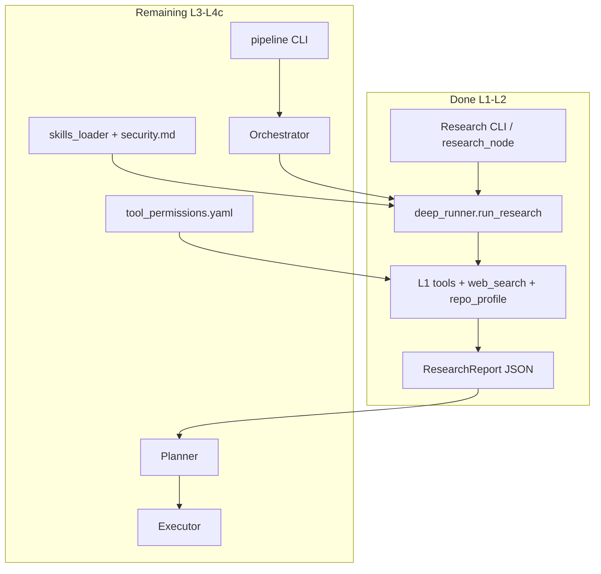
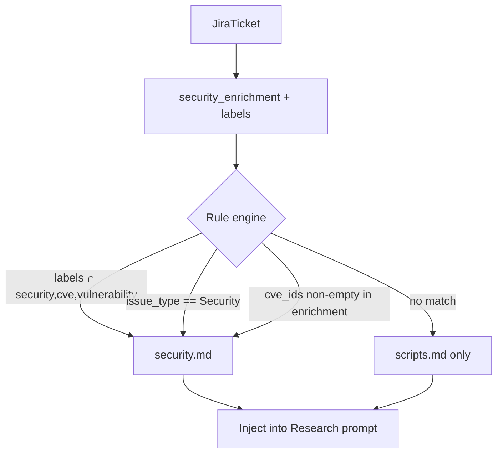

# Project State — Sprinklr Jira Solver MVP

**Purpose:** Session handoff document. Read this first in a new conversation — do not rely on chat history.

**Current architecture:** LangGraph pipeline (`src/core/graph.py`), skills in `skills/` via `SkillRegistry`, Cursor SDK for search/plan/edit. See [docs/README.md](README.md) and [docs/skills-authoring.md](skills-authoring.md).

**Milestone 3.3 (partial):** `java-dependency-vulns.md` reference skill + [`docs/skills-authoring.md`](skills-authoring.md). Sandboxed load-time validation and skill eval hooks were **not** implemented.

**Not a duplicate of:** [`plan.md`](plan.md) (long-term architecture) or level implementation plans. This file tracks **what is done**, **what is next**, and **how to verify each level**.

**Last updated:** July 2026 — after Milestone 3.3 skills system hardening.

---

## 1. Rules and authority

| Rule | Detail |
|------|--------|
| **Authority** | User MVP prompt overrides `plan.md` for this phase. `plan.md` is the long-term north star. |
| **Build order** | One level at a time. Stop after each level, report, wait for go-ahead. |
| **Terminal verification** | Every level must be runnable from the terminal with structured `[component]` logging. |
| **Folder rule** | L1 primitives only in [`src/tools/`](src/tools/). Agent-specific tools in `src/agents/<agent>/tools/`. |

### Agent model (locked for MVP)

| Agent | Type | Notes |
|-------|------|-------|
| **Research** | Deep Agent | `deepagents.create_deep_agent` on Python 3.11+; LangGraph ReAct fallback on 3.9 |
| **Orchestrator** | Simple structured | Single-turn LLM; no repo tools |
| **Planner** | Simple structured | Single-turn + bounded verification tools (read, grep, find only) |
| **Executor** | Simple structured | Deterministic-first; write, edit, bash only |

### Tool permission matrix (target — Level 4)

| Agent | Tools |
|-------|-------|
| Orchestrator | none |
| Research | read, grep, find, bash, ls, web_search, repo_profile |
| Planner | read, grep, find |
| Executor | write, edit, bash |

---

## 2. Completed work (Levels 1–2) — pointer only

Do not re-implement these. Use the entrypoints below to confirm the codebase still works.

### Level 1 — Scaffolding and primitive tools (DONE)

Seven Pi-aligned L1 tools: `read`, `write`, `edit`, `bash`, `find`, `grep`, `ls`.

```bash
pip install -r requirements.txt
python3 -m src
python3 -m src.tools.cli demo
pytest tests/test_tools.py -v
```

### Level 2 — Research Deep Agent + Jira (DONE)

Research runs as internal Deep Agent loop; LangGraph only sees `research_node` → `ResearchReport`.

```bash
# No LLM — verifies ticket, tools, anchors, prompt
python3 -m src.agents.research --mock-security --repo-path . --dry-run

# Full run — needs LLM_PROVIDER + keys in .env.local
python3 -m src.agents.research --mock-security --repo-path .

pytest tests/test_research.py tests/test_jira.py -v
```

### Key file map (completed)

| Area | Files |
|------|-------|
| L1 tools | [`src/tools/registry.py`](src/tools/registry.py), [`src/tools/base.py`](src/tools/base.py), [`src/tools/cli.py`](src/tools/cli.py) |
| Logging | [`src/core/logging.py`](src/core/logging.py) — structlog with `[component]` prefixes |
| Research runner | [`src/agents/research/deep_runner.py`](src/agents/research/deep_runner.py), [`src/agents/research/agent.py`](src/agents/research/agent.py) |
| Research tools | [`src/agents/research/tools/builder.py`](src/agents/research/tools/builder.py) |
| Research memory | [`src/agents/research/memory.py`](src/agents/research/memory.py) — `InMemoryResearchMemory` (Redis-swappable interface) |
| Jira (mentor port) | [`src/agents/orchestrator/tools/jira_client.py`](src/agents/orchestrator/tools/jira_client.py), [`jira_schema.py`](src/agents/orchestrator/tools/jira_schema.py), [`jira.py`](src/agents/orchestrator/tools/jira.py) |
| Schemas (current) | [`src/core/schemas.py`](src/core/schemas.py) |
| Context (legacy) | [`src/core/transform_context.py`](src/core/transform_context.py) — not yet split into ContextBuilder/PromptBuilder |
| Graph (legacy) | [`src/core/graph.py`](src/core/graph.py) — static topology + HITL; not aligned with Level 4 pipeline CLI |

### Known deferrals from L1–L2

- **`rank_candidate_files`** in [`src/agents/research/tools/file_discovery.py`](src/agents/research/tools/file_discovery.py) — exists but **not called** from runner; file ranking belongs in skills/prompts per `plan.md`.
- **`deepagents`** requires Python **3.11+**; use `.venv` with 3.11+ for full Deep Agent harness. Python 3.9 logs `[research_deep] deepagents_unavailable` and uses ReAct fallback.
- **No `security.md` skill yet** — Level 3.
- **No `tool_permissions.yaml`** — Level 4.
- **No `ContextBuilder` / `PromptBuilder` / `StateUpdater`** — still monolithic `transform_context.py`.
- **Planner/Executor/Orchestrator** exist as scaffold but are **not** verified end-to-end until Level 4.

---

## 3. Architecture — current vs target



---

## 4. Level 3 — Skills system (NEXT)

**Status:** NOT STARTED — wait for explicit go-ahead after this document is in place.

### Goal

Load ticket-type skills from markdown with a **fixed format** so adding `bug.md`, `feature.md` later requires only dropping a file (+ optional one selection rule line), not Python changes.

### Skill file format (locked)

Only **`security.md`** in Level 3. Exact structure:

```markdown
script_name: security_research
script_description: Research strategy for security/CVE tickets
script_content: |
  <multi-line prompt content here>
```

Fields are **top-level keys** with YAML-style `key: value` lines. `script_content` may use `|` block scalar for multi-line body.

**`security.md` should cover:**

- SQL injection / CVE / auth-module investigation strategy
- Search-first: find → grep → read (never read whole files)
- Use `security_enrichment` from Jira (CVE IDs, severity, affected component)
- Elevate `architectural_risk` to `high` when auth/security modules involved
- Negative finding policy when evidence insufficient (still emit valid `ResearchReport`)
- Max 5 tool iterations, max 10 unique files read

### Files to create

| File | Role |
|------|------|
| [`src/agents/research/skills/security.md`](src/agents/research/skills/security.md) | Only skill file for Level 3 |
| [`src/core/skills_loader.py`](src/core/skills_loader.py) | Parse skills dir; return `Skill` models |
| [`src/core/schemas.py`](src/core/schemas.py) | Add `Skill` model: `name`, `description`, `content`, `source_path` |

### `skills_loader.py` API (spec)

```python
def load_skill_file(path: Path) -> Skill:
    """Parse script_name / script_description / script_content. Raise ValueError with path on malformed file."""

def load_skills_from_dir(skills_dir: Path) -> dict[str, Skill]:
    """Load all *.md except scripts.md into name -> Skill map."""

def select_research_skill(ticket: JiraTicket, skills_dir: Path) -> tuple[Skill | None, str]:
    """Return (skill, reason). reason explains why selected or why none."""
```

### Selection rules (deterministic — no LLM picking)



1. If `ticket.labels` intersects `{"security", "cve", "vulnerability"}` → load `security.md`, reason=`label_match`
2. Else if `issue_type.lower() == "security"` → `security.md`, reason=`issue_type_security`
3. Else if `ticket_history_summary.security_enrichment.cve_ids` is non-empty → `security.md`, reason=`cve_present`
4. Else → no extra skill, reason=`no_skill_match` (base `scripts.md` only)

**Logging (required):**

```
[skills_loader] loaded=security reason=cve_present path=src/agents/research/skills/security.md
```

or

```
[skills_loader] loaded=none reason=no_skill_match
```

### Integration points (only these files change)

| File | Change |
|------|--------|
| [`src/agents/research/deep_runner.py`](src/agents/research/deep_runner.py) | `build_research_prompt()` calls `select_research_skill()`; inject skill block between `scripts.md` and context JSON |
| [`src/agents/research/__main__.py`](src/agents/research/__main__.py) | `--dry-run` JSON includes `loaded_skill`, `skill_reason` |

**Do not** wire skills into Planner, Executor, or Orchestrator in Level 3.

### Tests — [`tests/test_skills_loader.py`](tests/test_skills_loader.py)

- Parse valid `security.md` → correct `Skill` fields
- Malformed file (missing `script_name`) → `ValueError` with file path in message
- Mock security ticket → selects `security.md` with expected reason
- Mock bug ticket (no security signals) → `None` skill
- Dry-run CLI includes skill fields in stdout JSON

### Verify Level 3

```bash
python3 -m src.agents.research --mock-security --repo-path . --dry-run
# stderr: [skills_loader] loaded=security reason=...
# stdout JSON: "loaded_skill": "security_research", "skill_reason": "..."

pytest tests/test_skills_loader.py -v
```

### Level 3 out of scope

- `bug.md`, `feature.md` (extension: add file + one rule in `select_research_skill`)
- Skills for other agents
- `PromptBuilder` module extraction

---

## 5. Level 4 — Planner, Executor, Orchestrator

**Status:** NOT STARTED.

Build **together** but implement and test in order **4a → 4b → 4c**. LangGraph full wiring in **4c only**.

### 5a — Planner agent

**Type:** Simple structured agent — **not** a Deep Agent.

**Tools:** `read`, `grep`, `find` only — never write/edit/bash.

**Input:** `ResearchReport` / `research_output` (use mock JSON fixture for standalone tests).

**Output:** Pydantic `ExecutionPlan` from [`src/core/schemas.py`](src/core/schemas.py).

**Required per execution step:**

| Field | Required |
|-------|----------|
| `why`, `where` (file path), `what`, `validate` | Every step |
| `action` | `LOCATE \| EDIT \| VERIFY \| SEARCH` |
| `old_string` / `new_string` | Every `EDIT` step |

**Schema gap:** Current `ExecutionStep` uses `file`, `target`, `reason`. Level 4a should **add** canonical fields (`why`, `where`, `what`, `validate`) alongside legacy fields for backward compatibility — do not break existing tests without migration.

**New files:**

| File | Role |
|------|------|
| [`src/agents/planner/tools/builder.py`](src/agents/planner/tools/builder.py) | `build_planner_tools(repo_path)` → read, grep, find |
| [`src/agents/planner/__main__.py`](src/agents/planner/__main__.py) | Standalone CLI |
| [`src/agents/planner/fixtures/mock_research_report.json`](src/agents/planner/fixtures/mock_research_report.json) | Hand-authored or saved from Level 2 security run |

**Refactor [`src/agents/planner/agent.py`](src/agents/planner/agent.py):**

- Single LLM call + optional **bounded** verification tool calls (max **3** calls — not a ReAct loop)
- Malformed `ResearchReport` input → loud Pydantic validation error in `exit_message`; **no** silent best-effort plan
- Skills from [`src/agents/planner/skills/scripts.md`](src/agents/planner/skills/scripts.md) only

**Verify 4a:**

```bash
python3 -m src.agents.planner \
  --report src/agents/planner/fixtures/mock_research_report.json \
  --repo-path .

pytest tests/test_planner.py -v
```

**Success:** Valid `ExecutionPlan` JSON printed; each EDIT step has `old_string`/`new_string`; stderr shows `[planner]` tool verification logs if used.

**Failure:** Schema validation error with field path; no empty plan on bad input.

---

### 5b — Executor agent

**Type:** Simple structured agent — deterministic-first.

**Tools:** `write`, `edit`, `bash` only.

**Input:** `ExecutionPlan` JSON (mock fixture — independent of Planner actually running).

**Per-step logging (required):**

```
[executor] step=1 action=EDIT file=src/foo.py
[executor] step=1 result=ok|failed output=...
```

On bash failure: capture stdout+stderr in log and `exit_message`.

**Executor context (target from plan.md):** Eventually one step per dispatcher cycle via `ExecutorContext`. MVP Level 4b may loop all steps in one invocation but **must** log each step distinctly.

**New files:**

| File | Role |
|------|------|
| [`src/agents/executor/tools/builder.py`](src/agents/executor/tools/builder.py) | write, edit, bash only |
| [`src/agents/executor/__main__.py`](src/agents/executor/__main__.py) | Standalone CLI |
| [`src/agents/executor/fixtures/mock_plan.json`](src/agents/executor/fixtures/mock_plan.json) | Minimal write + edit steps |

**Refactor [`src/agents/executor/agent.py`](src/agents/executor/agent.py):**

- Standalone path: **no** git worktree / GitLab MR (defer to 4c or `--with-git` flag)
- LOW-tier LLM fallback on patch failure only (already partially in agent.py)
- Executor must **not** receive full `ResearchReport`

**Verify 4b:**

```bash
mkdir -p /tmp/executor_demo
python3 -m src.agents.executor \
  --plan src/agents/executor/fixtures/mock_plan.json \
  --repo-path /tmp/executor_demo

pytest tests/test_executor.py -v
```

**Success:** Files created/edited in temp dir; each step logged; exit 0.

**Failure:** Patch failure shows which step and command output; exit non-zero.

---

### 5c — Orchestrator + pipeline wiring

**Type:** Simple structured agent — **no repo tools**.

**Job:** Sequence Research → Planner → Executor with **real** artifacts (no mocks in happy path).

#### Permission config (new)

[`src/core/tool_permissions.yaml`](src/core/tool_permissions.yaml):

```yaml
orchestrator: []
research:
  - read
  - grep
  - find
  - bash
  - ls
  - web_search
  - repo_profile
planner:
  - read
  - grep
  - find
executor:
  - write
  - edit
  - bash
```

[`src/core/tool_permissions.py`](src/core/tool_permissions.py):

```python
def get_allowed_tools(agent_name: str) -> list[str]: ...
```

Each agent's `tools/builder.py` must filter against this config (not hardcoded scattered checks).

#### Orchestrator changes

[`src/agents/orchestrator/agent.py`](src/agents/orchestrator/agent.py):

- Routing intelligence stays in [`orchestrator/skills/scripts.md`](src/agents/orchestrator/skills/scripts.md)
- Output: keep `RoutingDecision` for MVP (`routing_route`, `risk_level`, `reason`); `ExecutionContract` from plan.md is optional upgrade
- On stage failure: **stop pipeline**, log `[orchestrator] stage_failed=research|planner|executor error=<msg>` — never continue on bad artifact

#### Graph / pipeline

Current [`src/core/graph.py`](src/core/graph.py) uses **static** `route_after_orchestrator` in Python — acceptable for MVP demo with HITL gates.

Level 4c minimum: **pipeline CLI without HITL first**, gates behind `--with-gates`.

**New entrypoint:** [`src/pipeline/__main__.py`](src/pipeline/__main__.py)

```bash
python3 -m src.pipeline --mock-security --repo-path .
python3 -m src.pipeline --mock-security --repo-path . --with-gates  # optional HITL
```

**Transition logging (required):**

```
[graph] node_start=research
[graph] handoff research -> planner payload_shape=ResearchOutput
[graph] node_start=planner
[graph] handoff planner -> executor payload_shape=ExecutionPlan
```


**Failure injection test:** Malformed ticket or forced tool failure → localized error with `[orchestrator] stage_failed=...`, not silent hang or uncontextualized stack trace.

**Verify 4c:**

```bash
python3 -m src.pipeline --mock-security --repo-path .
pytest tests/test_pipeline.py -v
```

---

## 6. Level 5 — Observability pass

**Status:** NOT STARTED.

### Goal

LangSmith tracing boundaries per agent: prompts, tool calls, outputs, execution time — independently inspectable.

### Current state

| Mechanism | Location |
|-----------|----------|
| `@traceable` on agent nodes | `research/agent.py`, `planner/agent.py`, `executor/agent.py`, `orchestrator/agent.py` |
| `@audit_tool` on L1 tools | `src/tools/base.py` |
| Env vars | `LANGCHAIN_TRACING_V2`, `LANGCHAIN_PROJECT` in `.env.local` |

### Work items

| Task | Files | Detail |
|------|-------|--------|
| Consistent trace names | All agents, `deep_runner.py` | `run_name`: `research_agent`, `planner_agent`, `executor_agent`, `orchestrator_agent` |
| Metadata tags | All `invoke()` wrappers | `jira_ticket_id`, `session_id`, `routing_route`, `prompt_version`, `harness=deepagents\|react_fallback` |
| Research inner loop | `deep_runner.py` | Outer span for LangGraph; inner deepagents/ReAct visible as child runs in LangSmith |
| Planner tool calls | `planner/agent.py` | Optional sub-spans per verification tool call |
| Smoke test | `tests/test_tracing.py` | Optional: assert trace metadata keys set when `LANGCHAIN_TRACING_V2=true` |

### Verify Level 5

```bash
export LANGCHAIN_TRACING_V2=true
export LANGCHAIN_PROJECT=sprinklr-jira-solver-dev

python3 -m src.pipeline --mock-security --repo-path .

# LangSmith UI:
# 1. Filter project = sprinklr-jira-solver-dev
# 2. Filter metadata jira_ticket_id = SEC-4421
# 3. Confirm separate traces/spans: research_agent, planner_agent, executor_agent
# 4. Inside research: child tool-call spans visible
```

### Level 5 out of scope

- Chainlit tool event UI polish
- Mongo cold audit trail
- Redis ReflectionMemory (hot cache)

---

## 7. Schema evolution tracker

MVP keeps **current** schemas unless Level 4 explicitly migrates. Avoid breaking tests.

| Artifact | Current (`schemas.py`) | Target (`plan.md`) | When to migrate |
|----------|------------------------|--------------------|-----------------|
| `ResearchReport` | `research_summary`, `hypotheses[]` | `problem_summary`, `evidence[]`, `assumptions[]`, no confidence scores | Level 4a or post-MVP |
| `RoutingDecision` | `routing_route`, `risk_level`, `reasoning` | `ExecutionContract` with `next_agent`, `model_tier` | Level 4c optional |
| `ExecutionPlan` | `root_hypothesis`, `files_to_change` | `goal`, `design_strategy`, steps with `why/where/what/validate` | Level 4a (add fields, keep legacy) |
| `ExecutionStep` | `file`, `target`, `reason` | `where`, `what`, `why`, `validate` | Level 4a |
| `ToolResult` | Implemented | Same | Done (L1) |
| `Skill` | **Missing** | N/A | Level 3 |

---

## 8. Environment and dependencies

| Requirement | Value |
|-------------|-------|
| Python | **3.11+** recommended (`.venv`); 3.9 works with ReAct fallback, no `deepagents` |
| `deepagents` | In `requirements.txt` with `python_version >= "3.11"` marker |
| LLM | `LLM_PROVIDER`, `ANTHROPIC_API_KEY` / `OPENAI_API_KEY` / `OLLAMA_BASE_URL` / OpenRouter vars |
| Jira | `JIRA_SERVER_URL`, `JIRA_EMAIL`, `JIRA_API_TOKEN` — or use `--mock-security` |
| LangSmith | `LANGCHAIN_TRACING_V2`, `LANGCHAIN_PROJECT` |
| Token budget | `TOKEN_BUDGET=150000` (default) |

### Verify without network / credentials

```bash
python3 -m src
python3 -m src.tools.cli demo
python3 -m src.agents.research --mock-security --repo-path . --dry-run
pytest tests/test_tools.py tests/test_research.py tests/test_jira.py tests/test_core.py -v
```

---

## 9. Test matrix (all levels)

| Level | Test file | Status | ~Tests |
|-------|-----------|--------|--------|
| 1 | `tests/test_tools.py` | **exists** | 11 |
| 1 | `tests/test_core.py` | **exists** | 16 |
| 2 | `tests/test_research.py` | **exists** | 6 |
| 2 | `tests/test_jira.py` | **exists** | 2 |
| 3 | `tests/test_skills_loader.py` | **todo** | ~5 |
| 4a | `tests/test_planner.py` | **todo** | ~6 |
| 4b | `tests/test_executor.py` | **todo** | ~6 |
| 4c | `tests/test_pipeline.py` | **todo** | ~4 |
| 5 | `tests/test_tracing.py` | **optional** | smoke |

**Full regression (after each level):**

```bash
pytest tests/ -v
```

---

## 10. Per-level report template (for implementer)

After completing each level, report using this structure:

```
LEVEL N COMPLETE: <name>

What changed:
Why it changed:
How to run/verify from the terminal:
  $ <exact command>
Expected output / what success looks like:
What failure would look like:
Architectural notes or concerns:
Next level: <name> — waiting for go-ahead
```

---

## 11. What to do next

1. **Confirm** Levels 1–2 still pass (commands in Section 2).
2. **Start Level 3** only after explicit user go-ahead.
3. Read Section 4 (Level 3) in this file — do not re-derive from chat history.
4. After Level 3, proceed 4a → 4b → 4c → 5 in order.

**Current gate:** Level 3 — Skills system (`security.md` + `skills_loader.py`).
