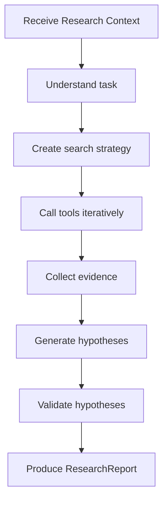
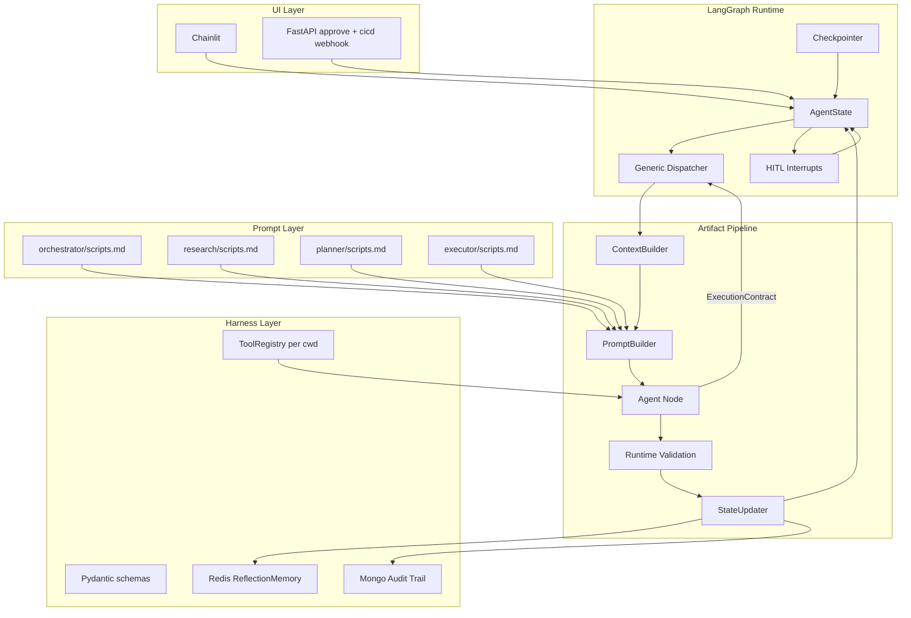
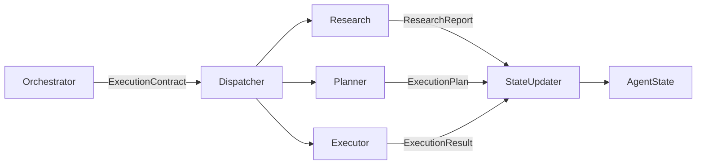
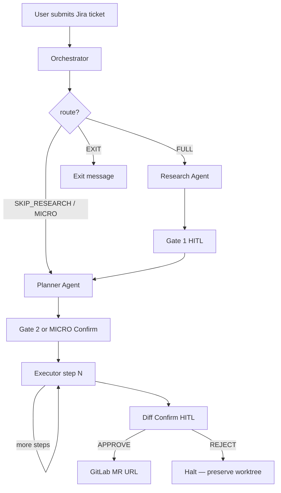
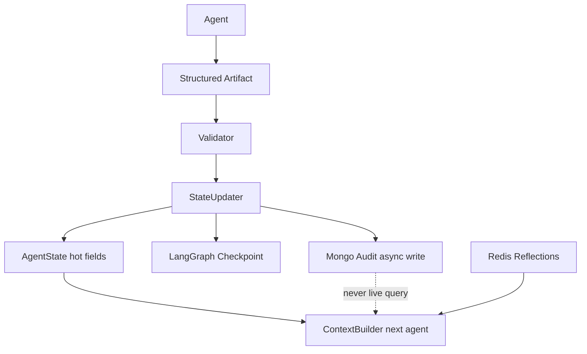
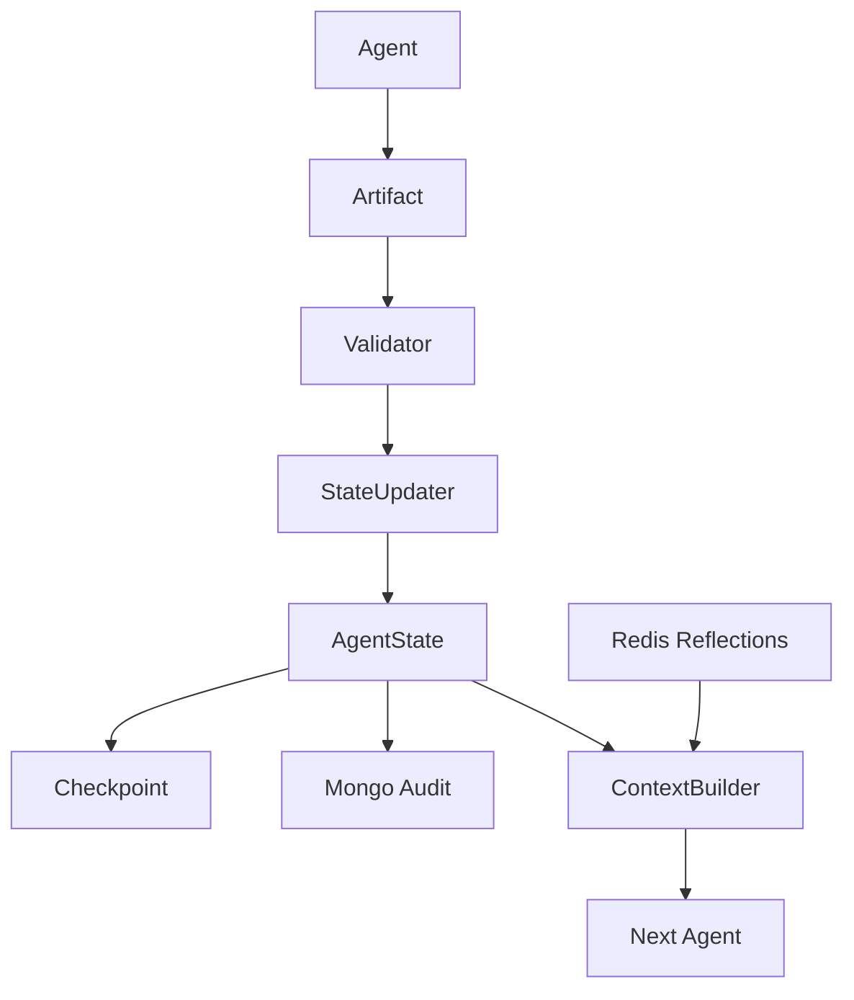

# Sprinklr Jira Solver — Phase 1 Master Plan

**Status:** Planning document only — use this as the single source of truth before writing code.  
**Last updated:** June 2026  
**Document hierarchy:** PRD (what to build) → this `plan.md` (architecture + build order) → [plan_v2.md](Implementation_plan/plan_v2.md) (deep ADR rationale)  
**References:** [PRD v2.0](file:///Users/prageet.mishra/Documents/Project%20Material/PRD/Finalized_PRD_sprinklr.md) · [PRD Addendum](docs/PRD_ADDENDUM_PHASE1.md) · [Implementation_plan.md](Implementation_plan.md) · [plan_v2.md](Implementation_plan/plan_v2.md) (detailed ADR blueprint)

---

## 1. What We Are Building

An autonomous coding platform for Sprinklr developers that:

1. Accepts a **Jira ticket** (+ optional prompt + repo path) via **Chainlit**
2. **Orchestrates** a multi-phase workflow with human approval gates
3. **Researches** the codebase (or bypasses research for scoped tickets)
4. **Plans** an execution contract with exact file patches
5. **Executes** changes in an isolated **GitLab worktree**
6. Returns an **MR URL** after human diff confirmation
7. Supports **self-healing** when CI/CD errors are fed back manually

**Phase 1 demo success criteria:**

| # | Scenario | Expected outcome |
|---|----------|------------------|
| 1 | DONE ticket | Immediate EXIT with message |
| 2 | Complex ticket | FULL → Gate 1 → Plan → Gate 2 → Execute → MR |
| 3 | Scoped ticket | SKIP_RESEARCH → Gate 2 → Execute → MR |
| 4 | Trivial ticket | MICRO → Quick Confirm → Execute → MR |
| 5 | Gate REVISE | Loops back to Research or Planner |
| 6 | Failed execution | ReflectionMemory cached in Redis; next run injects distilled lesson |
| 7 | CI/CD log upload | Re-orchestrates through FULL pipeline |

---

## 2. Locked Architecture Decisions

| Decision | Choice | Rationale |
|----------|--------|-----------|
| Agent model | **Multi-agent** (Orchestrator, Research, Planner, Executor) | PRD phases + separate audit trails |
| Orchestration intelligence | **100% in `scripts.md`** per agent | Pi-style prompt-driven; Python is thin runner only |
| LangGraph role | **Generic dispatcher + HITL interrupts** | No business routing rules in Python graph code |
| Execution contract | **`ExecutionContract`** with `route`, `next_agent`, `model_tier`, `reason` | Extensible routing without graph topology changes |
| Context output | **Typed Pydantic Context models** (`OrchestratorContext`, etc.) | ContextBuilder returns models, not raw dicts |
| Core tools | **In-process hardened tools** (not MCP) | Latency, sandboxing, Pi pattern |
| MCP | **Deferred** for file ops; optional later for Jira/RAG/CI | Complexity vs Phase 1 value |
| Context strategy | **ContextBuilder + typed artifacts** | Store everything, send almost nothing |
| Research | **Bounded ReAct** (max 5 tool iterations) + search-first | Balance exploration vs tokens |
| Planner | **Single-turn + verification tools** (read, grep, find only) | Verify facts without triggering a full research cycle |
| Planner output | **Patches** (`old_string` / `new_string`) on every EDIT step | Saves executor tokens |
| Executor | **Deterministic first**; LOW-tier LLM only for patch fallback | Hybrid execution model |
| Memory (hot) | **Redis ReflectionMemory** — distilled lessons | Agents consume reflections, not raw history |
| Memory (cold) | **Mongo audit trail** — never queried live by agents | Human review, debugging, analytics |
| HITL surface | **Chainlit** + `POST /approve/{thread_id}` for API resume | Intern demo + self-healing |
| Git platform | **GitLab**, target branch `develop` | PRD / Sprinklr default |
| Code review | **Human MR review only** (diff preview before push) | No LLM code review in Phase 1 |
| Tests / Gradle | **Deferred** | Explicit Phase 1 scope cut |
| RAG / Knowledge Base | **Phase 2** | grep/find sufficient for demo |
| Token budget | **150k per session**; tracked by LLM wrapper; warn at 80%; ContextBuilder truncates; hard stop at 100% | Pi token discipline |
| Build approach | **Refactor incrementally in place** | Repo already has partial scaffold |
| Build order | **Schemas → Tools → scripts.md → Runners → Graph/UI** | One layer at a time; no skipping |

### Architectural Invariants (Do Not Violate)

1. **`AgentState` is the canonical workflow state** — single source of truth for the runtime.
2. **No agent ever receives raw `AgentState`** — ContextBuilder filters everything.
3. **`ContextBuilder` constructs minimal context per agent** — store everything, send almost nothing.
4. **Every agent returns exactly one structured artifact** — no side-channel logs or tool traces.
5. **The runtime updates `AgentState` via `StateUpdater`** — agents never mutate state directly.
6. **Routing decides *who* runs next; `ContextBuilder` decides *what* they see** — decouple flow from context.

**Harness stack (top → bottom):** Thin Runtime → Rich Prompt Intelligence → Minimal Context → Deterministic Execution.

---

## 3. Architecture Pillars (Locked ADRs)

Each ADR: **Decision / Rationale / Phase 1 Scope / Non-goals**.

### ADR-001: Execution Model (Reasoning vs Runtime)

**Decision:** Clear separation between Reasoning (LLM domain) and Execution (Python/runtime domain).

| Agent | Model | Iteration budget |
|-------|-------|------------------|
| Orchestrator | Single-turn LLM | 1 call — classification + routing |
| Research | LangChain ReAct | Max 5 tool iterations |
| Planner | Single-turn LLM + verification tools | 1 call — verify, not investigate |
| Executor | Deterministic Python | LOW-tier LLM fallback only for patch repair |

**Rationale:** Reasoning power reserved for judgment; deterministic work stays in tools/runtime.

**Phase 1 scope:** Four agents as above. Executor hybrid fallback for failed patches.

**Non-goals:** Multi-turn planner, executor ReAct loops, LLM code review.

**Agent execution models (summary):**

| Agent | Execution | Why |
|-------|-----------|-----|
| Orchestrator | Single-turn LLM | Classification + routing is one judgment call |
| Research | LangChain ReAct (max 5) | Only agent that needs iterative exploration |
| Planner | Single-turn LLM + read, grep, find | Verify specific facts; design strategy without re-research |
| Executor | Deterministic Python + LOW LLM fallback | Predictable, auditable patch application |

---

### ADR-002: Three-Layer Tool Hierarchy

**Decision:** All agent operations follow a three-layer model.

| Layer | Classification | Examples | Ownership |
|-------|---------------|----------|-----------|
| Layer 1 | Primitive Tools | read, write, edit, find, grep, bash | Shared / Universal |
| Layer 2 | Helper Tools | web_search, extract_anchors, repo_profiler, git_diff | Specialized / Shared |
| Layer 3 | LLM Reasoning | Routing, hypothesis generation, file ranking, risk assessment | `scripts.md` only |

**First Principle:** If a task can be executed deterministically by Python → Tool (L1/L2). If it requires judgment or trade-offs → LLM Reasoning in `scripts.md` (L3).

**Rules:**
- No tool over-engineering — compose L1 primitives via reasoning instead of specialized search tools
- Intelligence decoupling — file ranking, risk analysis, hypothesis generation are **forbidden** as tools

**Phase 1 scope:** L1 fully implemented; L2 includes web_search, extract_anchors, repo_profiler. ast_parser / dependency_tracer deferred to Phase 2.

**Non-goals:** `repository_search`, `hypothesis_generator`, or `rank_candidate_files()` as tools (ranking belongs in Research `scripts.md`).

**Agent tool policy (Phase 1):**

| Agent | Allowed tools | Purpose | Forbidden |
|-------|--------------|---------|-----------|
| **Research** | L1 + L2 (find, grep, read, bash, web_search, extract_anchors, …) | **Investigate** — open-ended exploration | write, edit (no modifications) |
| **Planner** | read, grep, find only | **Verify** — confirm a specific fact (e.g. `validate()` exists) | web_search, repo_profiler, dependency_tracer, AST parser, write, edit, bash |
| **Executor** | read, edit, write, bash | **Implement** — apply approved patches | web_search, repo analysis, dependency tracing |
| **Orchestrator** | — (integration I/O in Python harness) | Route workflow | All repo tools |

**Key distinction:** Planner verification tools answer *"does this specific thing exist?"* — not *"what else is in the codebase?"* If Planner needs broad investigation, it must not re-run Research; verification calls are bounded and targeted.

**No confidence scores.** Artifacts use reasoning, evidence, risks, and assumptions — never numeric confidence (uncalibrated, hallucination-prone).

---

### ADR-003: Dynamic Dispatcher + ExecutionContract

**Decision:** Abandon static graph topologies in favor of a Dynamic Dispatcher Model.

**Execution Contract** (returned by Orchestrator, validated by Pydantic):

```json
{
  "route": "FULL",
  "next_agent": "research",
  "model_tier": "HIGH",
  "risk_level": "MEDIUM",
  "reason": "Complex multi-module bug requiring codebase exploration"
}
```

> **Note:** `model_tier` is `LOW` | `MEDIUM` | `HIGH` — not a literal model ID. See Section 5.5 for model selection policy (tentative).

**Safety & validation:** Python validates every ExecutionContract with Pydantic before dispatch. The LLM proposes the next step; the runtime enforces invariants (valid `next_agent`, allowed routes, model tier). Invalid contracts → EXIT with error — never silent fallback to FULL.

**Dispatcher logic** (Python — no business reasoning):
1. Read `next_agent` from `AgentState`
2. Invoke `ContextBuilder.build(agent=next_agent, state=state)`
3. Execute the agent node
4. Pass resulting artifact to `StateUpdater`
5. Repeat until `next_agent` is `END` or HITL interrupt

**Route presets** (Phase 1 — mapped to `next_agent` internally):

| Route | Typical `next_agent` sequence |
|-------|------------------------------|
| `EXIT` | END |
| `FULL` | research → (Gate 1) → planner → (Gate 2) → executor |
| `SKIP_RESEARCH` | planner → (Gate 2) → executor |
| `MICRO` | planner → (micro confirm) → executor |

**Rationale:** Adding SecurityAgent requires only orchestrator `scripts.md` update — no graph topology change.

**Phase 1 scope:** Generic dispatcher node registry; HITL gates remain interrupt nodes (pause/resume, not routing intelligence).

**Non-goals:** Static conditional edges encoding business routes in Python.

---

### ADR-004: ContextBuilder + Artifact Pipeline

**Decision:** AgentState is the system's source of truth, **not** the agent's source of context.

**Core principle:** Store everything, send almost nothing.

**Artifact pipeline:**

```
AgentState → ContextBuilder → AgentContext → PromptBuilder → LLM → Structured Artifact → Runtime Validation → StateUpdater → AgentState
```

**Three artifact types:**

| Artifact | Purpose | Constraints |
|----------|---------|-------------|
| AgentState | Workflow coordination | No prompt formatting, no markdown, no tool logs |
| AgentContext | Exactly what this agent needs | **Typed Pydantic model** — filtered, summarized, formatted |
| Prompt | Final LLM instruction | scripts.md + AgentContext + Available Tools |

**Typed Context models** — `ContextBuilder.build(agent, state)` returns a Pydantic model, never a raw `dict`:

```python
def build(agent: AgentName, state: AgentState) -> AgentContext  # discriminated union
```

| Agent | Return type |
|-------|-------------|
| orchestrator | `OrchestratorContext` |
| research | `ResearchContext` |
| planner | `PlanningContext` |
| executor | `ExecutorContext` |

All defined in `src/core/schemas.py`. JSON serialization happens only inside **PromptBuilder** — runners never pass dicts to the LLM.

**PromptBuilder ownership** — prompt assembly lives entirely in `PromptBuilder`:

| Component | Responsibility |
|-----------|----------------|
| **PromptBuilder** | Load `scripts.md`; inject typed Context; inject tool descriptions from ToolRegistry; produce final prompt |
| **Runner** | ContextBuilder → PromptBuilder → LLM → validate artifact → return to StateUpdater |
| **LangChain** | Receives finished prompt/messages only — no file I/O |

**ContextBuilder responsibilities:**
1. **Filter** — select relevant state fields per agent
2. **Summarize** — compact previous data
3. **Format** — structure for LLM consumption
4. **Inject tools** — agent-specific tool list
5. **Inject memory** — ReflectionMemory from Redis when task-related

**Agent I/O contracts:**

| Agent | Input (typed Context) | Output (artifact) |
|-------|----------------------|-------------------|
| Orchestrator | `OrchestratorContext` | ExecutionContract |
| Research | `ResearchContext` | ResearchReport |
| Planner | `PlanningContext` | ExecutionPlan |
| Executor | `ExecutorContext` (current step only) | ExecutionResult |

**ResearchReport must answer (no implementation plan, no confidence scores):**
1. What is the problem? (codebase terms)
2. Where is it likely located?
3. Why do we believe this? (evidence)
4. What constraints exist?
5. What risks should the Planner know?
6. What assumptions should the Planner verify?

Humans evaluate reasoning, evidence, risks, and assumptions — not hallucinated percentages.

**StateUpdater:** Agents never mutate `AgentState` directly. They return an artifact; runtime validates and applies the update. **Only StateUpdater** writes `next_agent`, `route`, and `current_phase` — see Section 5.5 state transition table.

**Phase 1 scope:** `ContextBuilder.build(agent, state)`, `PromptBuilder`, `StateUpdater` as separate modules.

**Non-goals:** Passing raw AgentState, tool logs, or conversation history between agents.

---

### ADR-005: Reflection Memory (Hot/Cold Split)

**Decision:** Adopt Reflection Memory pattern — agents consume distilled experience, not raw history.

| Store | Answers | Contents | Queried by agents? |
|-------|---------|----------|-------------------|
| LangGraph State | What is happening right now? | Current workflow pipeline | No (internal runtime) |
| Checkpoint | Where do I resume after HITL? | Pause/resume state | No |
| Redis (hot) | What have I learned? | ReflectionMemory objects | Yes — via ContextBuilder only |
| Mongo (cold) | What happened over ticket lifetime? | Full audit trail | No — human/debug only |

**Reflection flow:**

```
Executor failure → FailedAttempt (Mongo audit) → ReflectionGenerator (LLM) → ReflectionMemory → Redis cache → ContextBuilder injects into Planner/Research
```

**ReflectionMemory example:** `"Failed to validate overload X; use overload Y instead"`

**Phase 1 scope:** ReflectionGenerator on executor failure; ContextBuilder injects reflections per retrieval policy below.

**Reflection retrieval policy (Phase 1):**

1. **Scope:** Redis key `reflections:{jira_ticket_id}` — never cross-ticket in Phase 1
2. **Filter by agent:**
   - **Orchestrator:** inject all reflections for ticket (max 5, most recent first) — routing needs failure history
   - **Planner:** inject where `related_files ∩ affected_files ≠ ∅`
   - **Research:** inject where `related_files ∩ anchors ≠ ∅`
3. **Cap:** Max 5 reflections injected per agent call

**ReflectionMemory fields:**

```
reflection_id, ticket_id, lesson, related_phase, related_files, timestamp
```

**Reflexion principle:** Agents consume reflections, not raw history. ContextBuilder is forbidden from sending raw audit logs to any agent.

**Non-goals:** Sending raw audit logs or full tool outputs to any agent.

---

### ADR-006: Research Agent (The Explorer)

**Decision:** Research is the only agent authorized for iterative, open-ended exploration.

**Mission:** Produce a **ResearchReport** that gives the Planner sufficient evidence to generate a safe and accurate implementation plan.

**Execution model:** LangChain ReAct loop, max 5 iterations, internal pipeline hidden from LangGraph.

**Budgets (hard caps):**

| Budget | Limit |
|--------|-------|
| ReAct tool-call iterations | 5 |
| Unique files read | 10 |
| Lines per read call | 500 |

**Internal pipeline** (inside ReAct agent, not in graph):



**The graph only sees:** Research → ResearchReport

**Can use:** Layer 1 + Layer 2 tools (find, grep, read, web_search, extract_anchors)

**Cannot use:** Reasoning tools; hypothesis generation and file ranking happen in `scripts.md`

**Failure policy:** Produce a "Negative Finding" ResearchReport — never retry indefinitely.

**ReAct stop condition** — stop when **either**:

1. **Sufficient evidence** — ResearchReport passes Validator (all 6 questions answered; ≥1 affected file OR explicit negative finding), OR
2. **Budget exhausted** — 5 tool iterations OR 10 unique files read

Do not burn all 5 iterations if evidence is sufficient after iteration 2.

**Phase 1 scope:** Bounded ReAct as implemented; remove pre-ranked file injection from Python runner.

**Non-goals:** Planning code changes, modifying files, routing decisions, accessing raw AgentState.

---

### ADR-007: Planner Agent (The Architect) — Final

**Decision:** Planner transforms a validated ResearchReport into a deterministic, executable **ExecutionPlan**. Single reasoning call with **verification tools only** — not research tools.

**Engineering team model:**

| Agent | Role |
|-------|------|
| Orchestrator | Tech Lead — decides workflow |
| Research | Senior Investigator — understands the codebase |
| Planner | Software Architect — designs the implementation |
| Executor | Software Engineer — implements the approved design |

**Philosophy:** Research discovers. Planner designs. Executor implements. Three completely different jobs.

**Execution model:** Single-turn LLM call (non-iterative). Context built by ContextBuilder. Limited verification tools: **read, grep, find** only. No autonomous repository exploration.

**Planning flow** (how the Planner thinks — not immediate step generation):

```
ResearchReport → Design Strategy → Execution Strategy → Ordered Steps → ExecutionPlan
```

**Mission:** Transform a validated ResearchReport into a deterministic, executable ExecutionPlan.

**Responsibilities:**
- Design implementation strategy (how to solve, then what steps)
- Decide modification order
- Generate executable patch steps with WHY / WHERE / WHAT / VALIDATE per step
- Identify assumptions ("I'm assuming X because…")
- Highlight implementation risks
- Perform lightweight **verification** via read, grep, find when a specific fact must be confirmed

**Non-responsibilities:**
- Deep repository investigation (Research's job)
- Web search, dependency analysis, repo profiling, AST parsing
- File modification, code generation, workflow routing
- Triggering another Research → Planner cycle for broad re-exploration

**Canonical PlannerContext** (what ContextBuilder sends):

```json
{
  "research_summary": "...",
  "affected_files": [...],
  "evidence": [...],
  "risks": "...",
  "reflection": "..."
}
```

**ExecutionPlan artifact structure:**

```
ExecutionPlan
├── goal
├── assumptions          ← "I'm assuming X because…" (not confidence scores)
├── risks
├── execution_steps      ← ordered; each step has why / where / what / validate
└── validation_notes
```

**Each execution step must answer four questions:**

| Field | Example |
|-------|---------|
| **WHY** | Add null safety before API call |
| **WHERE** | PaymentService.java |
| **WHAT** | Replace validate() invocation (with old_string / new_string patch) |
| **VALIDATE** | Ensure no existing callers break |

**Constraints:**
- Verification tools only: read, grep, find — bounded, targeted calls
- Reflection-aware — consumes ReflectionMemory from Redis, not raw FailedAttempt dumps
- Sole owner of patch strategy — produces `old_string` / `new_string` on every EDIT step
- **No confidence scores** anywhere in output

**Phase 1 scope:** Single LLM call + optional bounded verification tool calls + Pydantic validation.

**Non-goals:** ReAct planning loops, web search, dependency tracing, executing changes, routing workflow.

---

## 4. Core Philosophy (Pi-Inspired Harness)

### First Principles

1. **LLM performs reasoning; Python performs orchestration.**
2. **Store everything; send almost nothing.**
3. **Every agent has one responsibility.**
4. **Artifacts are exchanged — not conversations.**
5. **Context is optimized before every LLM call** (ContextBuilder).
6. **Deterministic execution whenever possible.**

These principles deliver: lower token usage, better debugging, easier testing, replaceable agents, easier scaling.

### Three-Layer Tool Model

| Layer | Tools | Use for |
|-------|-------|---------|
| L1 Primitives | read, write, edit, find, grep, bash | Bounded file I/O, discovery, shell orchestration |
| L2 Helpers | web_search, extract_anchors, repo_profiler, git_diff | Deterministic parsing, profiling, external lookup |
| L3 Reasoning | — (lives in `scripts.md`) | Routing, hypotheses, file ranking, risk assessment |

**No reasoning tools.** Do not implement file ranking, hypothesis generation, or risk analysis as Python tools.

### Token Rules (Non-Negotiable)

1. **Search-first:** find/grep before read
2. **Never read whole codebase:** max 10 files per research cycle
3. **Structured handoffs:** typed artifacts only — never raw tool logs downstream
4. **Planner owns patches:** executor LLM is last resort only
5. **`ContextBuilder.build(agent, state)`** builds minimal context per agent

### Python vs Prompt Boundary

| Lives in Python (harness) | Lives in `scripts.md` (intelligence) |
|---------------------------|-------------------------------------|
| Jira fetch, git worktree, GitLab MR | Routing: FULL / SKIP_RESEARCH / MICRO / EXIT |
| Path sandbox, tool timeouts | MICRO eligibility rules |
| Pydantic output validation | Auth risk elevation |
| Generic dispatcher + HITL interrupts | Research strategy, planning strategy |
| ContextBuilder, StateUpdater, PromptBuilder | Self-healing re-route when CI error present |
| ReflectionGenerator | Token budget awareness instructions |
| Redis ReflectionMemory + Mongo audit I/O | Executor micro-decision rules |

### Design Trade-offs

| Choice | Why this | Why not the alternative |
|--------|----------|-------------------------|
| LangGraph + generic dispatcher | HITL interrupts, checkpointing, extensible agent registry | Pure LangChain chains — no pause/resume, rigid topology |
| ContextBuilder gateway | Prevents context smear; testable context per agent | Pass full state — tokens explode, agents get distracted |
| L1/L2 tools only (no reasoning tools) | Transparent intent; compose via prompts | 100 specialized tools — unmaintainable, hides reasoning |
| Planner has verification tools only (read, grep, find) | Confirm one fact without expensive Research → Planner re-cycle | Planner ReAct or full L2 tools — becomes a second Research Agent |
| Executor deterministic-first | Predictable patches; auditable execution | Full executor ReAct — slow, expensive, non-deterministic |
| Redis ReflectionMemory (hot) | High-signal lessons without re-processing history | Raw failure dumps in prompts — noise, token waste |
| Mongo audit (cold) | Full lifetime trail for humans; never slows live runs | Agents query Mongo — latency, context pollution |

### Why This Architecture Scales

Adding **SecurityAgent**, **TestingAgent**, **ValidationAgent**, or **RepairAgent** requires:

1. New agent runner + `scripts.md`
2. ContextBuilder profile for that agent
3. StateUpdater handler for its artifact
4. Orchestrator `scripts.md` entry for when to route there

**No changes needed:** LangGraph topology, dispatcher loop, HITL mechanics, memory layers, or artifact pipeline. New agents plug into the existing **Dispatcher → ContextBuilder → Artifact → StateUpdater** contract.

---

## 5. System Architecture



### Runtime Components

| Component | Purpose | Owns | Does NOT own |
|-----------|---------|------|--------------|
| **Dispatcher** | Route to next agent node | Read `next_agent`, invoke registry | Business routing rules, prompt assembly |
| **ContextBuilder** | Minimal agent context | Filter, summarize, format; return typed Context models; inject tools + memory | LLM calls, state mutation, JSON to runners |
| **PromptBuilder** | Final LLM instruction | Load scripts.md; serialize Context; inject tool list | Reasoning, tool execution, state mutation |
| **Validator** | Enforce artifact contracts | Pydantic parse, invariant checks | Retry logic, routing |
| **StateUpdater** | Apply artifacts to state | Single write path to AgentState; **owns `next_agent`** | Context assembly, prompt building |
| **ToolRegistry** | Sandboxed tool execution | L1/L2 tools per session cwd | Agent routing, memory |
| **Checkpointer** | Pause/resume / HITL | LangGraph checkpoint I/O | Business logic |

### Artifact Flow



### End-to-End Lifecycle



### Component Responsibilities

| Component | Input | Output | Never does |
|-----------|-------|--------|------------|
| **Orchestrator** | JiraRequest, repo profile, reflections | ExecutionContract | Search repo, generate patches |
| **Research** | Jira, anchors, repo profile | ResearchReport | Plan changes, modify files, route workflow |
| **Planner** | ResearchReport summary, reflection | ExecutionPlan (goal, assumptions, risks, steps, validation_notes) | Deep investigation, web search, modify files |
| **Executor** | `ExecutorContext` (one step) | ExecutionResult (per step) | See full plan, reason about architecture |
| **ContextBuilder** | AgentState + target agent | Typed AgentContext model | Mutate state, call LLM, load scripts.md |
| **StateUpdater** | Validated artifact | Updated AgentState + `next_agent` | Build prompts, execute tools |

### Routing Model

| Route | Path | Gates |
|-------|------|-------|
| `EXIT` | Ticket done / invalid / out of scope | None |
| `FULL` | Research → Gate 1 → Plan → Gate 2 → Execute | Gate 1 + Gate 2 |
| `SKIP_RESEARCH` | Plan → Gate 2 → Execute | Gate 2 only |
| `MICRO` | Micro-plan → Quick Confirm → Execute | Single confirm |

**MICRO eligibility (all must pass — defined in orchestrator `scripts.md`):**

- Single file OR max 2 files explicitly named in ticket/prompt
- No keywords: auth, authentication, refactor, migration, architecture, multi-module
- No ReflectionMemory for this ticket
- No `current_error_log`
- Risk = LOW; `create_files=false`; `write_tests=false`

---

## 5.5 Runtime Specifications

This section resolves implementation ambiguities. Locked ADRs define *what*; this section defines *how* at runtime.

### Model Selection Policy (TENTATIVE — Not Locked)

> **This policy is provisional.** Revisit before production. Not a locked ADR.

| Input | Source |
|-------|--------|
| `model_tier` in ExecutionContract | Orchestrator proposes `LOW` / `MEDIUM` / `HIGH` |
| Actual model resolution | **Runtime** via `src/core/llm.py` `_MODEL_MATRIX` + `LLM_PROVIDER` env |
| Default tiers by agent | Orchestrator=MEDIUM, Research=HIGH, Planner=HIGH, Executor fallback=LOW |
| Token budget ≥ 80% | Runtime downgrades next call one tier (HIGH→MEDIUM→LOW); Orchestrator `scripts.md` instructs awareness |
| Invalid tier in contract | Validator rejects → EXIT |

### ExecutorContext Schema

Executor receives **current step only** — never the full ExecutionPlan or ResearchReport:

```python
class ExecutorContext(BaseModel):
    step_id: int
    step: ExecutionStep              # current step only
    file_snippet: str | None         # bounded read (max 100 lines)
    worktree_path: str
    prior_step_results: list[str]    # summaries only, not tool logs
```

### Step-at-a-Time Execution

Executor runs **one step per dispatcher cycle**:

```
Dispatcher → Executor (step N) → StateUpdater (store result, increment index)
  → if more steps: next_agent = executor
  → if all steps done: next_agent = diff_confirm
  → if step failed: next_agent = END + reflection flow
```

### State Transition Table

**Rule:** Only `StateUpdater` writes `next_agent`. Dispatcher reads it; never computes routing.

| After event / artifact | StateUpdater sets `next_agent` |
|------------------------|-------------------------------|
| ExecutionContract (Orchestrator) | `contract.next_agent` |
| ResearchReport | `research_hag` (Gate 1) |
| Gate 1 APPROVE | `planner` |
| Gate 1 REVISE | `research` |
| Gate 1 REJECT | `END` |
| ExecutionPlan (FULL / SKIP_RESEARCH) | `planning_hag` |
| ExecutionPlan (MICRO) | `micro_confirm` |
| Gate 2 / MICRO APPROVE | `executor` (step 0) |
| Gate 2 / MICRO REVISE | `planner` |
| ExecutionResult (step N, more steps remain) | `executor` (step N+1) |
| ExecutionResult (all steps done) | `diff_confirm` |
| ExecutionResult (step failed) | `END` + reflection flow |
| Diff Confirm APPROVE | `END` (after MR push) |
| Diff Confirm REJECT | `END` (preserve worktree) |

### Retry Ownership

| Layer | Owns retries? | What |
|-------|--------------|------|
| **ToolRegistry** | No | Truncate, sanitize paths, return `ToolResult` |
| **Research runner** | Yes (bounded) | ReAct: 1 corrective retry per failed tool call within 5-iteration budget |
| **Planner runner** | No | Single turn; verification tool failure → validation error |
| **Executor runner** | Yes (once) | PATCH failure → LOW-tier LLM fallback once per step |
| **Dispatcher** | No | Routes only; never retries agents |
| **StateUpdater** | No | Writes state; sets `next_agent` |
| **Runtime / Orchestrator** | Yes (workflow) | `retry_count` / `max_retries=3` for self-healing cycles only |

### Tool Lifecycle Ownership

| Concern | Owner |
|---------|-------|
| Path sanitization | `ToolRegistry.resolve_path()` |
| Output truncation (>1000 chars) | `ToolDefinition._wrap_output()` in `base.py` |
| Timeout / kill | Per-tool (bash) |
| Retry | Agent runner (Research/Executor), **not** ToolRegistry |
| Caching | None in Phase 1 |
| Audit log | `@audit_tool` → event bus + temp log file path in `ToolResult` |

### Token Accounting

| Concern | Owner |
|---------|-------|
| Track usage | **LLM wrapper** in `runner_utils.py` — increment `state.total_tokens_used` after each call |
| Budget source | `AgentState.token_budget` (default 150k from env) |
| Warn at 80% | Orchestrator `scripts.md` + Runtime sets `metadata.token_warning=true` |
| Truncate context | **ContextBuilder** — caps snippets, reflections, evidence items |
| Hard stop at 100% | Runtime refuses next LLM call → EXIT |

### Artifact Persistence Lifecycle



| Store | When written | Read by agents? |
|-------|-------------|-----------------|
| AgentState | Every `StateUpdater.apply` | No — via ContextBuilder only |
| Checkpoint | After every graph node + HITL interrupt | No — resume only |
| Mongo | Async after artifact validation | No — human/debug only |
| Redis | ReflectionMemory on failure | Via ContextBuilder filter only |

### Full Artifact Lifecycle Loop



### FailureCategory Enum

```python
class FailureCategory(str, Enum):
    VALIDATION_ERROR = "ValidationError"
    TOOL_FAILURE = "ToolFailure"
    PATCH_FAILURE = "PatchFailure"
    TIMEOUT = "Timeout"
    LLM_FAILURE = "LLMFailure"
    APPROVAL_REJECTED = "ApprovalRejected"
    BUDGET_EXHAUSTED = "BudgetExhausted"
```

### Patch Strategy

**Deferred** — not specified in Phase 1 plan. Existing edit tool requires unique `old_string` match until decided.

---

## 6. Incremental Build Plan

**Rule:** Complete and test each step before starting the next. Do not wire LangGraph until Step 5.

### Step 1 — Schemas & Contracts

**Goal:** Single Pydantic source of truth for all agent and tool I/O.

**Files to create/update:**

| File | Contents |
|------|----------|
| `src/core/schemas.py` | See canonical schemas below — **breaking change** from current `hypotheses` / `root_hypothesis` fields |
| `src/core/state.py` | `AgentState` with `next_agent`, `current_step_index`, artifact fields; token budget 150k; session metadata |

**Typed Context models:**

```python
class OrchestratorContext(BaseModel):
    jira_ticket: JiraTicket
    user_prompt: str
    repo_profile: RepoProfile | None
    reflections: list[ReflectionMemory]   # max 5
    token_budget: int
    total_tokens_used: int

class ResearchContext(BaseModel):
    jira_ticket: JiraTicket
    repo_profile: RepoProfile | None
    anchors: list[str]
    reflections: list[ReflectionMemory]   # file-overlap filtered
    token_budget: int

class PlanningContext(BaseModel):
    research_summary: str
    affected_files: list[AffectedFile]
    evidence: list[EvidenceItem]
    risks: list[str]
    reflection: str | None
    routing_route: str
    token_budget: int

class ExecutorContext(BaseModel):
    step_id: int
    step: ExecutionStep
    file_snippet: str | None
    worktree_path: str
    prior_step_results: list[str]
```

**ResearchReport** (canonical):

```python
class EvidenceItem(BaseModel):
    source: str       # file:line or grep match
    observation: str

class ResearchReport(BaseModel):
    ticket_id: str
    problem_summary: str
    evidence: list[EvidenceItem]
    affected_files: list[AffectedFile]
    assumptions: list[str]
    constraints: list[str]
    risks: list[str]
    recommended_strategy: str   # guidance for Planner, not an ExecutionPlan
    architectural_risk: Literal["low", "medium", "high"]
    flags: list[str] = []
```

**ExecutionPlan** (canonical):

```python
class ExecutionStep(BaseModel):
    step_id: int
    why: str
    where: str              # file path
    what: str               # human description
    validate: str           # post-condition check
    action: Literal["LOCATE", "EDIT", "VERIFY", "SEARCH"]
    old_string: str | None
    new_string: str | None

class ExecutionPlan(BaseModel):
    ticket_id: str
    goal: str
    design_strategy: str
    execution_strategy: str
    assumptions: list[str]
    risks: list[str]
    execution_steps: list[ExecutionStep]
    validation_notes: list[str]
    write_tests: bool = False
    create_files: bool = False
```

**Other schemas:** `ExecutionContract`, `ReflectionMemory`, `ExecutionResult`, `FailureCategory`, `FailedAttemptRecord`, `ApprovalDecision`, `ToolResult`, tool inputs.

**AgentState canonical fields** (workflow coordination — no prompt formatting, no tool logs):

```
jira, route, next_agent, current_step_index, research_report, execution_plan,
execution_result, execution_contract, approval_state, reflection_memory,
failure_summary, metadata, checkpoint_id, token_budget, session_id
```

**ExecutionContract schema:**

```json
{
  "route": "FULL",
  "next_agent": "research",
  "model_tier": "HIGH",
  "risk_level": "MEDIUM",
  "reason": "..."
}
```

**ToolResult contract (every tool returns this):**

```json
{
  "output": "string (truncated to 1000 chars)",
  "exit_code": 0,
  "is_error": false,
  "truncated": false,
  "log_file_path": null,
  "latency_ms": 42,
  "tool_name": "read"
}
```

**Exit criteria:** Unit tests validate all Pydantic models parse correctly.

---

### Step 2 — Hardened Tool Harness

**Goal:** Pi-style tools with sandbox, audit trail, structured results. Classify each tool as L1 or L2.

**Files to create:**

```
src/tools/
  base.py       # ToolDefinition, ResultBuffer, @audit_tool, event bus
  registry.py   # ToolRegistry(cwd) — per session, NOT global
  read_tool.py          # L1
  write_tool.py         # L1
  edit_tool.py          # L1
  bash_tool.py          # L1 — timeout 30s, killpg, truncation
  find_tool.py          # L1 — fd fallback, limit 1000
  grep_tool.py          # L1
  web_search_tool.py    # L2
  file_discovery.py     # L2 — extract_anchors only; remove rank_candidate_files
  repo_profiler.py      # L2
```

**Safety requirements:**

- All paths validated against registry `cwd` (block traversal)
- Bash: mandatory timeout + process-tree kill on timeout
- Output > 1000 chars → truncate + write full log to temp file
- `@audit_tool` logs: tool_name, latency_ms, exit_code, is_error, truncated
- Event bus: emit `tool_start` / `tool_end` for UI
- **No reasoning in tools** — file ranking belongs in Research `scripts.md`

**Tool lifecycle ownership** (see Section 5.5):

| Concern | Owner |
|---------|-------|
| Path sanitization | `ToolRegistry` |
| Output truncation | `ToolDefinition._wrap_output()` |
| Timeout / kill | Per-tool (bash) |
| Retry | Agent runner, not ToolRegistry |
| Caching | None in Phase 1 |
| Audit | `@audit_tool` decorator |

**Exit criteria:** Each tool tested in isolation against a temp directory; path traversal blocked.

---

### Step 3 — Prompt Brains (`scripts.md`)

**Goal:** All orchestration intelligence in markdown; expand each agent's skills file.

| File | Must contain |
|------|--------------|
| `src/agents/orchestrator/skills/scripts.md` | FULL routing rules, MICRO eligibility, auth elevation, self-healing → FULL, token budget rules; output **ExecutionContract** JSON |
| `src/agents/research/skills/scripts.md` | Search-first strategy, max 5 ReAct iterations, stop on sufficient evidence OR budget, max 10 files read, 6-question ResearchReport checklist, negative finding policy |
| `src/agents/planner/skills/scripts.md` | Design strategy → execution strategy → steps; WHY/WHERE/WHAT/VALIDATE per step; verification tools (read, grep, find) for targeted checks; ReflectionMemory; **no confidence scores** |
| `src/agents/executor/skills/scripts.md` | Deterministic-first, LOW-tier LLM fallback rules only |

**Same step:** Remove any Python routing logic from `orchestrator/agent.py` (`MICRO_BLOCK_KEYWORDS`, `_evaluate_micro_eligibility`, auth elevation, silent FULL fallback).

**Exit criteria:** Read each `scripts.md` — a new developer can explain routing without reading Python.

---

### Step 4 — Thin Agent Runners + Context Pipeline

**Goal:** Python nodes become: ContextBuilder → PromptBuilder → LLM → validate artifact → StateUpdater. Runners do **not** load `scripts.md` directly.

**Files to create/update:**

| File | Role |
|------|------|
| `src/core/context_builder.py` | Return typed Context models; filter, summarize, inject tools + ReflectionMemory |
| `src/core/prompt_builder.py` | **Load scripts.md**; serialize Context; inject tool descriptions; produce final prompt |
| `src/core/state_updater.py` | Apply validated artifacts; **set `next_agent`** per transition table (Section 5.5) |
| `src/core/reflection.py` | ReflectionGenerator — distill FailedAttempt → ReflectionMemory |
| `src/core/runner_utils.py` | LLM JSON parse + validate; **token accounting** after each call |
| `src/agents/orchestrator/agent.py` | Thin runner: Jira I/O + prompt + validate ExecutionContract |
| `src/agents/research/agent.py` | Thin runner: bounded ReAct + ResearchReport (no pre-ranking) |
| `src/agents/planner/agent.py` | Single LLM call + bounded verification tools (read, grep, find) + ExecutionPlan |
| `src/agents/executor/agent.py` | **One step per invocation**; deterministic tools + LOW LLM fallback |

**Context each agent receives (typed — never raw AgentState):**

| Agent | Context type | Sees | Does NOT see |
|-------|-------------|------|--------------|
| Orchestrator | `OrchestratorContext` | Jira, reflections, repo_profile | Research/plan output, tool logs |
| Research | `ResearchContext` | Jira, anchors, filtered reflections | Full message history, raw AgentState |
| Planner | `PlanningContext` | research summary, affected files, evidence, risks | Raw grep/read logs, full plan |
| Executor | `ExecutorContext` | **current step only** + file snippet + prior step summaries | Full ExecutionPlan, ResearchReport, future steps |

**Exit criteria:** Each runner testable with mocked LLM + fixture state; no graph required; PromptBuilder owns all `scripts.md` loading.

---

### Step 5 — LangGraph + Chainlit + API

**Goal:** Wire generic dispatcher, HITL, events, diff-before-push, self-healing resume.

**Files to update:**

| File | Changes |
|------|---------|
| `src/core/graph.py` | Generic dispatcher reads `next_agent` from state; agent node registry; HITL interrupt nodes; gate_pause events |
| `chainlit_app.py` | thread_id persistence, tool event display, gate + diff confirm UX |
| `src/api/main.py` | `POST /approve/{thread_id}`, `POST /webhook/cicd-error` |
| `src/core/checkpointing.py` | Mongo prod / SQLite dev |

**Dispatcher pattern (critical):**

```
read next_agent from AgentState
  → ContextBuilder.build(agent=next_agent) → typed Context
  → PromptBuilder.build(context) → final prompt
  → execute agent node (one executor step if agent=executor)
  → StateUpdater.apply(artifact) → sets next next_agent
  → if HITL gate pending: interrupt
  → else: repeat
```

**Executor flow (critical — one step per cycle):**

```
Executor invoked for step N only
  → apply step via ToolRegistry
  → StateUpdater stores step result, increments current_step_index
  → if more steps: next_agent = executor
  → if all steps done: show diff → interrupt DIFF_CONFIRM
  → if APPROVE: commit + push + GitLab MR
  → if REJECT: preserve worktree, halt
  → if step FAIL: ReflectionGenerator → Redis → next_agent = END
```

**Exit criteria:** End-to-end demo on mock Jira ticket with Chainlit approval at each gate.

---

## 7. Target Directory Structure

```
sprinklr-jira-solver/
├── plan.md                          ← this file
├── AGENTS.md                        ← Cursor/agent standards
├── Implementation_plan/plan_v2.md   ← detailed ADR blueprint
├── docs/PRD_ADDENDUM_PHASE1.md
├── chainlit_app.py
├── requirements.txt
├── .env.local
├── src/
│   ├── core/
│   │   ├── state.py
│   │   ├── schemas.py
│   │   ├── config.py
│   │   ├── llm.py
│   │   ├── graph.py
│   │   ├── context_builder.py       ← replaces transform_context.py
│   │   ├── prompt_builder.py
│   │   ├── state_updater.py
│   │   ├── reflection.py            ← ReflectionGenerator
│   │   ├── runner_utils.py
│   │   ├── formatters.py
│   │   └── checkpointing.py
│   ├── agents/
│   │   ├── orchestrator/  (agent.py + skills/scripts.md)
│   │   ├── research/
│   │   ├── planner/
│   │   └── executor/
│   ├── tools/
│   │   ├── base.py, registry.py
│   │   ├── read|write|edit|bash|find|grep_tool.py   # L1
│   │   ├── jira_tool.py, git_worktree_tool.py
│   │   ├── repo_profiler.py, file_discovery.py      # L2
│   │   └── web_search_tool.py                       # L2
│   ├── memory/
│   │   ├── cache.py                 # ReflectionMemory hot cache (Redis)
│   │   └── audit.py                 # Mongo cold storage (Phase 1 stub OK)
│   └── api/main.py
├── tests/
└── docker/
```

---

## 8. Human Approval Checkpoints

| Gate | When | Actions | On REVISE |
|------|------|---------|-----------|
| Gate 1 | After Research | APPROVE / REJECT / REVISE | → Research (with notes) |
| Gate 2 | After Planning (FULL / SKIP_RESEARCH) | APPROVE / REJECT / REVISE | → Planner (with notes) |
| MICRO Confirm | After micro-plan | APPROVE / REJECT | → Planner or halt |
| Diff Confirm | After execution, before push | APPROVE / REJECT | Halt; preserve worktree |

**Resume mechanics:**

- LangGraph checkpoint keyed by `thread_id`
- Chainlit stores `thread_id` in session
- API: `POST /approve/{thread_id}` with `{"status": "APPROVE|REJECT|REVISE", "feedback": "..."}`
- Same checkpoint used by CI/CD self-healing re-runs

---

## 9. Failure Handling & Retry Strategy

| FailureCategory | Behavior |
|-----------------|----------|
| `ToolFailure` | Research: return to LLM once within ReAct budget; Executor: stop step immediately |
| `PatchFailure` | Executor tries LOW-tier LLM once per step; then halt + reflection |
| `ValidationError` | Planner/Orchestrator: return error to Chainlit; do not proceed |
| `LLMFailure` | Orchestrator invalid JSON → EXIT (no silent FULL fallback) |
| `Timeout` | Halt step; record FailedAttempt; reflection flow |
| `ApprovalRejected` | Halt workflow; preserve state for review |
| `BudgetExhausted` | Runtime refuses next LLM call → EXIT |

| Scenario | FailureCategory | Behavior |
|----------|-----------------|----------|
| Executor step fails | `PatchFailure` or `ToolFailure` | Mongo audit → ReflectionGenerator → Redis → halt |
| Planner validation fails | `ValidationError` | Error to Chainlit; no Gate 2 |
| CI/CD error uploaded | — | Save attempt → Orchestrator routes FULL |
| 3 consecutive self-healing cycles | — | Escalate; halt (max_retries=3) |

**Reflection flow on failure:**

```
1. Save FailedAttempt to Mongo (audit) with failure_category
2. Run ReflectionGenerator (LLM) → ReflectionMemory (with related_files)
3. Cache ReflectionMemory in Redis at reflections:{ticket_id}
4. ContextBuilder injects per retrieval policy (Section 5.5 / ADR-005)
```

**FailedAttempt fields (audit input — not sent directly to agents):**

```
attempt_id, ticket_id, phase_failed, failure_category, error_summary, plan_hash, plan_used, timestamp
```

**ReflectionMemory fields (hot cache — injected by ContextBuilder):**

```
reflection_id, ticket_id, lesson, related_phase, related_files, timestamp
```

---

## 10. Observability

| Layer | Mechanism |
|-------|-----------|
| LangGraph nodes | `@traceable` on each thin runner |
| Tools | `@audit_tool` decorator |
| Metadata tags | jira_ticket_id, session_id, routing_route, next_agent, prompt_version |
| UI | Chainlit tool event log (tool_start / tool_end) |
| Env | `LANGCHAIN_TRACING_V2=true` + LangSmith project |

---

## 11. Phase 1 vs Phase 2 vs Future

### Phase 1 — Must Have (this plan)

- Full pipeline with 4 routes + HITL gates
- Hardened in-process tools (L1 + L2)
- ContextBuilder + artifact-driven communication
- Generic dispatcher + ExecutionContract routing
- Prompt-driven orchestration
- Chainlit UI + approve API
- GitLab worktree + MR
- Redis ReflectionMemory + Mongo audit trail
- Manual CI/CD self-healing endpoint
- LangSmith tracing

### Phase 2 — Nice to Have

- RAG / Knowledge Base agent
- AST / tree-sitter call graphs (L2 dependency_tracer)
- Gradle compile verification
- Test execution
- Slack HITL notifications
- Automated CI/CD webhooks
- K8s production deployment
- Token budget 80% Chainlit confirm UI
- Plan → Validate → Repair loop

### Future Work

- Cursor CLI integration
- Testing / Validation / Failure Analysis / Fix Verification agents
- Multi-repo, multi-approver RBAC
- Epic orchestration
- Enterprise SSO

---

## 12. Environment Variables

```bash
# LLM
LLM_PROVIDER=local|anthropic|openai
OLLAMA_BASE_URL=http://localhost:11434
ANTHROPIC_API_KEY=
TOKEN_BUDGET=150000

# Jira
JIRA_SERVER_URL=
JIRA_EMAIL=
JIRA_API_TOKEN=

# Git / GitLab
REPO_PATH=
GITLAB_URL=
GITLAB_TOKEN=
GITLAB_PROJECT_ID=
GIT_TARGET_BRANCH=develop
WORKTREE_BASE=/tmp/worktrees

# Memory
REDIS_URL=redis://localhost:6379
MONGO_URL=mongodb://localhost:27017

# Observability
LANGCHAIN_TRACING_V2=true
LANGCHAIN_PROJECT=sprinklr-jira-solver-dev

# Limits
MAX_RESEARCH_ITERATIONS=5
MAX_FILES_PER_RESEARCH_CYCLE=10
MAX_LINES_PER_READ=500
```

---

## 13. Current Repo State vs This Plan

A partial scaffold already exists in the repo from earlier work. When you begin coding:

1. **Audit** each file against Steps 1–5 above
2. **Do not add new features** until the current step's exit criteria pass
3. **Prefer fixing gaps** over rewriting working pieces
4. Known areas to verify when you reach each step:
   - Step 1: typed Context models, canonical ResearchReport/ExecutionPlan schemas, FailureCategory, `model_tier`, `current_step_index`
   - Step 2: ToolRegistry owns sanitization/truncation; no retry in tools
   - Step 3: orchestrator outputs ExecutionContract with `model_tier`
   - Step 4: PromptBuilder loads scripts.md (not runners); ExecutorContext = current step only; StateUpdater owns `next_agent`
   - Step 5: executor one-step-per-cycle; diff confirm before git push
5. **Code alignment scorecard** (current scaffold vs target):

| Pillar | Code today | Target after Steps 1–5 |
|--------|------------|------------------------|
| Execution Model | ~85% | Orchestrator/Planner single-turn; Research ReAct capped at 5; executor step-at-a-time |
| Tool Hierarchy | ~75% | Remove `rank_candidate_files` from research runner |
| Dispatcher | ~30% | `graph.py` reads `next_agent`; StateUpdater sets transitions |
| ContextBuilder | ~60% | Typed Context models; reflection file-overlap filter |
| Memory | ~40% | ReflectionGenerator + Redis with `related_files` |
| Research Agent | ~80% | Stop on evidence OR budget; negative finding report |
| Planner Agent | ~85% | Verification tools; richer ExecutionPlan schema |

6. Architecture verification checklist:
   - ContextBuilder returns typed Pydantic models, not dicts
   - PromptBuilder loads scripts.md — runners do not
   - Executor receives `ExecutorContext` with current step only
   - StateUpdater is sole writer of `next_agent`
   - Token usage tracked in `runner_utils.py`
   - No confidence scores in any artifact
   - No agent receives raw `AgentState`
   - No reasoning logic in tools (especially file ranking)
   - Graph dispatcher reads `next_agent`, not route-specific Python switches
   - Planner has verification tools only (read, grep, find) — not L2 research tools
   - Redis stores ReflectionMemory with `related_files`; retrieval uses file-overlap filter

---

## 14. Assumptions (Explicit)

| Assumption | Default if not changed |
|------------|------------------------|
| Target repos | Polyglot Java + Python; agent detects via repo profiler |
| Single repo per ticket | From Jira `repo_links` or developer prompt |
| Approver | Single developer in Chainlit session |
| Self-healing HITL | API resume via `POST /approve/{thread_id}` |
| Python routing removal | Same PR as expanded orchestrator `scripts.md` |
| Demo repo | User provides `REPO_PATH` locally |
| Legacy `transform_context.py` | Rename to `context_builder.py` during Step 4 |

---

## 15. What To Do Next (Planning → Coding)

When you are ready to code, proceed **strictly in order**:

```
Step 1  Schemas          → test Pydantic models (ExecutionContract, ReflectionMemory)
Step 2  Tools            → test each tool in isolation; classify L1/L2
Step 3  scripts.md       → review prompts; strip Python routing
Step 4  Thin runners     → ContextBuilder + StateUpdater + ReflectionGenerator
Step 5  Graph + UI       → generic dispatcher + end-to-end Chainlit demo
```

**Do not skip steps.** End-to-end demo is only expected after Step 5.

For Cursor collaboration standards during implementation, follow [AGENTS.md](AGENTS.md).

---

## 16. Step 5 Blueprint (Next Planning Doc — Optional)

When Steps 1–5 code is complete, a separate tactical blueprint can document:

- Pseudocode for each thin runner loop
- Generic dispatcher node registry pattern
- Chainlit interrupt resume sequence diagram
- Golden prompt test cases for ExecutionContract routing

That blueprint is **documentation only** — this `plan.md` is sufficient to start Step 1 coding. See [plan_v2.md](Implementation_plan/plan_v2.md) for the detailed ADR source.

---

