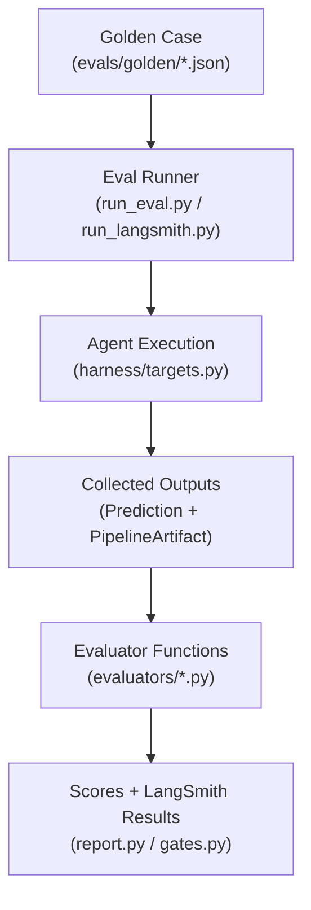
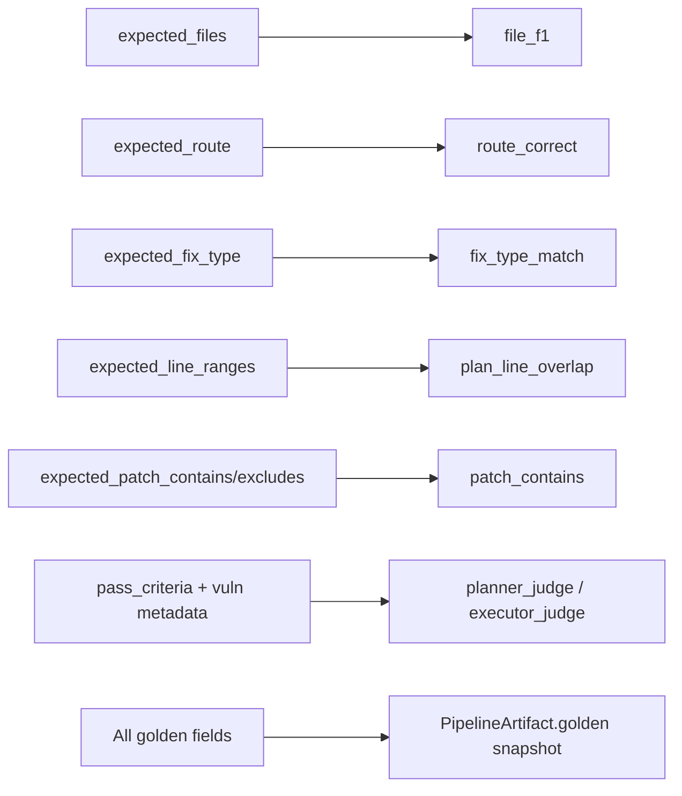
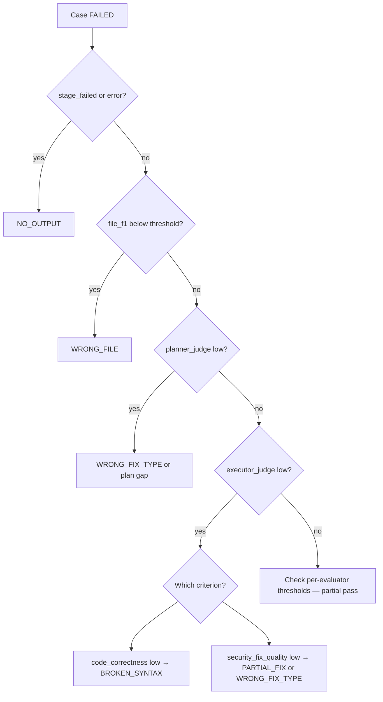

# Evaluator Architecture

> **Last updated:** 2026-07-13 — hybrid LLM judge evaluators for plan/implement.

This document explains how the IntuitionX / Sprinklr Jira Solver evaluation framework works end-to-end: what each evaluator measures, why it exists, how scores are computed, and how to interpret failures before diving into individual case post-mortems.

**Audience:** developers who have never touched `evals/` but need to debug agent regressions or extend the benchmark.

**Related docs:** command cheat sheet in [`eval_commands.md`](eval_commands.md); failure taxonomy origin in [`docs/Milestones.txt`](../../docs/Milestones.txt).

---

## 1. Evaluation Pipeline Overview

### High-level flow



Each golden case is an **immutable answer key**. The runner loads cases, invokes one or more pipeline stages, normalizes outputs into a `Prediction`, optionally freezes a full `PipelineArtifact`, runs registered evaluators, and emits a scorecard plus optional milestone gates.

### Where evaluation starts

Entry points:

| Entry | File | Purpose |
|-------|------|---------|
| Local scorecard | `evals/runners/run_eval.py` | Predict + score + HTML/JSON report |
| Offline judge | `evals/runners/run_judge_eval.py` | Score saved artifacts without re-running agents |
| LangSmith | `evals/runners/run_langsmith.py` | Same agents/evaluators, UI traces |
| Research rescore | `evals/runners/rescore_research_json.py` | Offline `file_f1` from saved research JSON |

All paths converge on `score_case()` in `run_eval.py`.

### How cases are loaded

1. `load_cases(path)` in `evals/schema/case.py` reads every `*.json` under a directory (or a single file).
2. Each JSON object validates into an `EvalCase` Pydantic model.
3. `filter_cases_for_mode()` keeps only cases whose `eval_scope` includes the active stage and, for unit modes, excludes integration cases (`case_kind == "integration"`).
4. `validate_dir()` checks schema, duplicate IDs, and emits warnings (e.g. unpinned `commit_sha`, empty `expected_files` when research is in scope).

Cases live under:

- `evals/golden/unit_test/` — per-agent unit cases (`G-00` … `G-20`)
- `evals/golden/integration_test/` — multi-issue e2e cases (`I-01` … `I-05`)

### How agent outputs are captured

**Live modes** call targets in `evals/harness/targets.py`:

| Mode | Target function | Stages run |
|------|-----------------|------------|
| `routing` | `run_routing_target` | Orchestrator only |
| `research` | `run_research_target` | Research only |
| `plan` | `run_plan_target` | Routing → research → planner |
| `implement` / `integration` / `e2e` | `run_integration_target` | Full pipeline |

Each target returns a flat `Prediction` (`evals/harness/prediction.py`) with fields like `route`, `files`, `plan_fix_type`, `patch_text`, `error`, `stage_failed`.

For **integration / e2e / implement with artifacts**, `run_integration_target` also builds a `PipelineArtifact` via `evals/harness/artifact_capture.py` and writes it to:

```
evals/runs/run_XXX/artifacts/{case_id}.json
```

The artifact is a frozen snapshot: ticket, research report, execution plan, plan validation, git diff, ±50-line before/after code context, step results, and a copy of golden answer-key fields.

**Offline score mode** (`--mode score`) skips agents entirely and loads recorded predictions from `evals/fixtures/predictions.json` or per-case JSON files.

### How evaluators receive data

`score_case()` iterates the `EVALUATORS` registry (`evals/evaluators/__init__.py`):

```python
for spec in specs:
    if spec.scope not in case.eval_scope: continue      # case doesn't test this stage
    if active is not None and spec.scope not in active: continue  # mode didn't run stage
    if spec.kind == "llm_judge" and not run_judges: continue
    if spec.requires_artifact and not pred.artifact_path: continue
    res = spec.fn(case, pred)
```

Each evaluator is a function `(EvalCase, Prediction) -> EvalScore` returning:

- `key` — metric name (e.g. `file_f1`)
- `score` — float in **0.0 … 1.0**
- `comment` — human-readable evidence
- `applicable` — if `False`, excluded from aggregates

LLM judges load the artifact JSON from `pred.artifact_path` (or accept an artifact directly in LangSmith paths).

### How final scores are calculated

**Per-case pass:** a case **passes** only if **every applicable evaluator** meets its per-evaluator threshold (`EvaluatorSpec.threshold`). See `score_case()` in `run_eval.py`:

```python
pass_flags.append(res.score >= spec.threshold)
passed = bool(pass_flags) and all(pass_flags)
```

**Experiment pass rate:** `build_scorecard()` in `evals/report.py` counts cases where `passed == True` and computes **evaluator means** (average of each metric across cases).

**Milestone gates:** `evals/gates.py` checks **mean** scores per scope against `MILESTONE_GATES`:

| Scope | Gate metrics | Threshold |
|-------|--------------|-----------|
| research | `file_f1` | ≥ 85% |
| plan | `planner_preflight`, `planner_judge` | ≥ 90%, ≥ 75% |
| implement | `executor_preflight`, `executor_judge` | ≥ 90%, ≥ 75% |

Legacy fixture scoring uses `LEGACY_MILESTONE_GATES` (`fix_type_match`, `plan_line_overlap`, `patch_contains`).

### Mode → active evaluators

`MODE_ACTIVE_SCOPES` in `run_eval.py` prevents scoring stages that did not run (e.g. research mode does not fail on missing planner output):

| Mode | Scored scopes |
|------|---------------|
| `routing` | routing only |
| `research` | research only |
| `plan` | routing, research, plan |
| `implement` | all four |
| `integration`, `e2e`, `score` | all in `eval_scope` |

---

## 2. Golden Case Schema

Golden cases are defined in `evals/schema/case.py` as `EvalCase`. Each case has **input** (ticket + repo) and **expected output** (answer key).

### Core identity

| Field | Type | Role |
|-------|------|------|
| `case_id` | string | Unique ID (`G-01`, `I-03`) |
| `title` | string | Human label in reports |
| `case_kind` | `"unit"` \| `"integration"` | Unit = single issue; integration = multi-repo / multi-issue |
| `language` | string | Taxonomy (`python`, `java`, …) — used in scorecard breakdowns |

### Repository pinning

| Field | Role |
|-------|------|
| `repo` | Primary `RepoSnapshot` (slug, url, **commit_sha**, local_fixture_path) |
| `repos` | Integration cases: list of pinned repos |

`commit_sha` must be pinned before baselining — evals clone/check out `.cache/eval_repos/{slug}@{sha}` via `evals/harness/repo.py`. Reproducibility depends on this hash.

### Taxonomy (coverage matrix)

| Field | Ground truth for |
|-------|------------------|
| `vuln_class` | Injection, XSS, Auth, IDOR, Crypto, Secrets, Routing, … |
| `owasp_category` | OWASP mapping (e.g. `A03:2021`) |
| `cwe` | CWE ID (e.g. `CWE-89`) — passed to LLM judges |
| `severity_label` | Critical / High / Medium / Low |
| `difficulty` | `easy` \| `medium` \| `hard` — scorecard bucket |

### Input: `ticket`

Maps 1:1 to `JiraTicket` via `evals/harness/ticket_builder.py`:

| Field | Why it matters |
|-------|----------------|
| `title`, `problem_statement` | What agents read |
| `labels`, `module`, `status` | Drive orchestrator routing (`expected_route`) |
| `acceptance_criteria` | Passed to LLM judges as pass criteria |
| `vulnerability_category` | Routing signal |

### Expected output (answer key)

| Field | Used by | Meaning |
|-------|---------|---------|
| `expected_route` | `route_correctness` | `FULL`, `SKIP_RESEARCH`, `MICRO`, or `EXIT` |
| `expected_files` | `file_identification_f1` | Research must identify these paths |
| `expected_line_ranges` | `plan_line_overlap` (legacy) | `{file, start, end}` vulnerable span |
| `expected_fix_type` | `fix_type_match` (legacy), judge hints | Canonical fix strategy (e.g. `parameterize_sql`) |
| `expected_patch_contains` | `patch_contains_excludes` (legacy), executor judge hints | Substrings that must appear in added diff lines |
| `expected_patch_excludes` | same | Forbidden patterns (false-fix detection) |
| `pass_criteria` | LLM judges | Free-text acceptance tests |
| `issues` | Integration cases | Per-issue nested `IssueExpectation` objects |

### Harness control

| Field | Role |
|-------|------|
| `eval_scope` | Which stages to score: `routing`, `research`, `plan`, `implement` |
| `requires_cursor` | Whether live eval needs Cursor CLI |

### How fields become ground truth



At artifact capture time, `build_golden_snapshot()` copies answer-key fields into the artifact so judges see the same ground truth even when scoring offline.

### Example (G-01)

From `evals/golden/unit_test/dvpwa.json`:

- **Vulnerability:** SQL injection in student creation
- **expected_files:** `sqli/dao/student.py`
- **expected_line_ranges:** lines 42–45 in that file
- **expected_fix_type:** `parameterize_sql`
- **expected_patch_contains:** `VALUES (%(name)s)`, `{'name': name}` (Psycopg-style binding)
- **expected_patch_excludes:** fake parameterization patterns that still interpolate

---

## 3. Research Agent Evaluation

Research evaluation measures **file identification** — did the agent find the code that must change? Routing is evaluated separately but often run in the same pipeline.

### Evaluator registry (research scope)

| Key | Function | File | Threshold |
|-----|----------|------|-----------|
| `file_f1` | `file_identification_f1` | `evals/evaluators/scoring.py` | **0.5** per case |

There is **no LLM judge for research** today. Research quality beyond file paths is captured in `research_summary` inside artifacts for human review and planner context, but not auto-scored.

### `file_identification_f1`

**Purpose:** Reward precise file discovery without requiring exact path strings. Security fixes fail downstream if research points at the wrong layer (controller vs DAO, wrong module, import-only file).

**Input:**

- `case.expected_files` — golden list
- `pred.files` — paths from `ResearchReport.affected_files` (populated by `_run_research()` in `targets.py`)

**Path matching:** compares **last 3 path segments** via `path_tail()` in `evals/evaluators/base.py`, tolerating `./`, leading `/`, and backslash variants.

**Scoring:**

```
precision = |expected ∩ actual| / |actual|
recall    = |expected ∩ actual| / |expected|
F1        = 2 * P * R / (P + R)
```

**Output:** `EvalScore("file_f1", f1, comment)` with precision/recall breakdown and `missed=[...]` list.

**Pass/fail:** per-case pass if `file_f1 >= 0.5`; milestone gate if **mean** `file_f1 >= 0.85` across research-scoped cases.

**Why F1, not exact match?**

- Partial credit when the correct file is found among extras (common when research includes call-site files).
- Penalizes both missing the vulnerable file (low recall) and noisy over-selection (low precision).

### Routing evaluator (often co-run)

| Key | Function | Threshold |
|-----|----------|-----------|
| `route_correct` | `route_correctness` | **1.0** (exact match) |

**Purpose:** Verify the orchestrator picks the right pipeline path before spending Cursor/LLM budget.

**Input:** `pred.route` vs `case.expected_route`.

**Score:** `1.0` if equal, else `0.0`.

### Research questions answered

#### Did Research find the correct files?

Check `file_f1` comment:

- `tp=N/M` — true positives vs expected count
- `missed=[...]` — expected tails not in actual set
- `P=… R=…` — precision/recall

Also inspect `artifact.research_output.affected_files` for reasoning quality.

#### Did Research identify the vulnerability?

Not directly scored. Indirect signals:

- `research_summary` and `hypotheses` in the artifact
- Whether `expected_files` appear with strong `evidence_strength`
- Flags like `reported_issue_not_reproduced_in_current_code` (see G-01) — research may correctly read code but disagree with the ticket; this affects planner/judge, not `file_f1`

#### Did Research collect enough context?

Enough for eval purposes means **the expected file is in `affected_files`**. Deeper context (line numbers, root cause narrative) feeds the planner and LLM judge but has no separate research metric.

#### What causes WRONG_FILE failures?

Per the project failure taxonomy (`docs/Milestones.txt`):

| Symptom in eval | Typical cause |
|-----------------|---------------|
| `file_f1 = 0`, `missed=[expected]` | Wrong file entirely — e.g. views.py instead of dao layer |
| Low precision, recall OK | Extra unrelated files (usually still passes at 0.5 threshold) |
| Low recall, precision OK | Found a related but wrong file (import chain, test file) |
| `research errored: …` in comment | Agent crash → score 0 |
| `stage_failed=research` on Prediction | Pipeline stopped before files populated |

**Inspect:** `Prediction.files`, `artifact.research_output`, LangSmith trace for research agent tool calls.

---

## 4. Planner Agent Evaluation

Planner evaluation uses a **hybrid** model:

1. **Deterministic preflight** — fast structural checks; fatals skip the LLM judge
2. **LLM-as-judge** — semantic review of the execution plan
3. **Legacy deterministic** — `fix_type_match`, `plan_line_overlap` (offline fixtures only)

### Active evaluators (integration path)

| Key | Function | File | Kind | Threshold |
|-----|----------|------|------|-----------|
| `planner_preflight` | `planner_preflight_score` | `evals/evaluators/preflight_scores.py` | deterministic | **0.90** |
| `planner_judge` | `planner_judge` | `evals/evaluators/planner_judge.py` | LLM | **0.75** |

### Legacy evaluators (fixture / `--mode score --fixtures-only`)

| Key | Function | Threshold |
|-----|----------|-----------|
| `fix_type_match` | `fix_type_match` | 1.0 |
| `plan_line_overlap` | `plan_line_overlap` | 0.5 |

Registered in `LEGACY_EVALUATOR_SPECS` inside `run_eval.py` when `pred.artifact_path` is absent.

---

### `planner_preflight` / `planner_preflight()`

**Purpose:** Catch broken plans **before** paying for an LLM judge call. Separates **fatals** (plan unusable) from **warnings** (resolver ambiguity — judge should decide).

**Input:** `PipelineArtifact` — `plan`, `plan_validation`, `stage_failed`, `error`

**Fatal conditions (`skip_judge=True`, score 0):**

- Pipeline failed before/during planner
- No execution plan produced
- Plan validation fatals (e.g. EDIT step references non-existent file, missing instruction, missing `target_type`/`target_name`, legacy patch fields)

**Soft guidance (not fatals):**

- `caution_flag` on EDIT steps — planner-emitted ambiguity note when target symbol appears multiple times; passed to executor/Cursor as disambiguation guidance, never a hard error

**Warnings (passed to judge, reduce score slightly):**

- No EDIT steps when fix expected
- Missing `intent_marker` on EDIT steps
- Instruction EDIT missing `instruction` or `intent_marker`
- Legacy patch fields on EDIT steps (`old_string`/`new_string`)
- Executor `edit_outcomes` with `noop_diff`, `structural_fail`, or `retry_count > 0` (skill iteration signal)
- Plan flags from `validate_execution_plan`

**Score formula:**

```
base = (# semantic checks with match_count==1) / max(# checks, 1)
score = base - 0.05 * len(warnings)   # if no fatals
```

**Pass threshold:** ≥ 0.90 per case; gate mean ≥ 90%.

---

### Legacy: `fix_type_match`

**Purpose:** Cheap check that the planner chose the right **category** of fix (parameterize vs sanitize vs encode).

**Input:** `case.expected_fix_type` vs `pred.plan_fix_type` (inferred in `targets.py` via `_infer_fix_type()` from plan text/keywords)

**Scoring:** canonicalized match (`_canon()` + synonym map) → 1.0 or 0.0

**Why it exists:** Fast regression signal for “right file, wrong strategy” (`WRONG_FIX_TYPE`) without LLM cost.

---

### Legacy: `plan_line_overlap`

**Purpose:** Verify the planner targets the correct **line span** in the vulnerable file.

**Input:**

- `case.expected_line_ranges`
- `pred.plan_line_ranges` — from explicit `read_start_line`/`read_end_line` or inferred from EDIT `old_string` position

**Scoring:** For each expected range, best overlap ratio with any actual range on the same file tail; **mean** across expected ranges.

**Pass threshold:** ≥ 0.5 per case.

---

### `planner_judge` (LLM-as-judge)

**Purpose:** Judge whether the **execution plan** would remediate the root cause if executed faithfully — something substring matching cannot capture (semantic edits, verify-only plans, conditional fixes).

**When skipped:** `planner_preflight.skip_judge == True` → score 0, comment explains fatals.

**Cache:** Verdicts stored at `evals/runs/{run_id}/judge_results/planner/{case_id}_v1.json`, keyed by `artifact_hash`.

#### Prompt structure

**System prompt:** `evals/prompts/planner_judge_system.md`

- Expert security code-review evaluator
- Judge **only** the planner stage
- Ground claims in supplied artifacts
- Distinguish fatal vs soft failures
- Output strict JSON (no markdown fences)

**User prompt:** built by `build_planner_judge_prompt()` in `planner_judge.py`:

| Section | Content |
|---------|---------|
| Case | case_id, vuln_class, CWE, ticket JSON, pass_criteria |
| Research | summary, affected_files list |
| Planner Output | full execution plan JSON (truncated 8k chars) |
| Deterministic Preflight | score, fatals, warnings |
| Preflight Warnings | formatted list (judge told to evaluate independently) |
| Repo Context | ±50 line excerpts from `before_context` |
| Task | JSON schema with 7 criteria + hard/soft failures |

#### Judge criteria (weights in `PLANNER_CRITERIA_WEIGHTS`)

| Criterion | Weight | What it checks |
|-----------|--------|----------------|
| `root_cause_analysis` | 20% | Plan addresses actual vulnerability, not symptoms |
| `technical_correctness` | 20% | Remediation approach is sound for the language/framework |
| `file_selection` | 15% | Correct files to change |
| `semantic_targeting` | 15% | EDIT steps aim at the right functions/lines |
| `instruction_quality` | 15% | Clear, actionable steps |
| `executability` | 10% | Plan can be executed by the executor agent |
| `no_hallucination` | 5% | No invented files/APIs |

**Composite score:** weighted average of criteria scores (0–100), normalized to 0–1 for `EvalScore`.

**Pass threshold:** ≥ 0.75 per case.

#### What the judge checks (examples)

- Correct remediation strategy (parameterize, not blacklist-filter)
- Security understanding aligned with ticket + CWE
- Minimal necessary changes vs scope creep
- Correct files (not just related modules)
- Safe implementation approach (no weakening auth while fixing injection)
- Avoids unnecessary edits — scored via instruction quality + hallucination criteria

#### Failure mapping (planner stage)

| Taxonomy | Planner evidence |
|----------|------------------|
| **WRONG_FIX_TYPE** | Low `technical_correctness`; judge `hard_failures` mention wrong strategy; legacy `fix_type_match=0` |
| **NO_OUTPUT** | Preflight fatals: no plan, pipeline error; `stage_failed=planner` |
| **PARTIAL_FIX** (planning) | Plan addresses only one injection point; low `semantic_targeting` / `root_cause_analysis` |
| **WRONG_FILE** (upstream) | Low `file_selection` criterion; research `file_f1` already low |

Verify-only plans with no EDIT steps often fail `executability` and `root_cause_analysis` even when files are correct (see G-01 walkthrough).

---

## 5. Executor Agent Evaluation

Executor evaluation mirrors planner: **preflight + LLM judge**, with legacy patch substring checks for fixtures.

### Active evaluators (integration path)

| Key | Function | Kind | Threshold |
|-----|----------|------|-----------|
| `executor_preflight` | `executor_preflight_score` | deterministic | **0.90** |
| `executor_judge` | `executor_judge` | LLM | **0.75** |

### Legacy: `patch_contains`

**Function:** `patch_contains_excludes` in `evals/evaluators/scoring.py`

**Purpose:** Deterministic check that the git diff contains required security patterns and does not leak forbidden ones.

**Input:** `pred.patch_text` (git diff), `expected_patch_contains`, `expected_patch_excludes`

**Scoring:**

- Only **added lines** (`+`) are searched (removed lines ignored — avoids false positives on old vulnerable code)
- `contains_score = present / must_have`
- If forbidden strings leak into added lines → cap score at 0.5

**Gate (legacy):** mean ≥ 80%.

---

### `executor_preflight` / `executor_preflight()`

**Purpose:** Catch executor failures and structural problems before LLM judging.

**Fatal conditions:**

- `stage_failed == "executor"`
- Expected git diff empty when plan had EDIT steps and `dry_run=False`

**Warnings:**

- EDIT step `ok=False` in step_results
- Changed files outside plan without recorded deviations
- Low-confidence executor self-validations (`confidence < 0.7`)

**Score:** `1.0 - 0.1 * len(warnings)` (0 if fatals)

---

### Static / verification checks (inside artifact)

Before the judge runs, the artifact already contains:

| Signal | Source |
|--------|--------|
| Plan validation | `build_plan_validation()` — semantic resolution, missing files |
| Step results | `execution.step_results` — READ/VERIFY/EDIT ok flags |
| Git diff | `artifact.git_diff` |
| Executor validations | `executor_validations` — agent self-checks |
| Plan deviations | `execution.plan_deviations` |

Preflight surfaces these; the LLM judge receives them in the user prompt.

---

### `executor_judge` (LLM-as-judge)

**Purpose:** Judge whether the **applied patch** actually fixes the vulnerability without breaking functionality — essential when fixes are semantic and multi-hunk.

#### Information provided to the judge

Built by `build_executor_judge_prompt()`:

| Section | Content |
|---------|---------|
| Case + Plan | vuln_class, CWE, plan EDIT steps |
| Execution Results | changed_files, step_results, plan_deviations, executor_validations |
| Before Context | ±50 lines pre-edit per EDIT target |
| After Context | ±50 lines post-edit |
| Diff | `git_diff` (up to 8k chars) |
| Deterministic Checks | preflight score, fatals, warnings |
| Golden Hints | expected_patch_contains/excludes, pass_criteria (**non-binding**) |

**System prompt:** `evals/prompts/executor_judge_system.md` — same principles as planner, plus emphasis on **regression risk**.

#### Judge criteria (weights in `EXECUTOR_CRITERIA_WEIGHTS`)

| Criterion | Weight | What it checks |
|-----------|--------|----------------|
| `intent_implementation` | 22% | Patch matches plan intent |
| `security_fix_quality` | 22% | Vulnerability actually closed |
| `code_correctness` | 18% | Valid syntax, sensible API usage |
| `precision` | 13% | Minimal diff — no unrelated edits |
| `regression_risk` | 10% | Functionality preserved |
| `validation_honesty` | 10% | Agent didn't fake verification |
| `response_accuracy` | 5% | Reported changes match diff |

#### Judge questions (implicit in criteria)

- Does the patch remove the vulnerability?
- Does it preserve intended functionality?
- Is the implementation secure (not a weak workaround)?
- Is code quality acceptable?
- Are edge cases handled (or at least not made worse)?

#### Failure mapping (executor stage)

| Taxonomy | Executor evidence |
|----------|-------------------|
| **BROKEN_SYNTAX** | Low `code_correctness`; step_results show EDIT failures; compilation errors in `pred.compilation_status` |
| **PARTIAL_FIX** | Medium `security_fix_quality`; judge soft_failures mention incomplete remediation |
| **WRONG_FIX_TYPE** | Fix applied but wrong approach; low `security_fix_quality`, high `code_correctness` |
| **NO_OUTPUT** | Preflight fatal: executor failed, empty diff; `stage_failed=executor` |

Legacy `patch_contains` gives a cheap signal for **PARTIAL_FIX** / **WRONG_FIX_TYPE** when required substrings are missing.

---

## 6. LLM-as-a-Judge Deep Dive

### Why LLM judge instead of exact code matching

Security fixes are **semantic**:

- Parameterization can use `%s`, `?`, named binds, ORM calls — substring rules miss valid fixes
- Plans use natural-language EDIT instructions without `old_string`
- A correct fix may refactor surrounding code
- False positives: matching a comment containing `execute(` is not a fix

Exact matching (`patch_contains`, `plan_line_overlap`) remains useful for **fast offline regression** and **CI without judge API costs**, but integration gates rely on hybrid preflight + judge.

### Model and settings

Configured in `evals/evaluators/llm_judge_base.py`:

| Env var | Effect |
|---------|--------|
| `EVAL_JUDGE_TIER=dev` (default) | `get_judge_llm_dev()` — fast/cheap model (`TaskComplexity.LOW`) |
| `EVAL_JUDGE_TIER=benchmark` | `get_llm(TaskComplexity.HIGH)` — e.g. GPT-5.2 / Opus class |
| `EVAL_JUDGE_PROVIDER` | Override LLM provider for judge |
| `EVAL_JUDGE_MODEL` | Override model name (defaults: `gemini-2.5-flash`, `gpt-4o-mini`, etc.) |
| `EVAL_JUDGE_VERSION` | Cache key version (default `v1`) |

Temperature is **not set in eval code** — inherited from `get_llm()` in `src/core/llm.py` for the chosen provider/complexity.

Invocation: `invoke_tracked(llm, messages, agent="eval_judge")` → parsed via `parse_llm_json(text, JudgeVerdict)`.

### Prompt structure

```
[SystemMessage]  ← planner_judge_system.md / executor_judge_system.md
[HumanMessage]   ← build_*_judge_prompt() with case + artifact sections
```

### JSON output schema

```json
{
  "score": 0,
  "passed": false,
  "criteria": {
    "criterion_name": {"score": 0, "reason": ""}
  },
  "hard_failures": [],
  "soft_failures": [],
  "reasoning": ""
}
```

Parsed into `JudgeVerdict` (`llm_judge_base.py`).

### Score calculation

1. Each criterion scored 0–100 by the LLM
2. `weighted_score()` = Σ (criterion_score × weight) / Σ weights
3. `normalized()` = weighted_score / 100 → stored as 0–1 `EvalScore.score`
4. Top-level `score` field is fallback if criteria dict is empty

### Score interpretation

| Normalized score | Meaning |
|------------------|---------|
| **1.0** | Perfect weighted criteria (rare — judge rarely gives all 100s) |
| **0.75+** | Passes default per-case threshold — fix/plan is acceptable |
| **0.5 – 0.74** | Mixed — some criteria strong, fatal gaps remain; investigate criteria reasons |
| **0.0** | Judge skipped (preflight fatal), invoke error, or unanimous hard failure |

The raw 0–100 `verdict.score` in cache files may differ slightly from the weighted normalized score used for gates — **gates use normalized weighted score**.

### Limitations

- **Inconsistency:** LLM judges can disagree on borderline cases; use cached verdicts for reproducibility
- **Prompt sensitivity:** Wording changes in system prompts shift scores — bump `EVAL_JUDGE_VERSION` when prompts change
- **Not a substitute for tests:** Combine with preflight, optional compilation status, and future exploit tests
- **Golden hints are non-binding:** `expected_patch_contains` in executor judge prompt guides but does not hard-score (legacy evaluators do)

### Caching workflow

```
integration run → artifact (hash H)
                 → judge invoked → verdict saved with artifact_hash H
offline re-judge → skip LLM if cache hash matches
--no-cache       → force re-invoke (run_judge_eval / pass use_cache=False)
```

---

## 7. LangSmith Integration

Implementation: `evals/langsmith_adapter.py` + `evals/runners/run_langsmith.py`.

### Design principle

**Same targets, same evaluators** as local `run_eval.py` — no parallel scoring logic. LangSmith wraps:

- `make_langsmith_target(mode)` → calls `TARGETS[mode]`, returns `Prediction.model_dump()`
- Per-metric wrappers (e.g. `file_f1_langsmith`) → call deterministic evaluators, return `{key, score, comment}`

### What gets logged

With `LANGCHAIN_TRACING_V2=true`:

- Full agent traces (orchestrator, research, planner, executor) via existing `@invoke_tracked` instrumentation
- LangSmith **experiment run** per case with:
  - **Inputs:** `jira_ticket`, `repo_snapshot` from dataset example
  - **Outputs:** serialized `Prediction` (route, files, plan fields, patch, errors, artifact_path)
  - **Evaluator scores:** attached as feedback keys matching metric names

Integration modes allocate a shared run directory:

```
evals/runs/run_XXX/
  metadata.json
  artifacts/{case_id}.json
  judge_results/planner|executor/{case_id}_v1.json
```

Set via `set_langsmith_run_id()` so all cases in one experiment share artifacts.

### Trace structure (how to navigate)

```
Experiment (prefix=week2-integration-...)
└── Run (one per golden case)
    ├── Inputs: jira_ticket, repo_snapshot
    ├── Target trace: routing → research → planner → executor spans
    ├── Outputs: Prediction JSON
    └── Evaluator results
        ├── route_correct
        ├── file_f1
        ├── planner_judge
        └── executor_judge
```

**Debugging failed runs:**

1. Open the experiment in LangSmith UI (filter by `experiment_prefix`)
2. Sort by failing evaluator score
3. **Pipeline trace** — find `stage_failed`, tool errors, LLM messages
4. **Outputs tab** — raw `Prediction`; note `artifact_path`
5. **Evaluator feedback** — read `comment` field (mirrors local scorecard)
6. **Local artifact** — open `evals/runs/.../artifacts/{case_id}.json` for full plan/diff/context
7. **Judge cache** — `judge_results/*/case_v1.json` for criterion-level reasons

### Dataset sync

`make evals-sync` / `evals/sync_langsmith.py` uploads golden cases to dataset `IntuitionX-Golden-20-v1`. Local golden JSON remains source of truth; LangSmith examples reference cases by `metadata.case_id`.

### Mode → LangSmith evaluators

| Mode | Evaluators |
|------|------------|
| routing | `route_correct` |
| research | `file_f1` |
| plan | `planner_judge` |
| implement | `executor_judge` |
| integration / e2e | all four above |

Legacy evaluator wrappers exist (`LEGACY_MODE_EVALUATORS`) for older experiments.

---

## 8. Failure Analysis Guide

The taxonomy (`WRONG_FILE`, `WRONG_FIX_TYPE`, `BROKEN_SYNTAX`, `PARTIAL_FIX`, `NO_OUTPUT`) is defined at the product level in `docs/Milestones.txt`. The eval framework does not emit these labels automatically — **map them from evaluator signals** below.

### Decision flow



---

### WRONG_FILE

**Evaluator signals:**

- `file_f1` below 0.5 (or low recall in comment)
- `missed=[expected file tails]` in scorecard comment
- Planner judge `file_selection` criterion low (secondary)

**Where to inspect:**

1. `Prediction.files` / `artifact.research_output.affected_files`
2. Research agent trace — file discovery tools, anchor extraction
3. Ticket wording — misleading module/labels pointing agent astray

**Common causes:** picked caller not sink; wrong repo path; test/fixture file; similar-named module.

---

### WRONG_FIX_TYPE

**Evaluator signals:**

- Legacy `fix_type_match = 0`
- Planner judge: low `technical_correctness`, hard_failures mentioning wrong strategy
- Executor judge: low `security_fix_quality` but edits present
- Legacy `patch_contains` missing must-have patterns (e.g. still using string format)

**Where to inspect:**

1. `artifact.plan` — root_hypothesis, EDIT instructions
2. Planner judge cache — criteria reasons
3. `expected_fix_type` vs inferred `plan_fix_type` in Prediction

**Planner vs executor:** if plan already wrong, fix executor even if patch is syntactically valid → **planner evidence needed**. If plan correct but patch sanitizes input instead of parameterizing → **executor WRONG_FIX_TYPE**.

---

### BROKEN_SYNTAX

**Evaluator signals:**

- Executor preflight: EDIT steps `ok=False`
- `pred.compilation_status` failure (when populated)
- Executor judge: low `code_correctness`
- Empty or malformed `git_diff` when edits expected

**Where to inspect:**

1. `artifact.step_results` for EDIT failures
2. `artifact.git_diff`
3. `after_context` excerpts — parse errors, truncated hunks

---

### PARTIAL_FIX

**Evaluator signals:**

- Executor judge: medium score (0.5–0.74), soft_failures about incomplete remediation
- Low `security_fix_quality` with decent `code_correctness`
- Legacy `patch_contains` partial (some must-have strings present)
- Planner: low `root_cause_analysis` when multiple injection points exist

**Interpretation:** something changed, vulnerability not fully closed — e.g. one query parameterized, second left concatenated.

---

### NO_OUTPUT

**Evaluator signals:**

- `pred.error` set; `stage_failed` in `{orchestrator, research, planner, executor}`
- Preflight fatals → judge score 0 with "fatal preflight — judge skipped"
- Empty `artifact.plan` or empty diff when edits required
- Research/plan/evaluator comment: `no artifact — run integration mode first`

**Where to inspect:**

1. Scorecard `error` / `stage_failed` columns
2. Top of `PipelineArtifact` — `error`, `stage_failed`
3. LangSmith trace for exceptions, rate limits, Cursor timeouts

---

## 9. Example Walkthrough — G-01 (`run_007`)

**Case:** SQL injection in student creation (DVPWA) — `evals/golden/unit_test/dvpwa.json`

**Run:** `evals/runs/run_007` (integration, `dry_run=false`, experiment `mixed-10-unit`)

### Expected (golden)

| Field | Value |
|-------|-------|
| Route | `FULL` |
| File | `sqli/dao/student.py` |
| Lines | 42–45 |
| Fix type | `parameterize_sql` |
| Patch must contain | `VALUES (%(name)s)`, `{'name': name}` |
| Pass criteria | Parameterized INSERT; no quoted interpolation |

### Actual (pipeline)

| Stage | Outcome |
|-------|---------|
| Routing | `FULL` ✓ |
| Research | Found `sqli/dao/student.py` **and** `sqli/views.py`; summary claims issue "already fixed" |
| Planner | Verify-only plan — **no EDIT steps**; flags `no_code_changes_required` |
| Executor | Despite verify-only plan, applied diff: parameterized `Student.create` **plus** unrelated `@authorize` decorators in `views.py` |

Vulnerable code before fix (from git diff in artifact):

```python
q = ("INSERT INTO students (name) "
     "VALUES ('%(name)s')" % {'name': name})
await cur.execute(q)
```

After fix:

```python
q = ("INSERT INTO students (name) "
     "VALUES (%s)")
await cur.execute(q, (name,))
```

### Evaluator outputs

| Evaluator | Score | Comment summary |
|-----------|-------|-----------------|
| `route_correct` | 1.0 | expected=FULL actual=FULL |
| `file_f1` | ~0.67 | P=0.50 R=1.00 tp=1/1 — extra file `views.py` |
| `planner_preflight` | 0.95 | warning: no EDIT steps |
| `planner_judge` | ~0.50 | verify-only plan; no remediation path |
| `executor_preflight` | 1.0 | no fatals |
| `executor_judge` | ~0.75 | SQLi fixed; regression risk from auth changes |

**Planner judge excerpt** (`judge_results/planner/G-01_v1.json`):

- `root_cause_analysis`: 20 — assumes already fixed, contradicts ticket
- `executability`: 60 — no EDIT steps
- `hard_failures`: "no remediation steps despite critical SQLi ticket"

**Executor judge excerpt** (`judge_results/executor/G-01_v1.json`):

- `security_fix_quality`: 90 — parameter binding correct
- `regression_risk`: 40 — unauthorized `@authorize` additions
- `passed`: true at judge level, but precision penalized

### Final classification

| Level | Result |
|-------|--------|
| **Case pass** | **FAIL** — `planner_judge` (~0.50) < threshold 0.75 |
| **Primary failure mode** | Planner gap → plan did not specify remediation (**maps to WRONG_FIX_TYPE / planning failure**, not WRONG_FILE) |
| **Secondary issues** | Research over-included `views.py` (file_f1 still passed); executor scope creep (regression risk) |
| **Bright spot** | Executor actually fixed SQLi — executor judge passed |

This case illustrates why **hybrid evaluation** matters: legacy `patch_contains` would pass after executor ran, but **planner_judge** catches verify-only plans that would fail on cases where the executor does not improvise fixes.

---

## Appendix A — Evaluator quick reference

| Key | Scope | Function | Threshold | Artifact required |
|-----|-------|----------|-----------|-------------------|
| `route_correct` | routing | `route_correctness` | 1.0 | No |
| `file_f1` | research | `file_identification_f1` | 0.5 | No |
| `planner_preflight` | plan | `planner_preflight_score` | 0.90 | Yes |
| `planner_judge` | plan | `planner_judge` | 0.75 | Yes |
| `executor_preflight` | implement | `executor_preflight_score` | 0.90 | Yes |
| `executor_judge` | implement | `executor_judge` | 0.75 | Yes |
| `fix_type_match` | plan | `fix_type_match` | 1.0 | No (legacy) |
| `plan_line_overlap` | plan | `plan_line_overlap` | 0.5 | No (legacy) |
| `patch_contains` | implement | `patch_contains_excludes` | 1.0 | No (legacy) |

Registry: `evals/evaluators/__init__.py` → `EVALUATORS`.

---

## Appendix B — Key files

| Path | Responsibility |
|------|----------------|
| `evals/schema/case.py` | Golden case schema + loaders |
| `evals/harness/targets.py` | Live pipeline targets → Prediction |
| `evals/harness/prediction.py` | Normalized output model |
| `evals/harness/artifact_capture.py` | PipelineArtifact assembly |
| `evals/artifacts/pipeline_result.py` | Artifact schema, run dirs, caching |
| `evals/evaluators/scoring.py` | Routing + research + legacy plan/implement |
| `evals/evaluators/preflight.py` | Planner/executor deterministic checks |
| `evals/evaluators/planner_judge.py` | Planner LLM judge |
| `evals/evaluators/executor_judge.py` | Executor LLM judge |
| `evals/evaluators/llm_judge_base.py` | Judge infra, weights, cache |
| `evals/runners/run_eval.py` | Main runner + `score_case` |
| `evals/gates.py` | Milestone gate thresholds |
| `evals/report.py` | Scorecard aggregation |
| `evals/langsmith_adapter.py` | LangSmith wrappers |
