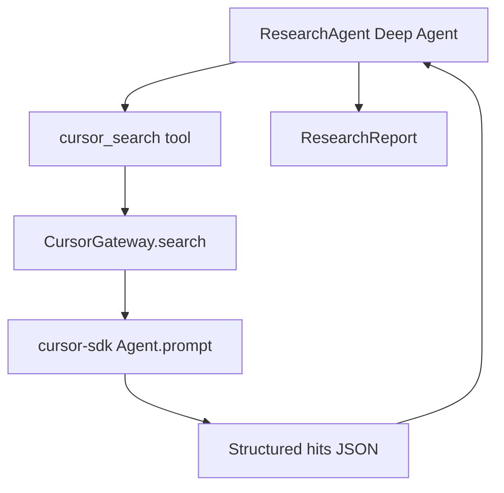

# Research search workflow (CursorGateway)

The Research Agent is a LangChain Deep Agent that **reasons** about Jira tickets but **delegates repository navigation** to Cursor via `CursorGateway.search()`.

## Flow



1. **ResearchAgent** loads ticket context, anchors, and the research skill (`SKILL.md`).
2. The LLM calls **`cursor_search(query="...")`** with natural-language questions.
3. **`CursorGateway.search()`** runs a scoped Cursor local agent (grep/find/read internally).
4. Cursor returns **structured hits**: `path`, `confidence`, `summary`, `snippets`.
5. The Research Agent synthesizes hypotheses and affected files → **`ResearchReport`**.

## Example queries

| Question | Purpose |
|----------|---------|
| `Find authentication middleware` | Locate auth entry points |
| `Where are JWT tokens validated?` | Trace token handling |
| `Locate SQL query construction in user search` | SQLi investigation |
| `Find usages of PreparedStatement` | Parameterization audit |

## Search result shape

```json
{
  "query": "Find authentication middleware",
  "hits": [
    {
      "path": "src/auth/middleware.py",
      "confidence": "high",
      "summary": "JWT validation middleware",
      "snippets": ["def validate_token(request):"]
    }
  ],
  "flags": []
}
```

## Entry points

| Path | Usage |
|------|-------|
| LangGraph | `research_node` → `ResearchAgent.run()` |
| M1.3 chain | `CursorResearchSubAgent` → `ResearchAgent.run()` |
| CLI | `python -m src.agents.research` |

## Dry-run / no API key

- `DryRunCursorGateway` returns deterministic mock hits (security demo → `UserSearchController.py`).
- M1.3 `--dry-run` returns `mock_research_report()` without invoking the LLM.
- Set `CURSOR_API_KEY` and `pip install cursor-sdk` for live Cursor search.

## Tool permissions

Research agent tools (`tool_permissions.yaml`):

- **`cursor_search`** — repository navigation (via Cursor)
- **`web_search`** — external CVE/docs
- **`repo_profile`** — layout typing

L1 primitives (`read`, `grep`, `find`, `ls`, `bash`) remain available to **Planner** and **Executor**; Cursor uses them internally during search.

## Related files

- [`src/agents/research/research_agent.py`](research_agent.py) — unified runner
- [`src/agents/research/tools/cursor_search.py`](tools/cursor_search.py) — LangChain tool
- [`src/integrations/cursor/gateway.py`](../../integrations/cursor/gateway.py) — gateway + parse
- [`src/agents/research/skills/research/SKILL.md`](skills/research/SKILL.md) — workflow rules
